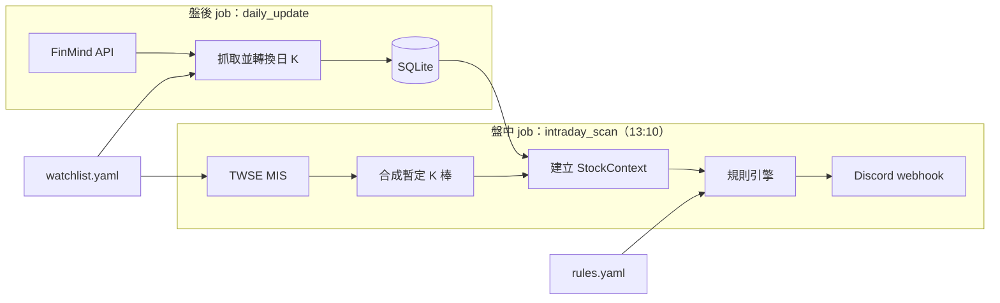

# 台股技術面盤中選股系統：專案規劃書

> 版本：v0.9（2026-10-31）｜狀態：開發中（M2 完成）
>
> 本文件是此專案的單一事實來源。實作前請完整閱讀。標記「⚠️ 待確認」的項目是使用者尚未拍板的決定：請採用文中預設值，並保持可在設定檔調整，不要自行改變規則語意。已拍板的決定記錄在第 15 節，不需要再次詢問。

---

## 0. 給 Claude 的閱讀指引

- 交易規則（第 3–5 節）以本文件的定義為準。需求與本文件衝突，或定義不足以寫成程式時，先停下來詢問，不要自行詮釋。
- 所有可調整的數字（均線天數、量比、天數區間等）一律放在設定檔，不可寫死在程式中。
- 停損／出場規則目前**不實作**，只保留介面（見 5.4）。
- 不使用付費 API，不做自動下單。
- 這是作品集專案：程式碼品質、測試、README 與本文件同等重要。
- 規則或架構有變更時，同步更新本文件的對應章節與第 16 節變更紀錄。

---

## 1. 專案概述

### 1.1 目標

以技術分析為主，依使用者自訂的選股邏輯，在**收盤前**快速篩選觀察清單中符合型態的股票並推播到 Discord，讓使用者在 13:30 收盤前有時間做決策。

### 1.2 使用情境

- 每個交易日 **13:10** 自動執行盤中掃描（時間可調）。
- 盤後由另一支程式更新歷史日 K 到本地資料庫。
- 掃描結果依「族群」分組推送到 Discord。

### 1.3 作品集展示重點

- 模組化、設定驅動的規則引擎（規則可插拔）
- 雙資料管線：盤後批次＋盤中即時
- 可測試的技術分析邏輯（轉折點、趨勢、進場規則）
- 清楚的文件與架構

---

## 2. 範圍與非目標

| 範圍內 | 非目標（目前不做） |
|---|---|
| 台股上市、上櫃股票 | 興櫃、ETF、權證 |
| 使用者自選的觀察清單（以科技股為主） | 全市場掃描 |
| 自訂分類（見 9.1）：產業鏈位置（族群 › 子分類，一檔一個）＋題材標籤（一檔可多個）；只用於顯示與分類 | 分類參與篩選（例：族群轉強）、自動匯入官方產業分類 |
| 盤中掃描結果推播 Discord | 盤後結果推播、網頁介面 |
| 進場訊號 | 停損／出場訊號（只保留介面）、自動下單、回測 |

---

## 3. 名詞定義

所有規則用語以下表為準。「現價」指盤中掃描時的最新成交價（見第 6 節）；「今日」的數值在盤中都以暫定 K 棒計算。

| 名詞 | 定義 | 參數／預設 |
|---|---|---|
| MA*n* | 最近 n 根 K 棒收盤價的簡單移動平均；盤中計算時包含今日暫定 K 棒 | — |
| 月線 | MA20 | — |
| 昨收 | 今日前一根 K 棒的收盤價（來自資料庫）。所有規則都用此值；Discord 顯示的漲跌幅另用 MIS 參考價，見第 11 節 | — |
| 紅 K | 現價（收盤）> 開盤 | — |
| 長紅 | 紅 K，且 (現價 − 開盤) / 昨收 ≥ `min_body_pct` | 3% |
| 爆量 | 今日成交量 ≥ 昨日成交量 × `volume_ratio` | 1.5 |
| 突破 MA*n* | 昨收 ≤ 昨日 MA*n*，且現價 > 今日 MA*n* | — |
| 站上 MA*n* | 現價 > 今日 MA*n* | — |
| 前高 | 不含今日，最近 `high_lookback_days` 根 K 棒的最高價 | 40（約兩個月） |
| 三線多排 | MA5 > MA10 > MA20 | — |
| 頭／底 | 以收盤價計算的轉折點，定義見 4.1 | — |

---

## 4. 趨勢判斷

### 4.1 轉折點（頭與底）

以**收盤價觸碰 MA5** 作為確認轉折點的時機，頭與底都以**收盤價**計算：

1. 均線以完整歷史資料計算，不限於計算區間，因此歷史足夠時，計算區間的第一根 K 棒就有 MA5。以計算區間內第一根有 MA5 的 K 棒決定初始狀態：收盤 > MA5 為「上方」，否則為「下方」。這根 K 棒只用來決定狀態，從下一根開始判斷觸碰。
2. 狀態為「上方」時，若某日收盤 ≤ MA5（觸碰或跌破），就確認一個**頭**：從上一個轉折點的隔天往後到當天（含），收盤價最高的那根 K 棒。之後狀態轉為「下方」。
3. 狀態為「下方」時，若某日收盤 ≥ MA5（觸碰或站上），就確認一個**底**：同樣的區間內，收盤價最低的那根 K 棒。之後狀態轉為「上方」。
4. 第一個轉折點的區間從計算區間的起點開始。
5. 區間內有多根同為極值時，取日期較晚的一根。
6. 頭與底必然交替出現。最後一次觸碰之後的走勢尚未確認，不產生轉折點。
7. 不做波段雜訊過濾。
8. 計算區間包含今日，也就是以收盤後的觀點判斷：今日收盤觸碰 MA5 就確認轉折點。盤中以暫定 K 棒的現價判斷，等於假設現價就是收盤價，收盤前可能改變（D22）。

| 參數 | 說明 | 預設 |
|---|---|---|
| `pivot_ma` | 判斷觸碰用的均線 | 5 |
| `lookback_days` | 計算轉折點使用的 K 棒數：截至今日（含）的最近 n 根，即「計算區間」 | 120 |

### 4.2 趨勢分類

**步驟一：基本趨勢**。使用**截至今日已確認**的轉折點判斷（含今日確認的轉折點；盤中為暫定 K 棒，見 4.1 第 8 點）：

| 趨勢 | 條件 |
|---|---|
| 多頭 `bull` | 最近兩個頭後 > 前，**且**最近兩個底後 > 前 |
| 空頭 `bear` | 最近兩個頭後 < 前，**且**最近兩個底後 < 前 |
| 盤整 `range` | 其他情況（含相等） |
| 資料不足 `unknown` | 已確認的頭或底少於 2 個 |

**步驟二：破位修正**。檢查最近一個已確認轉折點之後到今日（含今日現價）的收盤價；最近一個轉折點就是今日時，沒有收盤價可檢查，維持基本趨勢：

- 基本趨勢為多頭，且其中最低收盤 < 最近一個已確認的底 → 改判為**盤整**。理由：跌破前底後會形成頭頭高、底底低，屬於盤整。
- 基本趨勢為空頭，且其中最高收盤 > 最近一個已確認的頭 → 改判為**盤整**。理由同上：突破前頭後會形成頭頭高、底底低。

「資料不足」不等於盤整，不參與任何有趨勢條件的規則。

---

## 5. 選股規則

### 5.1 判斷流程

```
觀察清單中的每檔股票
  → 建立 StockContext（歷史 K + 今日暫定 K、均線、轉折點、趨勢）
  → 前置條件：全部通過才繼續
  → 逐一評估進場規則：各規則獨立，可同時觸發多條
  → 至少一條觸發 → 列入結果，並標示觸發了哪些規則
```

### 5.2 前置條件（Filters）

| ID | 名稱 | 條件 |
|---|---|---|
| `above_ma20` | 站上月線 | 現價 > 今日 MA20。未通過者不觸發任何進場規則。 |

### 5.3 進場規則（Entry Rules）

每條規則都有 `trends` 參數，列出適用的趨勢，可在設定檔調整。空陣列代表不限，此時「資料不足」`unknown` 的股票也會評估。

**E1 `bull_ma5_breakout`：多頭突破五日線紅 K**

- 趨勢：多頭（經 4.2 破位修正後）
- 突破 MA5（昨收 ≤ 昨日 MA5，現價 > 今日 MA5）
- 今日為紅 K

> 備註：回測時若跌破前底，尚未站回時由 4.2 的破位修正改判為盤整；站回五日線時確認的新底低於前底，趨勢同樣為盤整。兩種情況 E1 都不會觸發，因此「多頭回測不破低後站回」的情境已涵蓋在 E1 中。

**E2 `range_breakout_volume`：盤整長紅爆量過前高**

- 趨勢：盤整（經 4.2 破位修正後）
- 今日為長紅
- 爆量：今日量 ≥ 昨日量 × `volume_ratio`
- 現價 > 前高（不含今日，最近 `high_lookback_days` 日的最高價）

**E3 `ma_bull_alignment`：三線多排**

- 趨勢：不限
- 今日 MA5 > MA10 > MA20，且昨日尚未多排：只在形成當天觸發，避免多排期間每天重複出現（`only_on_formation: true`）。

### 5.4 停損／出場規則（保留，不實作）

- 定義 `ExitRule` 抽象介面，並在設定檔保留 `exit_rules` 區塊，目前為空。
- 引擎保留呼叫點；除非使用者明確要求，不實作任何出場規則。

---

## 6. 盤中暫定 K 棒

13:10 時今日 K 棒尚未完成。以 MIS 快照合成「今日暫定 K 棒」，附加在歷史 K 棒的最後一根：

| 欄位 | 來源 |
|---|---|
| open / high / low | MIS 開盤、最高、最低 |
| close | MIS 最新成交價（若為 `-`，依 8.2 處理） |
| volume | MIS 累積成交量（張） |

注意事項：

- 紅 K、長紅、突破均線等判斷都是「截至 13:10」的狀態，收盤前可能改變。Discord 訊息必須標示為盤中暫定結果。
- 13:10 的成交量只是全天的一部分（尚未包含 13:25–13:30 的收盤集合競價）。直接與昨日全日量比較屬於**保守**做法：能過門檻代表量確實很大。未來可加入「預估全日量」模式。此外資料庫的昨日量含零股、盤後定價、鉅額交易，MIS 只含一般交易，同樣使判斷偏保守（D21）。
- 轉折點與趨勢都納入今日暫定 K 棒（D22）：盤中觸碰 MA5 會即時確認轉折點，盤中跌破前底的多頭股也會即時改判為盤整。這些都可能在收盤前改變。
- 規則中的「昨收」一律取 K 棒資料的前一根收盤（第 3 節），不使用 MIS 的 `y`。MIS `y` 只用於顯示漲跌幅（第 11 節）與一致性檢查（7.2）。
- 今日尚無成交或無法取得價格的股票不合成暫定 K 棒，見 8.2。

---

## 7. 系統架構



兩支程式透過資料庫連接：**盤中掃描依賴盤後 job 寫入的歷史日 K**（均線與轉折點都需要歷史資料）。

### 7.1 盤後 job（`daily_update`）

1. 讀取觀察清單。
2. 對每檔股票查詢資料庫的最後日期，向 FinMind 補抓隔天到今天的日 K。資料庫沒有該檔資料（新加入清單）時，回補 `backfill_days` 個日曆天。已是最新的股票不送出請求。
3. 統一單位（成交量存「張」）後寫入 `daily_prices`；同一檔同一天已存在時覆寫。每檔抓完立即寫入。
4. 任何一檔請求失敗（重試 `finmind.retry` 次後仍失敗、超過請求上限、token 錯誤等）就中止，結束碼為 1。已寫入的資料保留，重新執行會從中斷處繼續。
5. FinMind 公告的更新時間為週一至五 17:30，排程設在此之後（M5）。不推播 Discord。

### 7.2 盤中 job（`intraday_scan`）

1. **交易日檢查**：MIS 回傳的資料日期不是今天 → 判定為非交易日，直接結束，不推播。
2. 批次向 MIS 查詢觀察清單中的所有股票。
3. **資料一致性檢查**：比對 MIS 昨收 `y` 與資料庫最後一筆收盤價。不一致時，在訊息底部彙總警告並列出代號，例：「昨收不一致（除權息或資料未更新）：2330、XXXX」。除權息日的參考價本來就會不同，因此文字同時列出兩種可能。不一致的股票規則照常評估。
   - 已知限制：若資料庫確實未更新，K 棒中的「昨日」會是前一個有資料的交易日，與昨日比較的判斷（突破、爆量、多排形成）會錯位。目前只警告、不中止。
4. 合成暫定 K 棒（無成交或無報價者略過，見 8.2）→ 建立 StockContext → 執行規則引擎。
5. 依族群分組推送 Discord。
6. 任何步驟失敗時重試 `retry` 次；仍失敗就推送錯誤通知到 Discord，避免使用者誤以為只是沒有訊號。

---

## 8. 資料來源與資料庫

### 8.1 FinMind（盤後）

- 資料集：台股日成交資訊 `TaiwanStockPrice`。`GET https://api.finmindtrade.com/api/v4/data`，參數 `dataset`、`data_id`、`start_date`、`end_date`。
- Token 放在 `.env`（`FINMIND_TOKEN`），以 `Authorization: Bearer` header 傳送。未設定時以未登入身分查詢（上限較低），並在 log 警告。
- 已實測確認（2026-10-31）：
  - 欄位：`date`、`stock_id`、`open`、`max`、`min`、`close`、`Trading_Volume` 等；`max`／`min` 為最高／最低價。
  - `Trading_Volume` 單位為「股」，數值與證交所「個股日成交資訊」相同，**含一般、零股、盤後定價、鉅額交易**，所以不是 1000 的倍數。寫入時 ÷1000 並四捨五入成「張」。與盤中 MIS 成交量的口徑不同，處理方式見 D21。
  - 沒有整股成交的日子通常沒有資料列，但也可能是一筆**價格全為 0** 的資料列（停牌，或只有零股成交，例：6708 2025-11-07 只成交 21 股）。這種資料列略過不寫入，與沒有資料列一樣視為當天沒有交易；其他價格不是正數的資料列也略過，並記錄警告。
  - 查無資料（代號錯誤、區間內沒有交易）時回傳空陣列，不是錯誤。
  - 已知資料錯誤：少數新上市股票在上市初期的 `open` 不在 `min`～`max` 範圍內（例：6831、7711、7769 的 2025-11 數筆），照原值寫入。規則對歷史 K 棒只用到收盤、最高價與成交量，只有回放到這幾天時才會用到錯誤的開盤價。
  - 免費會員每小時 600 次請求（`user_info` 端點的 `api_request_limit_hour`），超過時回 HTTP 402。每檔一次請求，觀察清單 290 檔首次回補約 290 次。
  - 不帶 `data_id` 的全市場查詢需要贊助會員，免費會員只能逐檔查詢。
  - token 錯誤回 HTTP 400（`Token is illegal.`）。
  - 官方文件標示的更新時間：週一至五 17:30（實際以 API 為準）。
- 請求間隔、逾時、重試次數與退避秒數由 `settings.yaml` 的 `finmind` 區塊設定（9.3）。連線失敗、逾時、HTTP 5xx 才重試；402 與其他 4xx 直接失敗。

### 8.2 TWSE MIS（盤中）

- 非官方公開端點，可能變動，實作時先驗證：
  `https://mis.twse.com.tw/stock/api/getStockInfo.jsp?ex_ch=tse_2330.tw|otc_XXXX.tw&json=1&delay=0`
- 上市股票用 `tse_` 前綴，上櫃股票用 `otc_` 前綴。一次請求可串接多檔（以 `|` 分隔），清單較長時分批查詢。
- 常用欄位（實作時驗證）：`c` 代號、`n` 名稱、`z` 最新成交價、`o` 開、`h` 高、`l` 低、`y` 昨收、`v` 累積成交量（張）、`d` 日期、`t` 時間、`b`／`a` 最佳五檔買／賣價（以 `_` 分隔）。
- 開盤價 `o` 為 `-` 代表今日尚無成交（含暫停交易）：該檔不評估，在訊息底部彙總「N 檔今日無成交或無報價，未評估」並列出代號。
- `z` 可能為 `-`（該時點沒有成交）：先間隔數秒重試；仍為 `-` 就改用最佳買價第一檔，並在結果中標註「價格為替代值」。最佳買價也沒有值時，同樣不評估，併入上一點的彙總。
- 控制請求頻率，避免 IP 被暫時封鎖。

### 8.3 資料庫（SQLite）

觀察清單與族群以 `config/watchlist.yaml` 為唯一來源，資料庫只存價格：

```sql
CREATE TABLE daily_prices (
    code    TEXT    NOT NULL,
    date    TEXT    NOT NULL,   -- YYYY-MM-DD
    open    REAL    NOT NULL,
    high    REAL    NOT NULL,
    low     REAL    NOT NULL,
    close   REAL    NOT NULL,
    volume  INTEGER NOT NULL,   -- 單位：張
    PRIMARY KEY (code, date)
);
```

- 使用**未還原**價格，與 MIS 即時報價一致。除權息會造成價格跳空，可能影響均線與轉折點，屬已知限制。
- 資料存取透過介面隔離（`data/base.py` 的 `PriceStore`、`DailyPriceSource`），未來換資料庫或資料源時只改單一模組。
- 未來可加 `signals` 表記錄每日觸發結果，供檢討與回測使用。

---

## 9. 設定檔

### 9.1 `config/watchlist.yaml`

分類分成兩個維度：

| 維度 | 說明 | 數量 | 例 |
|---|---|---|---|
| 產業鏈位置 `industry` | 公司「做什麼」。樹狀：族群 › 子分類 | 每檔恰好一個，以主要營收來源決定 | 銅箔基板廠 → `PCB/CCL` |
| 題材 `themes` | 市場「炒什麼」，可跨產業鏈 | 每檔 0 個以上 | `AI伺服器`、`矽光子` |

判斷 `industry` 的方法：

- 依 MoneyDJ「營收比重」取主要營收來源；同類產品合併計算（例：國巨的鉭質電容＋MLCC 合計為電容器）。
- 因題材才被列入概念股清單的公司，仍依主要營收歸到它實際所屬的產業，概念改以 `themes` 標註（例：大立光屬「光學」，CPO 是題材）。
- 營收項目名稱看不出產品用途時，維持原分類。
- 使用者另有指定時以指定為準（例：台玻歸「PCB/玻璃纖維、玻纖布」）。

```yaml
# 觀察清單（唯一來源）。market: tse = 上市, otc = 上櫃

industries:                  # 族群 → 子分類，子分類依上游到下游排列（決定顯示順序）
  PCB: [銅箔, 玻纖布, CCL, 硬板, HDI, 載板]
  半導體: [晶圓代工, 封測]

themes: [AI伺服器, 矽光子, CPO]

stocks:
  - code: "2330"
    name: 台積電
    market: tse
    industry: 半導體/晶圓代工
    themes: [AI伺服器]
  - code: "XXXX"             # 範例
    name: 範例CCL廠
    market: otc
    industry: PCB/CCL        # 格式：族群/子分類；族群未列子分類時可只寫族群
    themes: [AI伺服器]        # 可多個，也可省略
```

載入設定時必須驗證：每檔的 `industry` 存在於 `industries`、每個題材都存在於 `themes`，不符就報錯，避免打錯字造成分類遺漏。族群有列子分類時，`industry` 必須寫到子分類；只寫族群就報錯。

### 9.2 `config/rules.yaml`

```yaml
trend:
  pivot_ma: 5
  lookback_days: 120
  bull_break_to_range: true    # 多頭跌破前底 → 盤整
  bear_break_to_range: true    # 空頭突破前頭 → 盤整

filters:
  - id: above_ma20
    enabled: true
    params: { ma: 20 }

entry_rules:                   # trends: bull | range | bear；空陣列 = 不限
  - id: bull_ma5_breakout
    enabled: true
    params: { trends: [bull], ma: 5 }
  - id: range_breakout_volume
    enabled: true
    params: { trends: [range], min_body_pct: 3.0, volume_ratio: 1.5, high_lookback_days: 40 }
  - id: ma_bull_alignment
    enabled: true
    params: { trends: [], mas: [5, 10, 20], only_on_formation: true }

exit_rules: []                 # 保留，尚未實作
```

### 9.3 `config/settings.yaml`

```yaml
db_path: data/screener.db
log_dir: logs
backfill_days: 365           # 新加入的股票回補的日曆天數
finmind:
  timeout_sec: 30
  retry: 3                   # 連線失敗、逾時、伺服器錯誤時重試
  retry_backoff_sec: 5       # 第 n 次重試前等待 n × 此秒數
  request_interval_sec: 1    # 兩次請求的最短間隔
mis:
  batch_size: 50             # 每次請求的股票數，依實測調整
  request_interval_sec: 3
  retry: 3
```

### 9.4 `.env`（不進版控，另提供 `.env.example`）

```
FINMIND_TOKEN=
DISCORD_WEBHOOK_URL=
```

---

## 10. 擴展性設計

### 10.1 核心型別與規則介面

```python
class Trend(str, Enum):
    BULL = "bull"          # 多頭
    RANGE = "range"        # 盤整
    BEAR = "bear"          # 空頭
    UNKNOWN = "unknown"    # 資料不足

@dataclass(frozen=True)
class Pivot:
    date: date
    close: float
    kind: Literal["peak", "trough"]    # 頭 / 底

@dataclass
class StockContext:
    info: StockInfo            # code, name, market, industry, themes
    bars: pd.DataFrame         # 歷史日 K；最後一列為今日（盤中為暫定 K 棒）
    is_tentative: bool
    pivots: list[Pivot]        # 截至今日已確認的轉折點（盤中含暫定 K 棒）
    trend: Trend               # 已套用 4.2 破位修正
    def ma(self, n: int) -> pd.Series: ...    # 計算後快取

@dataclass(frozen=True)
class Signal:
    rule_id: str
    rule_name: str
    detail: str                # 例："量比 1.8x，突破 40 日高 123.5"

class Rule(ABC):
    id: ClassVar[str]
    name: ClassVar[str]
    def __init__(self, params: dict[str, Any]) -> None: ...

class FilterRule(Rule):
    @abstractmethod
    def passes(self, ctx: StockContext) -> bool: ...

class EntryRule(Rule):
    def applies_to(self, trend: Trend) -> bool: ...   # 依 params["trends"] 判斷
    @abstractmethod
    def evaluate(self, ctx: StockContext) -> Signal | None: ...

class ExitRule(Rule):          # 保留，目前不實作任何子類別
    @abstractmethod
    def evaluate(self, ctx: StockContext, position: Any) -> Signal | None: ...
```

規則以裝飾器註冊（例：`@register_rule("bull_ma5_breakout")`）。引擎讀取 `rules.yaml`，依 `id` 從註冊表建立已啟用的規則。

### 10.2 新增一條規則

1. 在 `rules/entry/` 新增檔案，繼承 `EntryRule`，並以 `@register_rule("新規則id")` 註冊。
2. 在 `rules.yaml` 的 `entry_rules` 加入設定。
3. 在 `tests/rules/` 加上對應的測試。

不需要修改引擎、資料層或推播程式。

### 10.3 設計原則

- 指標（均線等）集中在 `analysis/indicators.py` 計算並快取，規則只讀取、不重算。
- 均線四捨五入到小數 6 位：收盤價最多兩位小數，這樣可消除浮點誤差，讓「收盤 = 均線」（觸碰）的比較正確；不相等時差距至少 0.01/n，不會因此變成相等。實測未處理時約三分之一的均線值有誤差。
- 規則是純邏輯：輸入 `StockContext`，輸出 `Signal | None`，不碰網路與資料庫，方便測試。
- 資料來源以介面隔離，換資料源只需修改單一模組。

---

## 11. Discord 輸出格式

```
【盤中選股】2026-10-30 13:10（暫定 K 棒，收盤前可能變動）

▍PCB
XXXX 範例CCL廠  123.5  ▲3.2%｜CCL｜多頭｜#AI伺服器
  └ 多頭突破五日線紅K、三線多排

▍半導體
...

觀察 45 檔｜觸發 3 檔
⚠️ 昨收不一致（除權息或資料未更新）：XXXX
⚠️ 1 檔今日無成交或無報價，未評估：YYYY
```

- 依產業鏈族群分組，每檔只出現一次。
- 族群依 `industries` 的順序排列；族群內依子分類順序（上游到下游）排列，同子分類再依代號排列。
- 每檔顯示子分類與趨勢，題材以 `#` 標籤列在後面。
- 漲跌幅以 MIS 參考價 `y` 計算，與看盤軟體一致；除權息日會與規則使用的昨收不同（見第 3 節）。回放模式沒有 MIS 資料，改用前一日收盤。
- 訊息底部彙總警告：昨收不一致（7.2）、無成交或無報價未評估（8.2）。
- 回放模式（`--replay`）的標題改為「【回放】2026-10-29（以收盤 K 棒計算）」，避免與盤中結果混淆。
- Discord 單則訊息上限 2000 字，超過時依族群拆成多則；單一族群就超過上限時，在族群內再拆。
- 沒有任何觸發時，仍推送一則「今日無符合標的」，讓使用者確認程式有正常執行。
- 使用 webhook 推送，不需要建立 bot。

---

## 12. 專案結構

```
stock-screener/
├── CLAUDE.md                  # 給 Claude 的入口，指向本文件
├── PROJECT_PLAN.md            # 本文件
├── README.md
├── pyproject.toml
├── .env.example
├── .gitignore
├── config/
│   ├── settings.yaml
│   ├── watchlist.yaml
│   └── rules.yaml
├── src/screener/
│   ├── __main__.py            # CLI：update / scan
│   ├── config.py
│   ├── logging_setup.py       # 終端＋每日 log 檔
│   ├── models.py              # Trend, Pivot, StockInfo, DailyBar, StockContext, Signal
│   ├── data/
│   │   ├── base.py            # 資料層介面：PriceStore、DailyPriceSource
│   │   ├── db.py
│   │   ├── finmind.py
│   │   └── mis.py
│   ├── analysis/
│   │   ├── indicators.py
│   │   ├── pivots.py
│   │   ├── trend.py
│   │   └── context.py         # 由日 K 建立 StockContext
│   ├── rules/
│   │   ├── base.py            # Rule 介面與註冊表
│   │   ├── filters/
│   │   ├── entry/
│   │   └── exit/              # 保留
│   ├── engine.py
│   ├── notify/
│   │   └── discord.py
│   └── jobs/
│       ├── daily_update.py
│       ├── intraday_scan.py
│       └── analyze.py         # 工具指令：輸出轉折點與趨勢
├── tests/
│   ├── fixtures/              # 手工構造的 K 棒資料（CSV，開頭註解寫明預期結果的推導）
│   ├── data/                  # 資料庫與 FinMind（以假的 session 測試，不連網）
│   ├── jobs/
│   ├── analysis/
│   └── rules/
├── data/                      # SQLite（不進版控）
└── logs/                      # 不進版控
```

CLI：

```
python -m screener update                    # 盤後更新資料庫
python -m screener scan                      # 盤中掃描並推播
python -m screener scan --dry-run            # 只印在終端，不推播
python -m screener scan --replay 2026-10-29            # 以該日日 K 當作「今日」重跑並推播，供非交易時段測試與展示
python -m screener scan --replay 2026-10-29 --dry-run  # 回放，但只印在終端
python -m screener analyze 2330 2454                   # 印出轉折點與趨勢，供檢查分析結果
python -m screener analyze 2330 --date 2026-10-29      # 以該日日 K 當作「今日」
```

`--replay` 與 `--dry-run` 是獨立旗標。回放模式以資料庫中該日（含）以前的日 K 建立 StockContext，該日 K 棒視為「今日」（`is_tentative = false`）；不呼叫 MIS，因此不做交易日與一致性檢查。未加 `--dry-run` 時照常推播，標題標示「回放」（第 11 節）。

---

## 13. 開發準則

- Python 3.11 以上，全面使用 type hints；資料結構使用 `dataclass`。
- 主要套件：pandas、requests、PyYAML、python-dotenv、pytest。新增依賴前先說明理由。
- 參數一律來自設定檔，程式中不得出現魔術數字。
- 轉折點、趨勢判斷（含破位修正）與每條規則都必須有單元測試，使用 `tests/fixtures/` 的手工 K 棒資料，不依賴網路。
- 網路請求要有 timeout、重試與 log。
- log 寫入 `logs/`，記錄每次執行的抓取筆數、觸發結果與錯誤。
- 機密資訊只能放在 `.env`；`.env`、`data/`、`logs/` 加入 `.gitignore`。
- README 需包含：專案簡介、架構圖、安裝與設定、如何新增規則、免責聲明（非投資建議）。

---

## 14. 里程碑

| 階段 | 內容 | 完成標準 |
|---|---|---|
| M0 | 專案骨架、設定載入、logging、CLI 入口、`.env.example` | `python -m screener --help` 可執行 |
| M1 | 盤後資料：FinMind 抓取、單位轉換、寫入 SQLite、回補 | `screener update` 能建立並更新資料庫 |
| M2 | 分析核心：均線、轉折點、趨勢判斷與破位修正＋測試 | 測試全數通過；能對任一檔輸出轉折點與趨勢 |
| M3 | 規則引擎：介面、註冊表、前置條件、E1–E3＋測試 | `screener scan --replay <日期>` 能用歷史資料跑出結果 |
| M4 | 盤中資料：MIS 抓取、暫定 K 棒、交易日與一致性檢查 | 盤中 `screener scan --dry-run` 正確輸出 |
| M5 | Discord 推播、錯誤通知、排程設定範例（以 Windows 工作排程器為主；執行時電腦須開機） | 交易日 13:10 自動收到訊息 |
| 之後 | 停損規則、`signals` 紀錄、回測、盤後推播 | 視需求另行規劃 |

---

## 15. 決策紀錄與待確認問題

### 15.1 已確認的決策

| # | 項目 | 決定 |
|---|---|---|
| D1 | 頭／底的取值 | 收盤價；收盤觸碰 MA5 當天往前推到上一個轉折點，取區間極值（4.1） |
| D2 | 原 E4「多頭回測五日線不破低後站回」 | 刪除 |
| D3 | 三線多排 | 只在形成當天觸發，不限趨勢 |
| D4 | 長紅門檻 | 實體 ≥ 昨收的 3% |
| D5 | 爆量倍數 | 1.5 倍 |
| D6 | 族群用途 | 只用於顯示與分類，不參與篩選 |
| D7 | 多頭跌破前底 | 改判為盤整（頭頭高、底底低） |
| D8 | 價格 | 未還原 |
| D9 | 波段雜訊過濾 | 不過濾 |
| D10 | 開發方式 | 使用 Claude 開發；`CLAUDE.md` 指向本文件 |
| D11 | 空頭突破前頭 | 改判為盤整（與 D7 對稱） |
| D12 | 分類方式 | 兩個維度：產業鏈位置（族群 › 子分類，一檔一個，以主要營收決定）＋題材標籤（一檔可多個）；Discord 依族群分組，每檔只列一次（9.1、第 11 節） |
| D13 | 轉折點起始條件 | 均線以完整歷史計算；區間第一根有 MA5 的 K 棒只決定初始狀態，從下一根開始判斷觸碰（4.1） |
| D14 | 盤中無成交或無報價的股票 | 不評估，在訊息底部彙總並列出代號（8.2） |
| D15 | 昨收的來源 | 規則一律用資料庫的前一日收盤；顯示的漲跌幅用 MIS 參考價 `y`（第 3、6、11 節） |
| D16 | 昨收不一致 | 警告列出代號，文字為「除權息或資料未更新」；規則照常評估，不中止（7.2） |
| D17 | `--replay` | 與 `--dry-run` 獨立；未加 `--dry-run` 時照常推播，標題標示「回放」（第 11、12 節） |
| D18 | 趨勢不限的規則 | `trends` 為空陣列時，「資料不足」的股票也會評估（5.3） |
| D19 | 次要實作細節 | 有子分類的族群必須寫到子分類（9.1）；單一族群超過 2000 字時在族群內再拆（第 11 節）；排程範例以 Windows 工作排程器為主（第 14 節） |
| D20 | 產業與題材的區分 | 嚴格依 D12：`industry` 依主要營收決定（同類產品合併計算），因題材列入的公司歸回實際產業，概念改以 `themes` 標註；題材清單待使用者確定後再標註（9.1） |
| D21 | 爆量的成交量口徑 | 維持現狀：資料庫存 FinMind 的日成交量（含零股、盤後定價、鉅額交易），盤中直接與 MIS 的累積成交量（只含一般交易）比較，`volume_ratio` 維持 1.5。2026-10-30 實測收盤時資料庫比 MIS 多 11～24%（台積電 36,616 張對 29,562 張、環球晶 9,850 張對 8,913 張），會讓盤中判斷偏保守、程度因股而異。實際使用後依觸發頻率再調整（第 6 節、8.1） |
| D22 | 轉折點納入今日 | 趨勢以收盤後的觀點判斷：轉折點的計算區間包含今日 K 棒。盤中以 13:10 暫定 K 棒判斷，等於假設現價就是收盤價，收盤前可能改變；回放與 `analyze` 用當日收盤 K 棒。三種模式規則一致（4.1、4.2、第 6 節） |

### 15.2 待確認

實作中發現定義不足時，新增到此處並詢問使用者。

| # | 項目 | 說明 |
|---|---|---|
| Q2 | 多頭跌破月線是否改判盤整 | 使用者提出（2026-10-31）：轉折點以外的 K 線判斷也可能改變趨勢，例如多頭股跌破月線（MA20）改判為盤整。尚待定義：跌破的條件（例：收盤 < MA20）、改判後何時恢復（再站回月線、或形成新的轉折點）、空頭站上月線是否對稱處理。注意 5.2 前置條件 `above_ma20` 已讓現價在月線之下的股票不觸發任何進場規則，差別主要在跌破後又站回月線的股票，以及 `analyze` 顯示的趨勢。目前維持 4.2 的判斷，定義後再實作。 |

---

## 16. 變更紀錄

- v0.9（2026-10-31）：M2 完成。轉折點改為納入今日 K 棒，盤中以暫定 K 棒判斷（D22；4.1、4.2、第 6 節、5.3 E1 備註）；均線四捨五入到小數 6 位以消除浮點誤差（10.3）；新增 `analyze` 工具指令與 `analysis/context.py`（第 12 節）；新增待確認 Q2：多頭跌破月線是否改判盤整（15.2）。
- v0.8（2026-10-31）：M1 完成。記錄 FinMind 實測結果（8.1）；明訂盤後 job 的補抓、失敗與續跑行為（7.1）；`settings.yaml` 新增 `finmind` 區塊（9.3）；`backfill_days` 為日曆天；專案結構新增 `data/base.py`（第 12 節）；爆量的成交量口徑維持現狀（D21）。
- v0.7（2026-10-31）：明訂 `industry` 的判斷方法（9.1、D20）；觀察清單依此重新分類。
- v0.6（2026-10-30）：M0 完成；專案結構新增 `logging_setup.py`。
- v0.5（2026-10-30）：補齊實作前發現的定義缺口（D13–D19）：轉折點起始條件、盤中無成交股票的處理、昨收的來源、一致性檢查的警告文字、回放模式的推播行為、趨勢不限的規則包含資料不足，以及驗證、訊息拆分、排程等次要細節。
- v0.4（2026-10-30）：分類改為「產業鏈位置＋題材」兩個維度；更新觀察清單格式與 Discord 輸出格式。
- v0.3（2026-10-30）：確認空頭突破前頭改判為盤整；規則定義已無待確認項目。
- v0.2（2026-10-30）：頭／底改以收盤價計算；新增趨勢破位修正；刪除 E4；確認長紅 3%、爆量 1.5 倍、三線多排形成當天觸發、族群只用於顯示、未還原價格、不過濾雜訊；新增 `CLAUDE.md`。
- v0.1（2026-10-30）：初版。
