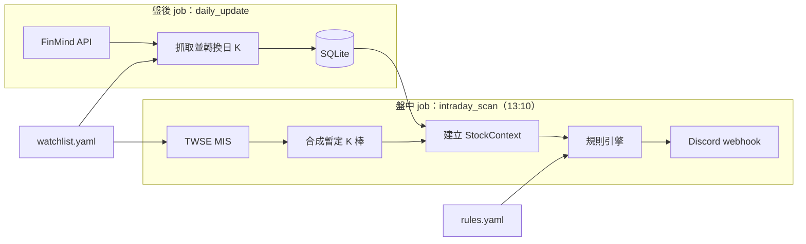

# 台股技術面盤中選股系統：專案規劃書

> 版本：v0.26（2026-11-07）｜狀態：開發中（M0–M7 完成；多方的進場與出場規則已定義，尚未實作（5.4、5.5）；M8 起的研究功能未規劃，見 `RESEARCH_PLAN.md`）
>
> 本文件是每日選股系統與共用部分的單一事實來源；研究功能（M7 起）的規劃在 `RESEARCH_PLAN.md`，兩者的邊界見 10.4。實作前請完整閱讀。標記「⚠️ 待確認」的項目是使用者尚未拍板的決定：請採用文中預設值，並保持可在設定檔調整，不要自行改變規則語意。已拍板的決定記錄在第 15 節，不需要再次詢問。

---

## 0. 給 Claude 的閱讀指引

- 交易規則（第 3–5 節）以本文件的定義為準。需求與本文件衝突，或定義不足以寫成程式時，先停下來詢問，不要自行詮釋。
- 所有可調整的數字（均線天數、量比、天數區間等）一律放在設定檔，不可寫死在程式中。
- 進場與出場規則已定義（5.4、5.5），目前**不實作**：每日的 `scan`、`update` 不使用，也不推播；要實作時先和使用者確認。
- 不使用付費 API，不做自動下單。
- 這是作品集專案：程式碼品質、測試、README 與本文件同等重要。
- 規則或架構有變更時，同步更新本文件的對應章節與第 16 節變更紀錄。
- 研究功能（M7 起）另讀 `RESEARCH_PLAN.md`。每日系統與研究功能的邊界（10.4）必須遵守：任何會讓每日的 `scan`、`update` 依賴研究程式、研究設定或研究套件的修改都不允許。

---

## 1. 專案概述

### 1.1 目標

以技術分析為主，依使用者自訂的選股邏輯，在**收盤前**快速篩選觀察清單中符合型態的股票並推播到 Discord，讓使用者在 13:30 收盤前有時間做決策。

### 1.2 使用情境

- 每個交易日 **13:10** 自動執行盤中掃描（時間可調）。
- 盤後由另一支程式更新歷史日 K 到本地資料庫。
- 掃描結果依「族群」分組推送到 Discord。

M7 起在同一個專案進行量化研究：驗證哪些選股依據在台股真的有用，驗證過的依據回饋到每日選股（`RESEARCH_PLAN.md`，D42）。

### 1.3 作品集展示重點

- 模組化、設定驅動的規則引擎（規則可插拔）
- 雙資料管線：盤後批次＋盤中即時
- 可測試的技術分析邏輯（轉折點、趨勢、觸發規則）
- 清楚的文件與架構

---

## 2. 範圍與非目標

| 範圍內 | 非目標（目前不做） |
|---|---|
| 台股上市、上櫃股票 | 興櫃、ETF、權證 |
| 使用者自選的觀察清單（以科技股為主）；研究功能使用全市場資料（`RESEARCH_PLAN.md`） | 每日推播掃描全市場 |
| 自訂分類（見 9.1）：產業鏈位置（族群 › 子分類，一檔一個）；只用於顯示與分組 | 分類參與篩選（例：族群轉強）、自動匯入官方產業分類、題材標籤（D31） |
| 盤中掃描結果推播 Discord；研究的定期報告推播到另一個 Discord 頻道（D43） | 每日選股的盤後推播、網頁介面 |
| 觸發訊號：多方與空方（D26）；訊號回測（M6，見 14.1） | 推播進場與出場訊號（規則已定義，見 5.4、5.5）、盤中即時監測（D52）、自動下單、交易回測（尚未規劃；研究的定期再平衡組合回測見 `RESEARCH_PLAN.md` M10） |

---

## 3. 名詞定義

所有規則用語以下表為準。「現價」指盤中掃描時的最新成交價（見第 6 節）；「今日」的數值在盤中都以暫定 K 棒計算。

| 名詞 | 定義 | 參數／預設 |
|---|---|---|
| MA*n* | 最近 n 根 K 棒收盤價的簡單移動平均；盤中計算時包含今日暫定 K 棒 | — |
| 月線 | MA20 | — |
| 昨收 | 今日前一根 K 棒的收盤價（來自資料庫）。所有規則都用此值；Discord 顯示的漲跌幅另用 MIS 參考價，見第 11 節 | — |
| 紅 K | 現價（收盤）> 開盤 | — |
| 黑 K | 現價（收盤）< 開盤 | — |
| 長紅 | 紅 K，且 (現價 − 開盤) / 昨收 ≥ `min_body_pct` | 3% |
| 長黑 | 黑 K，且 (開盤 − 現價) / 昨收 ≥ `min_body_pct` | 3% |
| 爆量 | 今日成交量 ≥ 昨日成交量 × `volume_ratio`。昨日成交量為 0 張時算不出量比，視為不成立（D23、D39） | 1.3（D29） |
| 突破 MA*n* | 昨收 ≤ 昨日 MA*n*，且現價 > 今日 MA*n* | — |
| 跌破 MA*n* | 昨收 ≥ 昨日 MA*n*，且現價 < 今日 MA*n*（與「突破」對稱） | — |
| 站上 MA*n* | 現價 > 今日 MA*n* | — |
| 在 MA*n* 之下 | 現價 < 今日 MA*n*。現價剛好等於 MA*n* 時，既不算站上也不算在之下 | — |
| 前高 | 不含今日，最近 `high_lookback_days` 根 K 棒的最高價；今日之前不足這麼多根時視為算不出（D23） | 40（約兩個月） |
| 前低 | 不含今日，最近 `low_lookback_days` 根 K 棒的最低價；不足時同樣視為算不出 | 40 |
| 三線多排 | MA5 > MA10 > MA20 | — |
| 三線空排 | MA5 < MA10 < MA20 | — |
| 頭／底 | 以收盤價計算的轉折點，定義見 4.1 | — |

---

## 4. 趨勢判斷

### 4.1 轉折點（頭與底）

以**收盤價觸碰 MA5** 作為確認轉折點的時機，頭與底都以**收盤價**計算：

1. 均線以完整歷史資料計算，不限於計算區間，因此歷史足夠時，計算區間的第一根 K 棒就有 MA5。以計算區間內第一根有 MA5 的 K 棒決定初始狀態：收盤 > MA5 為「上方」，否則為「下方」。這根 K 棒只用來決定狀態，從下一根開始判斷觸碰。
2. 狀態為「上方」時，若某日收盤 ≤ MA5（觸碰或跌破），就確認一個**頭**：從上一個轉折點的隔天往後到當天（含），收盤價最高的那根 K 棒。之後狀態轉為「下方」。
3. 狀態為「下方」時，若某日收盤 ≥ MA5（觸碰或站上），就確認一個**底**：同樣的區間內，收盤價最低的那根 K 棒。之後狀態轉為「上方」。
4. 第一個轉折點的區間從計算區間的起點開始。
5. 區間內有多根同為極值時，取日期較晚的一根。
6. 頭與底必然交替出現。最後一次觸碰之後的走勢尚未確認，不產生轉折點。
7. 不做波段雜訊過濾。
8. 計算區間包含今日，也就是以收盤後的觀點判斷：今日收盤觸碰 MA5 就確認轉折點。盤中以暫定 K 棒的現價判斷，等於假設現價就是收盤價，收盤前可能改變（D22）。

| 參數 | 說明 | 預設 |
|---|---|---|
| `pivot_ma` | 判斷觸碰用的均線 | 5 |
| `lookback_days` | 計算轉折點使用的 K 棒數：截至今日（含）的最近 n 根，即「計算區間」 | 120 |

### 4.2 趨勢分類

**步驟一：基本趨勢**。使用**截至今日已確認**的轉折點判斷（含今日確認的轉折點；盤中為暫定 K 棒，見 4.1 第 8 點）：

| 趨勢 | 條件 |
|---|---|
| 多頭 `bull` | 最近兩個頭後 > 前，**且**最近兩個底後 > 前 |
| 空頭 `bear` | 最近兩個頭後 < 前，**且**最近兩個底後 < 前 |
| 盤整 `range` | 其他情況（含相等） |
| 資料不足 `unknown` | 已確認的頭或底少於 2 個 |

**步驟二：破位修正**。檢查最近一個已確認轉折點之後到今日（含今日現價）的收盤價；最近一個轉折點就是今日時，沒有收盤價可檢查，維持基本趨勢：

- 基本趨勢為多頭，且其中最低收盤 < 最近一個已確認的底 → 改判為**盤整**。理由：跌破前底後會形成頭頭高、底底低，屬於盤整。
- 基本趨勢為空頭，且其中最高收盤 > 最近一個已確認的頭 → 改判為**盤整**。理由同上：突破前頭後會形成頭頭高、底底低。

「資料不足」不等於盤整，不參與任何有趨勢條件的規則。

趨勢只由轉折點（4.1）與破位修正決定，不因其他 K 線條件（例：跌破月線）或規則是否觸發而改變（D24）。例：盤整股出現長紅爆量過前高會觸發 E2，但趨勢仍為盤整，直到新的轉折點改變判斷。

---

## 5. 選股規則

### 5.1 判斷流程

```
觀察清單中的每檔股票
  → 建立 StockContext（歷史 K + 今日暫定 K、均線、轉折點、趨勢）
  → 多方、空方各自判斷：
      前置條件：該方向的全部通過才繼續
      逐一評估該方向的觸發規則：各規則獨立，可同時觸發多條
  → 至少一條觸發 → 列入該方向的結果，並標示觸發了哪些規則
```

每條規則屬於多方或空方（由規則本身決定，D26）。多方前置條件要求在月線之上、空方要求在月線之下，因此同一檔股票同一天只會出現在其中一邊。

規則需要的數值因歷史不足而算不出來時（例：不到 20 根沒有 MA20、不到 40 根沒有完整的前高），該條件視為不成立：前置條件不通過、規則不觸發（D23）。

### 5.2 前置條件（Filters）

| ID | 方向 | 名稱 | 條件 |
|---|---|---|---|
| `above_ma20` | 多方 | 站上月線 | 現價 > 今日 MA20。未通過者不評估任何多方觸發規則。 |
| `below_ma20` | 空方 | 跌破月線 | 現價 < 今日 MA20。未通過者不評估任何空方觸發規則；在月線之上，或剛好等於月線時，空方規則都不評估。 |

### 5.3 觸發規則（Trigger Rules）

觸發規則篩出值得看的候選，不等於實際進場（5.5）。

每條規則都有 `trends` 參數，列出適用的趨勢，可在設定檔調整。空陣列代表不限，此時「資料不足」`unknown` 的股票也會評估。

多方：E1–E3。空方：E4–E6，E4、E5 與 E1、E3 對稱（D26），E6 與 E2 對稱但不看成交量（D27）。

**E1 `bull_ma5_breakout`：多頭突破五日線紅 K**

- 趨勢：多頭（經 4.2 破位修正後）
- 突破 MA5（昨收 ≤ 昨日 MA5，現價 > 今日 MA5）
- 今日為紅 K

> 備註：回測時若跌破前底，尚未站回時由 4.2 的破位修正改判為盤整；站回五日線時確認的新底低於前底，趨勢同樣為盤整。兩種情況 E1 都不會觸發，因此「多頭回測不破低後站回」的情境已涵蓋在 E1 中。

**E2 `range_breakout_volume`：盤整長紅爆量過前高**

- 趨勢：盤整（經 4.2 破位修正後）
- 今日為長紅
- 爆量：今日量 ≥ 昨日量 × `volume_ratio`
- 現價 > 前高（不含今日，最近 `high_lookback_days` 日的最高價）

**E3 `ma_bull_alignment`：三線多排**

- 趨勢：不限
- 今日 MA5 > MA10 > MA20，且昨日尚未多排：只在形成當天觸發，避免多排期間每天重複出現（`only_on_formation: true`）。
- 只看均線排列，不要求紅 K 或上漲（D25）：下跌當天若均線剛好形成多排，同樣觸發。

**E4 `bear_ma5_breakdown`：空頭跌破五日線黑 K**（空方，與 E1 對稱）

- 趨勢：空頭（經 4.2 破位修正後）
- 跌破 MA5（昨收 ≥ 昨日 MA5，現價 < 今日 MA5）
- 今日為黑 K

> 備註：反彈時若突破前頭，尚未跌回時由 4.2 的破位修正改判為盤整；跌回五日線時確認的新頭高於前頭，趨勢同樣為盤整。兩種情況 E4 都不會觸發。

**E5 `ma_bear_alignment`：三線空排**（空方，與 E3 對稱）

- 趨勢：不限
- 今日 MA5 < MA10 < MA20，且昨日尚未空排：只在形成當天觸發（`only_on_formation: true`）。
- 只看均線排列，不要求黑 K 或下跌。

**E6 `range_breakdown`：盤整長黑破前低**（空方，與 E2 對稱但不看成交量）

- 趨勢：盤整（經 4.2 破位修正後）
- 今日為長黑：(開盤 − 現價) / 昨收 ≥ `min_body_pct`
- 現價 < 前低（不含今日，最近 `low_lookback_days` 日的最低價）
- 不看成交量（D27）

### 5.4 出場規則（已定義，尚未實作）

多方部位只看收盤，下列條件先成立的當天以收盤價賣出（D51）：

| 條件 | 定義 | 參數 |
|---|---|---|
| 跌破五日線 | 現價 < 今日 MA5；剛好等於 MA5 時不賣。判斷用未還原價（D8） | `ma`：5 |
| 到期 | 進場後第 5 個交易日（進場當天不算） | `max_hold_days`：5 |

- 不設固定百分比的停損與停利（比較結果見 `RESEARCH_PLAN.md` 第 8 節）。
- 只看收盤，所以沒有「同一天同時碰到停損與停利」的問題；代價是盤中跌再深也要等到收盤，實際虧損可能比預期大。
- 收盤跌停鎖死賣不掉時，順延到之後第一個沒有收在跌停價的收盤，可以超過 5 天。跌停價的算法同 14.1。
- 參數在實作時放進設定檔。目前沒有實作：每日的 `scan`、`update` 不使用這些規則，也不推播。`ExitRule` 介面、設定檔的 `exit_rules` 區塊（目前為空）與引擎的呼叫點都保留。

### 5.5 進場規則（已定義，尚未實作）

觸發規則（5.3）只篩出值得看的候選，不等於實際進場：一天可能有數十檔觸發，不可能全部進場，收在漲跌停的訊號也很難成交。分成三層定義：觸發（候選）、進場（實際要做哪些、怎麼做）、出場（5.4）。

**多方**：下列條件全部成立的當天，以收盤價買進（D50）：

| 條件 | 定義 |
|---|---|
| 趨勢 | 多頭（經 4.2 破位修正後） |
| E1 | 當天觸發 E1：通過 `above_ma20`、突破 MA5、紅 K（5.3） |
| 過昨高 | 現價 > 昨日最高價 |
| 五日線上揚 | 今日 MA5 > 昨日 MA5 |

- 不包含已在五日線上方的續漲：E1 要求昨收 ≤ 昨日 MA5。
- 只有這一條。其他觸發規則單獨成立時不進場；盤整趨勢先不做，因為盤整突破的股票通常在尾盤前已漲停，買不到。
- 時點與價格：實際以 13:10 的暫定 K 棒判斷、在收盤買進；回測以收盤 K 棒判斷、以當日收盤為進場價。
- 成交限制：收在漲停價視為不成交（判斷方式同 14.1）。持有中不重複進場。
- 尚未定義：如何挑選與同時最多幾檔、部位大小與資金上限。歷史上可成交的訊號平均每天 3.4 檔，全部都買時平均同時持有約 11 檔。

**空方**：方向與多方相反，目前不做。融券成本與券源等細節等多方完成後再定義。
訊號回測（14.1）與訊號成績單（`RESEARCH_PLAN.md` 4.1）的「進場價」只是統計用的假設：假設每個訊號都進場，M6 用當日收盤，成績單用 13:10 現價，與這裡的進場規則無關。

---

## 6. 盤中暫定 K 棒

13:10 時今日 K 棒尚未完成。以 MIS 快照合成「今日暫定 K 棒」，附加在歷史 K 棒的最後一根：

| 欄位 | 來源 |
|---|---|
| open / high / low | MIS 開盤、最高、最低 |
| close | MIS 最新成交價：`z`，為 `-` 時用最後一筆成交 `trade.z`（D47）；兩者都沒有時依 8.2 處理 |
| volume | MIS 累積成交量（張） |

注意事項：

- 紅 K、長紅、突破均線等判斷都是「截至 13:10」的狀態，收盤前可能改變。Discord 訊息必須標示為盤中暫定結果。
- 13:10 的成交量只是全天的一部分（尚未包含 13:25–13:30 的收盤集合競價）。直接與昨日全日量比較屬於**保守**做法：能過門檻代表量確實很大。未來可加入「預估全日量」模式。此外資料庫的昨日量含零股、盤後定價、鉅額交易，MIS 只含一般交易，同樣使判斷偏保守（D21）。
- 轉折點與趨勢都納入今日暫定 K 棒（D22）：盤中觸碰 MA5 會即時確認轉折點，盤中跌破前底的多頭股也會即時改判為盤整。這些都可能在收盤前改變。
- 規則中的「昨收」一律取 K 棒資料的前一根收盤（第 3 節），不使用 MIS 的 `y`。MIS `y` 只用於顯示漲跌幅（第 11 節）與一致性檢查（7.2）。
- 今日尚無成交或無法取得價格的股票不合成暫定 K 棒，見 8.2。

---

## 7. 系統架構



兩支程式透過資料庫連接：**盤中掃描依賴盤後 job 寫入的歷史日 K**（均線與轉折點都需要歷史資料）。

### 7.1 盤後 job（`daily_update`）

1. 讀取觀察清單。
2. 對每檔股票查詢資料庫的最後日期，向 FinMind 補抓隔天到今天的日 K。資料庫沒有該檔資料（新加入清單）時，回補 `backfill_days` 個日曆天。已是最新的股票不送出請求。
3. 統一單位（成交量存「張」）後寫入 `daily_prices`；同一檔同一天已存在時覆寫。每檔抓完立即寫入。
4. 任何一檔請求失敗（重試 `finmind.retry` 次後仍失敗、超過請求上限、token 錯誤等）就中止，結束碼為 1。已寫入的資料保留，重新執行會從中斷處繼續。
5. FinMind 公告的更新時間為週一至五 17:30，排程預設 21:00（第 14 節）。成功時不推播 Discord；失敗時推送錯誤通知（D30），否則要到隔天掃描出現大量「昨收不一致」才會發現。

### 7.2 盤中 job（`intraday_scan`）

1. 依 `mis.batch_size` 分批向 MIS 查詢觀察清單中的所有股票（8.2）。
2. **交易日檢查**：MIS 回傳的資料日期全部都不是今天 → 判定為非交易日，直接結束（結束碼 0），不推播。個別股票的資料日期不是今天時，該檔視為無報價、不評估。
3. 拿不到成交價（`z` 與 `trade.z` 都是 `-`）的股票等待 `missing_price_wait_sec` 秒後重新查詢，最多 `missing_price_retry` 次；仍沒有時改用替代價（8.2）。重新查詢失敗（重試 `retry` 次後仍失敗）時不中止，記錄警告並沿用第一次的報價，同樣改用替代價（D40）。
4. **資料一致性檢查**：比對 MIS 昨收 `y` 與資料庫中今天以前最後一筆收盤價（資料庫沒有該檔日 K 時也算不一致）。不一致時，在訊息底部彙總警告並列出代號，例：「昨收不一致（除權息或資料未更新）：2330、XXXX」。除權息日的參考價本來就會不同，因此文字同時列出兩種可能。不一致的股票規則照常評估。
   - 已知限制：若資料庫確實未更新，K 棒中的「昨日」會是前一個有資料的交易日，與昨日比較的判斷（突破、爆量、多排形成）會錯位。目前只警告、不中止。
5. 合成暫定 K 棒（無成交或無報價者略過，見 8.2），接在資料庫中今天以前的日 K 之後（資料庫已有今天的日 K 時以暫定 K 棒取代）→ 建立 StockContext → 執行規則引擎。
6. 依族群分組推送 Discord。
7. **推播成功後寫入訊號紀錄**（M7，D45、D46）：執行紀錄、推播的每個訊號、MIS 回傳的全部報價（重新查詢的以新的取代）寫入 `screener.db`（8.3），原始資料列另存 `snapshot_dir` 下的壓縮檔（檔名為掃描時間，例 `2026-11-04_131005.json.gz`）。先寫壓縮檔，再在同一個交易內寫入資料庫，任何一步失敗時資料庫不會留下不完整的紀錄。`--dry-run`、`--replay`、非交易日與推播失敗時不寫入。寫入失敗時推送錯誤通知（「已推播 Discord，但訊號紀錄寫入失敗」），結束碼 1；已推播的訊息不受影響。
8. 每個請求失敗時重試 `retry` 次；仍失敗就推送錯誤通知到 Discord，避免使用者誤以為只是沒有訊號（第 3 步的重新查詢除外）。MIS 沒有回傳任何觀察清單股票的報價，或交易日卻沒有任何一檔可評估時，同樣視為失敗。
   - 錯誤通知的格式：「❌ 盤中選股執行失敗（2026-11-02 13:10）」、錯誤原因、log 檔路徑。資料庫不存在、`rules.yaml` 錯誤、程式例外也會通知。
   - 不通知的情況：`--dry-run`；`config/` 的設定檔本身無法載入（此時連 Discord 的設定都讀不到，結束碼 2）；推送錯誤通知本身失敗（只記錄在 log）。

---

## 8. 資料來源與資料庫

### 8.1 FinMind（盤後）

- 資料集：台股日成交資訊 `TaiwanStockPrice`。`GET https://api.finmindtrade.com/api/v4/data`，參數 `dataset`、`data_id`、`start_date`、`end_date`。
- Token 放在 `.env`（`FINMIND_TOKEN`），以 `Authorization: Bearer` header 傳送。未設定時以未登入身分查詢（上限較低），並在 log 警告。
- 已實測確認（2026-10-31）：
  - 欄位：`date`、`stock_id`、`open`、`max`、`min`、`close`、`Trading_Volume` 等；`max`／`min` 為最高／最低價。
  - `Trading_Volume` 單位為「股」，數值與證交所「個股日成交資訊」相同，**含一般、零股、盤後定價、鉅額交易**，所以不是 1000 的倍數。寫入時 ÷1000 並四捨五入成「張」。與盤中 MIS 成交量的口徑不同，處理方式見 D21。
  - 沒有整股成交的日子通常沒有資料列，但也可能是一筆**價格全為 0** 的資料列（停牌，或只有零股成交，例：6708 2025-11-07 只成交 21 股）。這種資料列略過不寫入，與沒有資料列一樣視為當天沒有交易；其他價格不是正數的資料列也略過，並記錄警告。
  - 查無資料（代號錯誤、區間內沒有交易）時回傳空陣列，不是錯誤。
  - 部分股票含掛牌前的興櫃交易（D38）。興櫃期間的資料有兩種異常，照原值寫入：`open` 不在 `min`～`max` 範圍內（2026-11-01 檢查 2020-06 起的資料：30 檔、3,793 筆，例：6831、7711、7769 的 2025-11），以及成交不到 500 股而四捨五入成 0 張（93 筆）。兩者**全部在上市日／上櫃日之前**，掛牌後沒有。規則對歷史 K 棒只用到收盤、最高價、最低價與成交量，錯誤的開盤價只有回放到這幾天時才會用到；昨日 0 張時爆量不成立（D39）。以 2026-10-30 為今日，沒有任何股票的計算區間含興櫃 K 棒（6125 廣運 2026-06-01 轉上市，計算區間內轉市前的 17 根是上櫃交易，屬正常資料），新加入剛掛牌的股票時才會受影響。
  - 免費會員每小時 600 次請求（`user_info` 端點的 `api_request_limit_hour`），超過時回 HTTP 402。每檔一次請求，觀察清單 290 檔首次回補約 290 次。
  - 不帶 `data_id` 的全市場查詢需要贊助會員，免費會員只能逐檔查詢。
  - token 錯誤回 HTTP 400（`Token is illegal.`）。
  - 官方文件標示的更新時間：週一至五 17:30（實際以 API 為準）。
- 請求間隔、逾時、重試次數與退避秒數由 `settings.yaml` 的 `finmind` 區塊設定（9.3）。連線失敗、逾時、HTTP 5xx 才重試；402 與其他 4xx 直接失敗。

### 8.2 TWSE MIS（盤中）

- 非官方公開端點，可能變動：
  `https://mis.twse.com.tw/stock/api/getStockInfo.jsp?ex_ch=tse_2330.tw|otc_6488.tw&json=1&delay=0`
- 上市股票用 `tse_` 前綴，上櫃股票用 `otc_` 前綴。一次請求可串接多檔（以 `|` 分隔），依 `batch_size` 分批查詢。
- 已實測確認（2026-10-31，週六；非交易日回傳最後一個交易日 10/30 收盤後的資料）：
  - 欄位：`c` 代號、`n` 名稱、`d` 日期（`20261030`）、`t` 最新成交時間、`z` 最新成交價、`o` 開、`h` 高、`l` 低、`y` 參考價（昨收）、`v` 累積成交量（張）、`b`／`a` 最佳五檔買／賣價（以 `_` 分隔）、`u`／`w` 漲停／跌停價、`trade` 最後一筆成交（`z` 價格、`t` 時間、`v` 張數）。價格為 `"2370.0000"` 形式的字串，沒有值時為 `-`。
  - 觀察清單 290 檔全部查得到；10/30 收盤後的 `o`／`h`／`l`／`z` 與資料庫 10/30 日 K 完全相同，`y` 與 10/29 收盤完全相同。
  - `v` 只含一般交易：10/30 收盤時為資料庫（FinMind）日成交量的 56%～99.7%，中位數 97.5%（D21）。
  - 一次 150 檔可以；290 檔時網址過長，回 HTTP 414，此時錯誤訊息提示調小 `batch_size`。
  - 代號或市場前綴錯誤時，該檔回傳 `c` 為空字串的資料，無法對應：在 log 警告（提示檢查 `market`），並視為無報價。
  - 跌停鎖死時 `b` 為 `-`（沒有買單）；漲停鎖死時 `a` 為 `-`（沒有賣單）。此時另一邊的掛單，收盤後的第一檔就是跌停價／漲停價。盤中則不同（2026-11-03～06 的 13:10 實測）：第一檔的價格是 `0.0000`，第二檔才是實際價格，例：1303 的 `a` 為 `0.0000_271.0000_271.5000_…`。賣價 84 檔次，其中 83 次第二檔為跌停價（例外：4919 最後成交 107.5 為跌停價，第二檔為 108）；買價 10 檔次，第二檔都是漲停價。因此買賣價取第一個有價格的檔位（D48）。
  - 參考價 `y` 已取到升降單位，除權息日可能與官方公告的參考價差一檔（3289 宜特 2026-11-05：MIS 125.5，官方 125.4）。
  - 回應另有 `pz` 等未使用的欄位。10/30 收盤後 `trade.z` 與 `z` 全部相同。`-v` 執行時，拿不到成交價的股票會在 log 記錄完整資料。
- 開盤價 `o` 為 `-` 代表今日尚無成交（含暫停交易）：該檔不評估，在訊息底部彙總「N 檔今日無成交或無報價，未評估」並列出代號。
- 盤中實測（2026-11-02 13:10）：`z` 是最近一次更新（約每 5 秒一次）的成交價，那次更新只有掛單變動、沒有成交時為 `-`：290 檔中 265 檔，等 5 秒重新查詢後仍有 255 檔。最後一筆成交記在 `trade`（例：台積電 `z` 為 `-`，`trade.z` 為 13:10:15 成交的 2340，最佳買價 2335），`pz` 同樣為 `-`。因此現價依序取 `z`、`trade.z`（D47），`trade.z` 是實際成交價，不標註替代值。
- `z` 與 `trade.z` 都沒有值時：先等待數秒後重新查詢（7.2 第 3 步）；仍沒有，或重新查詢失敗（D40），就依序改用最佳買價、最佳賣價（第一個有價格的檔位，D48），並在結果中標註「價格為替代值」與替代來源（D28）。賣價是為了跌停鎖死時沒有買單的情況，此時賣價通常即跌停價，與漲停鎖死時買價即漲停價對稱。買賣價都沒有值時，同樣不評估，併入上一點的彙總。
- 控制請求頻率（`request_interval_sec`），避免 IP 被暫時封鎖。
- 頻率限制（2026-11-02 實測）：290 檔分 6 批、每批間隔 3 秒，加上 5 秒後重新查詢 6 批，沒有遇到限制。

### 8.3 資料庫（SQLite）

觀察清單與族群以 `config/watchlist.yaml` 為唯一來源，資料庫只存價格：

```sql
CREATE TABLE daily_prices (
    code    TEXT    NOT NULL,
    date    TEXT    NOT NULL,   -- YYYY-MM-DD
    open    REAL    NOT NULL,
    high    REAL    NOT NULL,
    low     REAL    NOT NULL,
    close   REAL    NOT NULL,
    volume  INTEGER NOT NULL,   -- 單位：張
    PRIMARY KEY (code, date)
);
```

- 使用**未還原**價格，與 MIS 即時報價一致。除權息、減資、面額變更會造成價格跳空，可能影響均線與轉折點，屬已知限制（實例：6669 緯穎 2026-09-02 除權 7800 → 2610，隔天因均線仍含除權前價格而觸發三線空排；回測中的處理見 D34）。
- M6 新增除權息與公司行動兩個資料表，只存原始事件，還原價在讀取時計算（14.2）。
- M7 新增盤中掃描的紀錄（7.2 第 7 步；`RESEARCH_PLAN.md` 4.1），只由 `scan` 寫入，研究的 `signal-report` 只讀取：

  ```sql
  CREATE TABLE scan_runs (            -- 實際推播的盤中掃描，每次一筆（D45）
      id INTEGER PRIMARY KEY AUTOINCREMENT,
      date TEXT NOT NULL,             -- 交易日
      scanned_at TEXT NOT NULL,       -- 掃描開始的時間（本機），即訊息標題的時間
      rules_fingerprint TEXT NOT NULL,  -- rules.yaml 解析後內容的 sha256 前 12 碼（只改註解不會變）
      observed INTEGER NOT NULL, evaluated INTEGER NOT NULL, not_evaluated INTEGER NOT NULL,
      substituted INTEGER NOT NULL,   -- 現價為替代值的檔數
      prev_close_mismatch INTEGER NOT NULL,
      raw_file TEXT                   -- MIS 原始資料的壓縮檔（D46）
  );
  CREATE TABLE signals (              -- 推播的訊號：一檔股票觸發的一條規則
      run_id INTEGER NOT NULL, code TEXT NOT NULL, rule_id TEXT NOT NULL, rule_name TEXT NOT NULL,
      side TEXT NOT NULL, trend TEXT NOT NULL,
      price REAL NOT NULL,            -- 推播時的現價
      price_substitute TEXT,          -- best_bid | best_ask；NULL 為成交價
      change_pct REAL, detail TEXT NOT NULL,
      PRIMARY KEY (run_id, code, rule_id)
  );
  CREATE TABLE quote_snapshots (      -- 該次掃描 MIS 回傳的全部股票，欄位同 Quote（10.1）；沒有值時為 NULL
      run_id INTEGER NOT NULL, code TEXT NOT NULL, date TEXT NOT NULL,
      open REAL, high REAL, low REAL, last REAL, prev_close REAL, volume INTEGER, best_bid REAL, best_ask REAL,
      PRIMARY KEY (run_id, code)
  );
  ```

  原始資料列（每檔約 45 個欄位，含五檔價量、漲跌停價）不進資料庫，另存壓縮檔：2026-11-02 實測 290 檔約 45 KB。
- 資料存取透過介面隔離（`data/base.py` 的 `PriceStore`、`ScanStore`、`DailyPriceSource`），未來換資料庫或資料源時只改單一模組。

---

## 9. 設定檔

### 9.1 `config/watchlist.yaml`

每檔股票以產業鏈位置 `industry` 分類：公司「做什麼」，樹狀為族群 › 子分類，每檔恰好一個，以主要營收來源決定（例：銅箔基板廠 → `PCB/CCL`）。原本另有題材 `themes`（市場「炒什麼」），已移除（D31）。

判斷 `industry` 的方法：

- 依 MoneyDJ「營收比重」取主要營收來源；同類產品合併計算（例：國巨的鉭質電容＋MLCC 合計為電容器）。
- 因題材才被列入概念股清單的公司，仍依主要營收歸到它實際所屬的產業（例：大立光因 CPO 題材列入，歸「光學」）。
- 營收項目名稱看不出產品用途時，維持原分類。
- 使用者另有指定時以指定為準（例：台玻歸「PCB/玻璃纖維、玻纖布」）。

```yaml
# 觀察清單（唯一來源）。market: tse = 上市, otc = 上櫃

industries:                  # 族群 → 子分類，子分類依上游到下游排列（決定顯示順序）
  PCB: [銅箔, 玻纖布, CCL, 硬板, HDI, 載板]
  半導體: [晶圓代工, 封測]

stocks:
  - code: "2330"
    name: 台積電
    market: tse
    industry: 半導體/晶圓代工
  - code: "XXXX"             # 範例
    name: 範例CCL廠
    market: otc
    industry: PCB/CCL        # 格式：族群/子分類；族群未列子分類時可只寫族群
```

載入設定時必須驗證：每檔的 `industry` 存在於 `industries`，不符就報錯，避免打錯字造成分類遺漏。族群有列子分類時，`industry` 必須寫到子分類；只寫族群就報錯。

### 9.2 `config/rules.yaml`

```yaml
trend:
  pivot_ma: 5
  lookback_days: 120
  bull_break_to_range: true    # 多頭跌破前底 → 盤整
  bear_break_to_range: true    # 空頭突破前頭 → 盤整

filters:                       # 每條規則屬於多方或空方；前置條件只管同方向的觸發規則
  - id: above_ma20             # 多方
    enabled: true
    params: { ma: 20 }
  - id: below_ma20             # 空方
    enabled: true
    params: { ma: 20 }

trigger_rules:                 # trends: bull | range | bear；空陣列 = 不限
  # 多方
  - id: bull_ma5_breakout
    enabled: true
    params: { trends: [bull], ma: 5 }
  - id: range_breakout_volume
    enabled: true
    params: { trends: [range], min_body_pct: 3.0, volume_ratio: 1.3, high_lookback_days: 40 }
  - id: ma_bull_alignment
    enabled: true
    params: { trends: [], mas: [5, 10, 20], only_on_formation: true }
  # 空方
  - id: bear_ma5_breakdown
    enabled: true
    params: { trends: [bear], ma: 5 }
  - id: range_breakdown        # 與 range_breakout_volume 對稱，但不看成交量
    enabled: true
    params: { trends: [range], min_body_pct: 3.0, low_lookback_days: 40 }
  - id: ma_bear_alignment
    enabled: true
    params: { trends: [], mas: [5, 10, 20], only_on_formation: true }

exit_rules: []                 # 保留，尚未實作
```

### 9.3 `config/settings.yaml`

```yaml
db_path: data/screener.db
log_dir: logs
snapshot_dir: data/snapshots # 盤中掃描推播後保存的 MIS 原始資料（7.2 第 7 步，D46）
backfill_days: 365           # 新加入的股票回補的日曆天數
finmind:
  timeout_sec: 30
  retry: 3                   # 連線失敗、逾時、伺服器錯誤時重試
  retry_backoff_sec: 5       # 第 n 次重試前等待 n × 此秒數
  request_interval_sec: 1    # 兩次請求的最短間隔
mis:                         # timeout_sec、retry、retry_backoff_sec、request_interval_sec 同 finmind
  timeout_sec: 10
  retry: 3
  retry_backoff_sec: 3
  request_interval_sec: 3
  batch_size: 50             # 每次請求的股票數；實測 150 檔可以，290 檔回 HTTP 414
  missing_price_retry: 1     # 成交價為 "-" 時重新查詢的次數
  missing_price_wait_sec: 5  # 重新查詢前等待的秒數
discord:                     # 欄位同 finmind；被限流（HTTP 429）時改等 Discord 指定的秒數
  timeout_sec: 10
  retry: 3
  retry_backoff_sec: 5
  request_interval_sec: 1    # 多則訊息之間的間隔
```

連線失敗、逾時、回應傳到一半連線中斷與 HTTP 5xx 會重試（FinMind、MIS、Discord 與證交所 ISIN 清單相同）。研究的設定不放在這裡（10.4 規則 4）：`backtest.yaml` 只有 `backtest` 指令會讀取，欄位見 14.1；`research.yaml` 只有 `events`、`signal-report` 會讀取，見 9.5。

### 9.4 `.env`（不進版控，另提供 `.env.example`）

```
FINMIND_TOKEN=
DISCORD_WEBHOOK_URL=
DISCORD_RESEARCH_WEBHOOK_URL=      # 研究的定期報告（M7 起，D43）
```

### 9.5 `config/research.yaml`（研究指令專用）

```yaml
events:                         # events 指令（14.2）
  refetch_days: 7               # 已查過的股票，從上次查詢的迄日往前重疊幾天再查
  reference_tolerance_pct: 0.5  # 交叉驗證：以股利金額計算的參考價與官方差異超過此值（%）時列在 log
  dividend_lookahead_days: 30   # 股利資料的查詢迄日往後放寬的天數（14.2）
isin:                           # 證交所 ISIN 清單（上市日／上櫃日），events 使用；欄位同 settings.yaml 的 finmind
  timeout_sec: 60               # 上市清單約 10 MB
  retry: 3
  retry_backoff_sec: 5
  request_interval_sec: 1
signal_report:                  # 訊號成績單（RESEARCH_PLAN.md 4.1）
  horizons: [1, 5]              # 「累積」一段的持有交易日數
  top_n: 3                      # 本週表現最好、最差各列出幾個
  output_dir: data/research/signal_report     # 明細 CSV
  backtest_summary: data/backtest/summary.csv # 對照「M6 驗證段」；不存在時不顯示
```

FinMind 與 Discord 的請求設定沿用 `settings.yaml`。M7 之前 `isin`、`events` 與 `finmind.dividend_lookahead_days` 放在 `settings.yaml`（D44 修正）。

---

## 10. 擴展性設計

### 10.1 核心型別與規則介面

```python
class Trend(str, Enum):
    BULL = "bull"          # 多頭
    RANGE = "range"        # 盤整
    BEAR = "bear"          # 空頭
    UNKNOWN = "unknown"    # 資料不足

class Side(str, Enum):
    LONG = "long"          # 多方
    SHORT = "short"        # 空方

@dataclass(frozen=True)
class Pivot:
    date: date
    close: float
    kind: Literal["peak", "trough"]    # 頭 / 底

@dataclass(frozen=True)
class Quote:                   # 盤中即時報價（MIS 快照）；沒有值（"-"）的欄位為 None
    code: str
    date: date
    open: float | None         # None：今日尚無成交
    high: float | None
    low: float | None
    last: float | None         # 最新成交價；None：該時點沒有成交
    prev_close: float | None   # 參考價 y
    volume: int | None         # 累積成交量（張）
    best_bid: float | None
    best_ask: float | None
    raw: Mapping[str, Any] | None = field(default=None, compare=False)   # MIS 原始資料列，供存檔（D46）
    def current_price(self) -> tuple[float | None, PriceSubstitute | None]: ...   # 成交價→買價→賣價（D28、D47）

@dataclass
class StockContext:
    info: StockInfo            # code, name, market, industry
    bars: pd.DataFrame         # 歷史日 K；最後一列為今日（盤中為暫定 K 棒）
    is_tentative: bool
    pivots: list[Pivot]        # 截至今日已確認的轉折點（盤中含暫定 K 棒）
    trend: Trend               # 已套用 4.2 破位修正
    def ma(self, n: int) -> pd.Series: ...    # 計算後快取

@dataclass(frozen=True)
class Signal:
    rule_id: str
    rule_name: str
    detail: str                # 例："量比 1.80x，突破 40 日高 123.5"
    side: Side

class Rule(ABC):
    id: ClassVar[str]
    name: ClassVar[str]
    def __init__(self, params: dict[str, Any]) -> None: ...

class FilterRule(Rule):
    side: ClassVar[Side]       # 只管同方向的觸發規則
    @abstractmethod
    def passes(self, ctx: StockContext) -> bool: ...

class TriggerRule(Rule):
    side: ClassVar[Side]
    def applies_to(self, trend: Trend) -> bool: ...   # 依 params["trends"] 判斷
    @abstractmethod
    def evaluate(self, ctx: StockContext) -> Signal | None: ...

class ExitRule(Rule):          # 保留，目前不實作任何子類別
    @abstractmethod
    def evaluate(self, ctx: StockContext, position: Any) -> Signal | None: ...
```

規則以裝飾器註冊（例：`@register_rule("bull_ma5_breakout")`）。引擎讀取 `rules.yaml`，依 `id` 從註冊表建立已啟用的規則。

### 10.2 新增一條規則

1. 在 `rules/trigger/` 新增檔案，繼承 `TriggerRule`，並以 `@register_rule("新規則id")` 註冊。以 `side` 指定多方或空方（未指定時無法註冊），以 `params_schema` 宣告參數與型別，需要檢查數值時覆寫 `configure`。`rules/` 下的模組會被自動匯入。
2. 在 `rules.yaml` 的 `trigger_rules` 加入設定。規則 id 不存在、參數缺少、多出或型別不符時，執行時直接報錯。
3. 在 `tests/rules/` 加上對應的測試。

不需要修改引擎、資料層或推播程式。

### 10.3 設計原則

- 指標（均線等）集中在 `analysis/indicators.py` 計算並快取，規則只讀取、不重算。
- 消除浮點誤差（`analysis/numeric.py`）：價格最多兩位小數、成交量為整數，均線與門檻計算（長紅的實體、爆量的倍數）的精確值都只有有限位小數，四捨五入到小數 6 位後再比較，「剛好等於門檻」才會判斷正確；不相等時差距遠大於 1e-6，不會因此變成相等。實測未處理時約三分之一的均線值有誤差，(10.35 − 10.05) / 10 也會算成 2.99999…%。
- 第 3 節的名詞（紅 K、長紅、爆量、突破、前高、均線排列）集中定義在 `rules/conditions.py`，各規則共用。
- 規則是純邏輯：輸入 `StockContext`，輸出 `Signal | None`，不碰網路與資料庫，方便測試。
- 資料來源以介面隔離，換資料源只需修改單一模組。

### 10.4 每日系統與研究功能的邊界

每日的 `scan`、`update` 由工作排程器自動執行，必須保持穩定；研究功能（訊號回測與 M7 起的研究，見 `RESEARCH_PLAN.md`）會經常修改。兩者在同一個專案中，以下列規則隔開（D42）。

| 項目 | 每日系統 | 研究功能 |
|---|---|---|
| 指令 | `update`、`scan`（排程執行）、`analyze` | `events`、`backtest`、`signal-report`（M7），以及之後的研究指令 |
| 程式 | `jobs/daily_update.py`、`jobs/intraday_scan.py`、`jobs/analyze.py` | `backtest/`、`research/`（M7 起）、`jobs/` 中研究指令的程式 |
| 資料 | `data/screener.db`：觀察清單的日 K（`update` 寫入）、訊號紀錄（M7，`scan` 寫入，8.3）；`data/snapshots/`（MIS 原始資料，`scan` 寫入） | 讀取 `screener.db`；除權息與公司行動由 `events` 寫入 `screener.db`；全市場資料存在 `data/market.db`，輸出在 `data/backtest/`、`data/research/` |
| 設定 | `settings.yaml`、`watchlist.yaml`、`rules.yaml` | `backtest.yaml`、`research.yaml` |
| 套件 | pandas、requests、PyYAML、python-dotenv | 另加研究專用套件（選用依賴群組 `research`：plotly） |
| 排程 | `stock-screener-scan`、`stock-screener-update` | 獨立的工作：`stock-screener-weekly`（M7 成績單，每週六 10:00） |
| 文件 | 本文件 | `RESEARCH_PLAN.md` |

兩邊共用的模組：`models.py`、`config.py`、`http.py`、`logging_setup.py`、`formatting.py`、`data/`、`analysis/`、`rules/`、`engine.py`、`notify/`、`jobs/__init__.py`、`__main__.py`。

規則：

1. **依賴只能單向。** 研究程式可以匯入共用模組；每日系統與共用模組不可以匯入研究程式（`screener.backtest`、`screener.research`、研究指令的 job）。CLI 在執行研究指令時才匯入對應的程式（同 M6 的 `backtest`）。以測試確認執行 `update`、`scan` 時不會載入任何研究程式與研究套件。
2. **共用模組的修改，每日系統的測試必須全數通過。** 研究需要的新功能先放在研究程式，確定兩邊都會用到才移到共用模組。
3. **資料分開。** 研究指令不寫入 `screener.db` 的日 K 與訊號紀錄；全市場資料與研究的中間結果存在 `market.db` 與 `data/research/`，每日系統不讀取。
4. **設定分開。** 研究專用的設定放在 `backtest.yaml`、`research.yaml`，不放在 `settings.yaml`：`settings.yaml` 每個指令都會載入並驗證，研究的設定寫錯會讓 `scan` 失敗。研究不為了實驗修改 `rules.yaml`，改用 `--rules-file`（D35）。
5. **套件分開。** 研究專用套件放在 `pyproject.toml` 的選用依賴群組 `research`；排程使用的環境不需要安裝也能執行 `update`、`scan`。
6. **推播與排程分開。** 研究的定期報告推播到另一個 Discord 頻道（`.env` 的 `DISCORD_RESEARCH_WEBHOOK_URL`，D43）；研究的推播與排程失敗時都不影響每日的推播與排程；研究的排程避開 13:10 前後與 21:00 起的一小時（`update` 會用掉該小時約一半的 FinMind 額度）。
7. **開發在分支或 worktree 進行。** 主資料夾的 `main` 供排程使用，不直接修改（第 14 節）。
8. **拆分條件。** 研究程式的規模超過每日系統，或需要大型套件（例：機器學習）時，評估把研究功能拆成獨立專案。依賴單向時，拆分只需搬移研究程式與研究設定。

既有不符合上述規則的地方，已在 M7 修正（D44）：

- 規則 4：`settings.yaml` 的 `isin`、`events` 區塊與 `finmind.dividend_lookahead_days` 只有 `events` 使用，但每個指令都會載入驗證。→ 移到 `research.yaml`（9.5）；`settings.yaml` 再出現這兩個區塊時載入報錯（未知的欄位）。
- 規則 5：plotly 列在主要依賴，排程使用的環境也會安裝。→ 移到選用依賴群組 `research`。
- 規則 1：`__main__.py` 一開始就匯入 `jobs/corporate_events.py`（`events`）。→ `events`、`backtest`、`signal-report` 都在執行該指令時才匯入。

依賴方向以測試確認（`tests/test_cli.py`）：另開一個行程執行 `update`、`scan --dry-run`、`scan --replay --dry-run` 後，plotly、`screener.backtest`、`screener.research` 與研究指令的 job 都沒有被載入；`research.yaml` 不存在或寫錯時，`update`、`scan` 照常執行。

---

## 11. Discord 輸出格式

```
【盤中選股】2026-10-30 13:10（暫定 K 棒，收盤前可能變動）

━━ 多方 ━━
▍PCB
XXXX 範例CCL廠  123.5  ▲3.2%｜CCL｜多頭
  └ 多頭突破五日線紅K、三線多排

▍半導體
...

━━ 空方 ━━
▍半導體
2330 台積電  2370  ▼1.9%｜製造｜空頭
  └ 空頭跌破五日線黑K
2308 台達電  1335  ▼9.8%｜電源供應器｜空頭｜⚠️ 價格為替代值（最佳賣價）
  └ 空頭跌破五日線黑K

觀察 45 檔｜觸發 5 檔（多方 3、空方 2）
⚠️ 昨收不一致（除權息或資料未更新）：XXXX
⚠️ 1 檔今日無成交或無報價，未評估：YYYY
```

- 先列多方、再列空方（D26），各自依產業鏈族群分組，同一方向內每檔只出現一次；沒有觸發的方向不列出。
- 族群依 `industries` 的順序排列；族群內依子分類順序（上游到下游）排列，同子分類再依代號排列。
- 每檔顯示子分類與趨勢。現價為替代值時（8.2）在最後標註「⚠️ 價格為替代值（最佳買價／最佳賣價）」。
- 標題的時間為掃描時間（本機時間，時:分）。
- 漲跌幅以 MIS 參考價 `y` 計算，與看盤軟體一致；除權息日會與規則使用的昨收不同（見第 3 節）。回放模式沒有 MIS 資料，改用前一日收盤。
- 訊息底部彙總警告：昨收不一致（7.2）、無成交或無報價未評估（8.2）。
- 回放模式（`--replay`）的標題改為「【回放】2026-10-29（以收盤 K 棒計算）」，避免與盤中結果混淆。當日沒有日 K 的股票不評估，底部警告為「N 檔當日沒有日 K（無成交或資料未更新），未評估：XXXX」。
- Discord 單則訊息上限 2000 字（以 UTF-16 計算，與 Discord 相同），超過時依族群拆成多則；單一族群就超過上限時，在族群內逐檔再拆。從方向或族群中間開始的一則，開頭補上「━━ 空方 ━━（續）」「▍PCB（續）」。單一行就超過上限時（例：未評估的代號非常多）直接切開。`--dry-run` 印出時以「──── 第 1/2 則 ────」分隔。
- 沒有任何觸發時，仍推送一則「今日無符合標的」，讓使用者確認程式有正常執行。
- 使用 webhook 推送，不需要建立 bot。webhook 網址本身就是憑證，只放在 `.env`，log 與錯誤訊息中會遮蔽；訊息不觸發 @everyone 等提及。未設定時，`scan`（未加 `--dry-run`）以結束碼 2 結束；`update` 照常執行，但失敗時不會推送錯誤通知。

---

## 12. 專案結構

```
stock-screener/
├── CLAUDE.md                  # 給 Claude 的入口，指向本文件
├── PROJECT_PLAN.md            # 本文件：每日系統與共用部分
├── RESEARCH_PLAN.md           # 研究功能的規劃（M7 起）
├── README.md
├── pyproject.toml
├── .env.example
├── .gitignore
├── config/
│   ├── settings.yaml
│   ├── watchlist.yaml
│   ├── rules.yaml
│   ├── backtest.yaml          # 訊號回測（14.1），只有 backtest 指令會讀取
│   └── research.yaml          # 研究的設定（9.5），只有 events、signal-report 會讀取
├── src/screener/
│   ├── __main__.py            # CLI：update / scan / analyze；研究指令 events / backtest / signal-report 執行時才匯入
│   ├── config.py
│   ├── logging_setup.py       # 終端＋每日 log 檔
│   ├── models.py              # Trend, Pivot, StockInfo, DailyBar, StockContext, Signal, 除權息與公司行動、訊號紀錄
│   ├── http.py                # 請求間隔、逾時與重試（FinMind、MIS、Discord 共用）
│   ├── data/
│   │   ├── base.py            # 資料層介面：PriceStore、EventStore、ScanStore、DailyPriceSource、QuoteSource、EventSource
│   │   ├── db.py
│   │   ├── finmind.py         # 日 K、除權息、減資、面額變更
│   │   ├── isin.py            # 證交所 ISIN 清單：上市日／上櫃日
│   │   └── mis.py
│   ├── analysis/
│   │   ├── indicators.py
│   │   ├── pivots.py
│   │   ├── trend.py
│   │   ├── context.py         # 由日 K 建立 StockContext
│   │   ├── adjustment.py      # 還原權息（後還原，14.2）
│   │   └── numeric.py         # 消除浮點誤差
│   ├── rules/
│   │   ├── base.py            # Rule 介面與註冊表
│   │   ├── conditions.py      # 第 3 節的名詞定義，規則共用
│   │   ├── filters/           # above_ma20（多方）、below_ma20（空方）
│   │   ├── trigger/           # E1、E2、E4、E6 各一檔；E3、E5 在 ma_alignment.py
│   │   └── exit/              # 保留
│   ├── engine.py
│   ├── notify/
│   │   ├── base.py            # 推播介面：Notifier
│   │   ├── message.py         # 組成訊息、拆成多則（研究的報告共用）、錯誤通知（第 11 節）
│   │   └── discord.py         # Discord webhook
│   ├── formatting.py          # 顯示用的數字格式
│   ├── backtest/              # 訊號回測（14.1）
│   │   ├── signals.py         # 產生歷史訊號、標記、報酬
│   │   ├── market.py          # 升降單位與漲跌停價
│   │   ├── stats.py           # 分組統計
│   │   └── report.py          # 終端摘要、CSV、Plotly 圖表報表
│   ├── research/              # 研究程式（M7 起，RESEARCH_PLAN.md 第 5 節）
│   │   ├── signal_report.py   # 訊號成績單的計算：一致性、報酬、基準、除權息調整
│   │   └── signal_report_output.py  # 成績單的 Discord 訊息與明細 CSV
│   └── jobs/
│       ├── daily_update.py
│       ├── corporate_events.py  # 抓取除權息與公司行動、對照官方參考價
│       ├── intraday_scan.py
│       ├── backtest.py
│       ├── signal_report.py   # 訊號成績單（研究頻道）
│       └── analyze.py         # 工具指令：輸出轉折點與趨勢
├── scripts/
│   └── register_tasks.ps1     # 在 Windows 工作排程器註冊 scan、update、weekly（第 14 節）
├── tests/
│   ├── fixtures/              # 手工構造的 K 棒資料（CSV，開頭註解寫明預期結果的推導）、MIS 實際回應（JSON）
│   ├── data/                  # 資料庫、FinMind 與 MIS（以假的 session 測試，不連網）
│   ├── jobs/
│   ├── notify/                # 訊息格式與 Discord（以假的 session 測試，不連網）
│   ├── analysis/
│   ├── backtest/
│   ├── research/
│   └── rules/
├── data/                      # SQLite（screener.db；研究的 market.db 規劃中）、MIS 原始快照、回測與研究輸出（不進版控）
└── logs/                      # 不進版控
```

CLI：

```
python -m screener update                    # 盤後更新資料庫
python -m screener update --since 2020-06-01  # 把日 K 往前回補到該日（回測使用）
python -m screener events                    # 抓取除權息、減資與面額變更（回測使用）
python -m screener scan                      # 盤中掃描並推播
python -m screener scan --dry-run            # 只印在終端，不推播
python -m screener scan --replay 2026-10-29            # 以該日日 K 當作「今日」重跑並推播，供非交易時段測試與展示
python -m screener scan --replay 2026-10-29 --dry-run  # 回放，但只印在終端
python -m screener analyze 2330 2454                   # 印出轉折點與趨勢，供檢查分析結果
python -m screener analyze 2330 --date 2026-10-29      # 以該日日 K 當作「今日」
python -m screener backtest                            # 訊號回測（14.1）
python -m screener backtest --rules-file config/rules_test.yaml --rules range_breakout_volume --horizon 10
python -m screener signal-report                       # 上一週的訊號成績單，推播到研究頻道（RESEARCH_PLAN.md 4.1）
python -m screener signal-report --end 2026-11-13 --dry-run  # 指定期間的最後一天，只印在終端
```

`--replay` 與 `--dry-run` 是獨立旗標。回放模式以資料庫中該日（含）以前的日 K 建立 StockContext，該日 K 棒視為「今日」（`is_tentative = false`）；不呼叫 MIS，因此不做交易日與一致性檢查。未加 `--dry-run` 時照常推播，標題標示「回放」（第 11 節）。

---

## 13. 開發準則

- Python 3.11 以上，全面使用 type hints；資料結構使用 `dataclass`。
- 主要套件：pandas、requests、PyYAML、python-dotenv、pytest；研究專用套件放在選用依賴群組 `research`（10.4），目前為 plotly（回測報表，D36）。新增依賴前先說明理由。
- 參數一律來自設定檔，程式中不得出現魔術數字。
- 轉折點、趨勢判斷（含破位修正）與每條規則都必須有單元測試，使用 `tests/fixtures/` 的手工 K 棒資料，不依賴網路。
- 網路請求要有 timeout、重試與 log。
- log 寫入 `logs/`，記錄每次執行的抓取筆數、觸發結果與錯誤。
- 機密資訊只能放在 `.env`；`.env`、`data/`、`logs/` 加入 `.gitignore`。
- README 需包含：專案簡介、架構圖、安裝與設定、如何新增規則、免責聲明（非投資建議）。

---

## 14. 里程碑

| 階段 | 內容 | 完成標準 | 狀態 |
|---|---|---|---|
| M0 | 專案骨架、設定載入、logging、CLI 入口、`.env.example` | `python -m screener --help` 可執行 | 完成（2026-10-30） |
| M1 | 盤後資料：FinMind 抓取、單位轉換、寫入 SQLite、回補 | `screener update` 能建立並更新資料庫 | 完成（2026-10-31） |
| M2 | 分析核心：均線、轉折點、趨勢判斷與破位修正＋測試 | 測試全數通過；能對任一檔輸出轉折點與趨勢 | 完成（2026-10-31） |
| M3 | 規則引擎：介面、註冊表、前置條件、多方 E1–E3、空方 E4–E6＋測試 | `screener scan --replay <日期>` 能用歷史資料跑出結果 | 完成（2026-10-31） |
| M4 | 盤中資料：MIS 抓取、暫定 K 棒、交易日與一致性檢查 | 盤中 `screener scan --dry-run` 正確輸出 | 完成（2026-11-03） |
| M5 | Discord 推播、錯誤通知、排程設定範例（以 Windows 工作排程器為主；執行時電腦須開機） | 交易日 13:10 自動收到訊息 | 完成（2026-11-02） |
| M6 | 訊號回測：回補 2020-06 起的日 K、除權息與公司行動資料、還原價、歷史訊號的報酬統計（14.1） | `screener backtest` 輸出各規則的統計，並手算數例供使用者對照 | 完成（2026-11-01） |
| M7–M11 | 研究功能：訊號紀錄與追蹤、全市場資料、單因子研究、組合回測與模擬組合、回饋到每日選股 | 見 `RESEARCH_PLAN.md` 第 4 節 | M7 完成（2026-11-07，`RESEARCH_PLAN.md` 4.1）；M8 起未規劃 |
| 之後 | 交易回測：模擬 5.4、5.5 的進出場，含挑選與部位上限 | 視需求另行規劃 | 規則已定義（D50、D51），交易回測未規劃 |

M4、M5 的驗證：

- 已驗證（2026-10-31，週六）：以 MIS 回傳的 10/30 收盤資料跑盤中流程，結果與 `--replay 2026-10-30` 完全相同（觸發 65 檔）；週末執行 `scan --dry-run` 判定為非交易日後結束；`--replay 2026-10-30` 實際推播到 Discord，拆成 2 則（1,955、933 字）；兩個排程已在工作排程器註冊。
- 盤中實測（2026-11-02）：13:10 排程自動執行，13:10:59 推播 1 則（觸發 12 檔：多方 4、空方 8），整個流程約 1 分鐘；昨收全部一致；MIS 沒有遇到頻率限制。成交價 `z` 為 `-` 的有 265 檔，重新查詢後仍有 255 檔改用最佳買價，原因是 `z` 只代表最近一次更新有沒有成交（8.2），已改為先用最後一筆成交 `trade.z`（D47）。
- 確認（2026-11-03～06）：改用 `trade.z` 後替代價 4 天都是 0 檔（修正前 255 檔），290 檔全部評估；13:10 排程約 25～45 秒完成；21:00 盤後更新每天寫入 290 筆，約 5 分鐘；昨收不一致只有 3289 宜特 11/05（除息，官方 127 → 125.4）。週六執行 `scan --dry-run` 判定為非交易日後結束。實際環境這幾天沒有失敗，錯誤通知仍只由測試涵蓋。

排程（M5、M7）：`scripts/register_tasks.ps1` 註冊兩個週一至週五的工作與一個每週的研究工作，時間可用參數調整（`-ScanTime`、`-UpdateTime`、`-WeeklyTime`）：

| 工作 | 預設時間 | 指令 | 錯過時（例：關機） |
|---|---|---|---|
| `stock-screener-scan` | 13:10 | `python -m screener scan` | 不補跑：收盤後才推播盤中結果沒有意義 |
| `stock-screener-update` | 21:00 | `python -m screener update` | 開機後補跑 |
| `stock-screener-weekly` | 週六 10:00 | `python -m screener signal-report` | 開機後補跑（R3）；研究功能，失敗時錯誤通知推到研究頻道 |

以目前使用者身分執行，電腦須開機且已登入；使用電池時也會執行。國定假日照常觸發，scan 判定為非交易日後結束。

### 14.1 M6：訊號回測（完成）

以歷史日 K 逐日回放規則，統計每條規則觸發後的報酬，並與同期基準比較，用來判斷規則有沒有優勢、比較參數的好壞。只看觸發訊號、不模擬交易；交易回測是另外的工作（5.4、5.5、第 14 節）。

**定義（D32）**

| 項目 | 定義 |
|---|---|
| 期間 | 日 K 從 2020-06-01 起回補，訊號從 2021-01-01 起算，讓每個訊號都有完整的 120 根計算區間（4.1）；到資料庫最後一個交易日為止 |
| 訊號 | 以回放模式逐日計算（收盤 K 棒，第 12 節），規則與參數同 `rules.yaml`。判斷訊號用未還原價格，與每日推播一致（D8、D34） |
| 掛牌前 | 上市日／上櫃日（證交所 ISIN 清單）之前的興櫃交易，以及掛牌後前五個交易日沒有漲跌幅限制，不產生訊號、也不列入基準；K 棒仍用於計算均線與轉折點（D38）。不在 ISIN 清單中的股票（例：已下市）無法排除，照常回測並在 log 警告；資料庫沒有日 K 的股票不列入 |
| 進場價 | 訊號當日收盤 |
| 持有天數 | 1、3、5、10、20 個交易日；訊號之後不足 N 個交易日的，不列入該天數的統計 |
| 報酬 | 以還原權息後的收盤價計算（14.2）：還原收盤[t+N] / 還原收盤[t] − 1；空方取負號 |
| 最大有利／不利幅度 | 持有 N 日內，以還原後的最高、最低價相對進場價計算，供日後設定停損停利參考 |
| 基準 | 同一天觀察清單所有有日 K 的股票，持有 N 日報酬的等權平均；超額報酬 = 方向報酬 − 同方向的基準報酬 |
| 交易成本 | 同時列出未扣與扣除成本。來回成本 = 手續費率 × 折扣 × 2 ＋ 證交稅 0.3%；手續費 0.1425%、2.8 折（D53），合計約 0.38%。下方第一次回測的數字用不打折的 0.585% |
| 觀察清單 | 用目前的清單（存活者偏差，見下方已知限制） |
| 樣本切分 | 2021-01-01～2024-12-31 為觀察段，可據以調整參數；2025-01-01 以後為驗證段，只用來驗證，不據以調整 |
| 重複訊號 | 同時列出「全部訊號」與「去重」：同一檔、同一規則，距離上次計入不到 5 個交易日的訊號不計 |
| 漲跌停 | 多方訊號當日收在漲停價、空方訊號收在跌停價的標記出來，另列排除後的結果（實際很難成交）。漲跌停價 = 參考價（昨收；除權息日為除權息參考價）± 10%，依證交所升降單位取到可成交的價位 |
| 空方 | 報酬取負號，不計融券或借券成本 |
| 跳空事件 | 訊號日之前 120 根 K 棒（含當天）內，有單次價格調整幅度 ≥ 3% 的除權息、減資或面額變更（\|1 − 調整因子\| ≥ 3%）的訊號標記出來，另列排除後的結果；並以還原價重算一次規則作為對照（D34） |

### 14.2 除權息、減資與面額變更（M6）

回測的報酬要還原權息，否則除權息的跳空會被當成下跌：空方規則看起來變好、多方規則被低估。

- 資料集（2026-10-31～11-01 實測，免費方案都可用；`TaiwanStockPriceAdj` 還原股價需付費會員，不使用）：

  | 資料集 | 用途 | 注意事項 |
  |---|---|---|
  | `TaiwanStockDividend` | 股利金額 | 現金股利 = `CashEarningsDistribution` + `CashStatutorySurplus`，股票股利 = `StockEarningsDistribution` + `StockStatutorySurplus`（只取盈餘那一欄會少算）。現金股利歸到 `CashExDividendTradingDate`、股票股利歸到 `StockExDividendTradingDate`，兩者可能不同天；其中一個空白時用另一個。查詢的日期過濾套在權利分派基準日（比除權息交易日晚 6～10 天），迄日要往後放寬（`research.yaml` 的 `events.dividend_lookahead_days`，30 天），再依交易日濾回。現金增資除權只記認購比率與價格，不在股利金額中 |
  | `TaiwanStockDividendResult` | 官方除權息前後價格 | 還原時優先使用（D37）；`date` 即除權息交易日。包含現金增資除權 |
  | `TaiwanStockCapitalReductionReferencePrice` | 減資 | 逐檔查詢。因子 = `PostReductionReferencePrice` / `ClosingPriceonTheLastTradingDay` |
  | `TaiwanStockSplitPrice` | 面額變更、分割、反分割 | 不分股票，一次回傳全市場（2015 年以來 35 筆：面額變更 24、反分割 6、分割 4、未標示 1）。因子 = `after_price` / `before_price`。2021 年以來觀察清單有 4 檔：6531 愛普、6415 矽力-KY、5536 聖暉、2327 國巨 |
  | 證交所 ISIN 清單（非 FinMind） | 上市日／上櫃日 | `isin.twse.com.tw/isin/C_public.jsp?strMode=2`（上市）與 `strMode=4`（上櫃），Big5 編碼的 HTML，只列目前掛牌的證券。日期是在目前市場掛牌的日子：上櫃轉上市者記轉上市日，轉市前的上櫃期間也會被排除（D38）。觀察清單 290 檔全部查得到，market 與 watchlist.yaml 一致；2020 年以後掛牌的有 36 檔 |

- 還原方法沿用 Taiwan-Quant-Research 專案的 `ingestion/adjustment.py`（D33），採後還原：最新一天的價格不變，把歷史價格往下折算。
  - 除權息的調整因子：有官方公告的前後價格時 = 參考價 / 除權息前收盤（D37）；沒有時以股利金額代入證交所公式，參考價 = (前一日收盤 − 現金股利) / (1 + 股票股利 / 10)，因子 = 參考價 / 前一日收盤。
  - 減資與面額變更的因子直接取官方公告的「事件後參考價 / 事件前收盤價」，不自行推導。
  - 每一天的累積因子 = 該日「之後」所有事件因子的乘積，不含事件當天；含當天會把當天價格多折一次。
  - 同一天的多筆除權息先把金額加總再代入公式；同一天的除權息與公司行動，兩個因子相乘。
  - 事件日是休市日時（例：2024-07-25 凱米颱風），順延到之後的第一個交易日；晚於最後一個交易日的事件不影響任何報酬，略過。
  - 還原價不四捨五入：低價股還原到個位數後，四捨五入的誤差會直接變成報酬誤差。
  - 原專案以真實事件對照官方參考價驗證（有官方參考價的 458 筆事件，最大誤差 0.07%），測試案例一併移植。
- 本專案的交叉驗證（`events` 執行後寫入 log，2026-11-01 觀察清單 290 檔）：以股利金額計算的參考價與官方比對 1,778 筆，差異超過 `events.reference_tolerance_pct`（0.5%）的 15 筆（最大 5.8%，多為同日另有現金增資）；官方有、股利資料沒有的 96 筆，多為現金增資除權（例：3321 同泰 2025-12-05 由 23.0 除權為 18.97）。因此改以官方前後價格為優先（D37）。實際上，掛牌後（可產生訊號的期間）的股利事件全部都有同一天的官方結果，股利金額的公式只是備援；也沒有股利事件與官方結果落在不同交易日而被重複還原的情況。
- 已知的資料疑點（2026-11-01 檢查，照官方資料還原，維持 D37）：官方除權息結果 1,879 筆中，有 6 筆當天的最高或最低價超出「以官方參考價計算的漲跌停」範圍，代表當天實際的參考價不是官方數字：

  | 代號 | 日期 | 官方前 → 後 | 當天高／低／收 | 以前一日收盤計算的漲跌停 |
  |---|---|---|---|---|
  | 2464 盟立 | 2026-09-02 | 184.5 → 182.3 | 202 / 181.5 / 202 | 吻合 |
  | 3234 光環 | 2023-07-11 | 29.25 → 26.92 | 30.45 / 27.95 / 29.1 | 吻合 |
  | 3321 同泰 | 2025-12-05 | 23.0 → 18.97 | 21.9 / 19.3 / 20.65 | 兩種都不吻合 |
  | 4991 環宇-KY | 2025-12-22 | 192.5 → 189.42 | 211.5 / 200 / 211.5 | 吻合 |
  | 6209 今國光 | 2021-09-01 | 30.95 → 30.51 | 34 / 30.8 / 31.25 | 吻合 |
  | 6834 天二科技 | 2026-10-02 | 119.5 → 115.48 | 131 / 118 / 131 | 吻合（收盤 131 即漲停） |

  影響很小：持有期間跨過這些日子的訊號，持有 5 日 4 個、20 日 23 個（共 59,876 個），報酬誤差即調整因子的偏差（例：3234 因子 0.92，約 8.7%）。減資與面額變更 30 筆都在漲跌停範圍內。
- 資料庫只存原始事件（新增除權息、官方除權息結果、公司行動、上市櫃日與查詢期間等資料表），還原價在讀取時計算。後還原的因子取決於之後發生的事件，存進資料庫的還原價在下一次除權息後就過期了。
- 請求數：`update --since` 每檔 1 次（290 檔約 5 分鐘，2020-06 起共寫入 441,587 筆）；`events` 每檔 3 次加上全市場面額變更 1 次，免費方案每小時約可查 200 檔，超過上限時中止，一小時後重新執行會從中斷處繼續，當天已查過的股票不會重複查詢（7.1）。證交所 ISIN 清單每次 2 次請求，不佔 FinMind 額度。

**實作項目**

1. 往前回補日 K：`update` 新增往前回補的方式（例：`--since 2020-06-01`）；目前只會補資料庫最後一筆之後的資料。
2. 除權息與公司行動：抓取 14.2 的資料集、寫入資料庫，移植還原計算與測試。
3. 產生歷史訊號：逐日回放，記下日期、代號、規則、方向、趨勢、收盤價，以及跳空事件與漲跌停的標記。
4. 計算報酬：各持有天數的方向報酬、最大有利／不利幅度、基準報酬與超額報酬。
5. 統計與報表：依規則、方向、持有天數統計次數、勝率（方向報酬 > 0 的比例）、平均、中位數、平均超額報酬、扣成本後的平均；分觀察段與驗證段、全部與去重、含與不含漲跌停及跳空事件。終端印出摘要（預設持有 5 日，`--horizon` 可改），輸出到 `data/backtest/`（不進版控）：每個訊號一列的明細 `signals.csv`、所有分組的統計 `summary.csv`。
6. 還原價對照：以還原價重算規則再跑一次，比較訊號與報酬的差異，作為日後是否修改 D8 的依據（D34）。
7. 圖表報表（D36）：以 Plotly 產生 `data/backtest/report.html`，用瀏覽器開啟，滑鼠停留可看數字、可縮放與開關系列；圖表程式庫內嵌在檔案中，離線也能看。單一持有天數的圖使用與終端摘要相同的天數（預設 5 日，`--horizon` 可改）。
   - 總覽熱圖：規則 × 持有天數的平均超額報酬，觀察段與驗證段各一張；優於基準為藍、劣於基準為紅。
   - 觀察段 vs 驗證段：各規則的平均超額報酬並排的長條圖；驗證段明顯變差的規則，可能是參數貼合了過去。
   - 累積超額報酬曲線：依訊號日期累加各規則的超額報酬，標示驗證段的起點；看優勢是穩定累積，還是集中在某段行情。
   - 最大有利／不利幅度散佈圖：每個訊號一點，供日後設定停損停利參考。
8. CLI 與設定：`python -m screener backtest`；持有天數、成本、樣本切分日、去重天數、跳空門檻等放在設定檔。另有兩個選項（D35）：
   - `--rules-file <檔案>`：用另一份規則檔回測，預設為 `config/rules.yaml`。`rules.yaml` 同時是每日推播的設定，在裡面新增或修改規則，下一個交易日就會生效；新規則或不同參數先寫在另一份規則檔回測，確認後再搬進 `rules.yaml`。
   - `--rules <id,id>`：只回測指定的規則，縮短執行時間。
   - 回測不會自動執行。新增規則後再執行一次 `backtest`，新規則就會納入，回測程式不需要修改。
   - 每次回測都算到資料庫最後一天（每日的 `update` 會自動補上新的日 K），但除權息與公司行動要手動執行 `events` 才會更新。事件資料只查到上次執行 `events` 的那天；有股票的日 K 比它新時，終端摘要與 log 提醒先執行 `events`，但照常回測（D41）。
9. 測試：報酬、基準、去重、漲跌停、還原計算；確認每個訊號只用到當天（含）以前的資料。
10. 文件：本節、第 12 節專案結構與 README。

**完成標準**：`python -m screener backtest` 對 2021-01-01 至資料庫最新一天輸出各規則的統計與圖表報表；手算數個訊號的報酬與基準，列出供使用者對照。

**第一次回測（2026-11-01，規則同當時的 `rules.yaml`）**

- 期間 2021-01-01～2026-10-30，290 檔，訊號 59,876 個（去重後 56,637），執行約 4.5 分鐘。漲跌停鎖死 6.2%、跳空事件 22.1%。
- 手算驗證三個訊號，報酬、基準、超額報酬與 CSV 一致到小數第四位：6531 愛普 2025-06-05 盤整長紅爆量過前高（持有 10 日內除息 6.99 元，還原後 +3.16%）、4760 勤凱 2022-09-26 盤整長黑破前低（空方 +2.75%）、8027 鈦昇 2021-06-02 空頭跌破五日線黑K（持有 20 日內有一筆只有官方結果的除權，空方 +5.25%）。
- 持有 5 日的平均超額報酬（去重、排除漲跌停鎖死），觀察段 → 驗證段：多頭突破五日線紅K +0.08% → +0.10%；盤整長紅爆量過前高 −0.16% → −0.59%；三線多排 −0.18% → −0.15%；空頭跌破五日線黑K 0.00% → +0.13%；盤整長黑破前低 +0.19% → +0.49%；三線空排 +0.12% → +0.24%。各規則的超額報酬都在 ±1% 以內；平均報酬（未減基準）扣除來回成本 0.585% 後，12 個組合中 8 個為負。
- 盤整長紅爆量過前高約一半的訊號收在漲停：含漲停時持有 5 日超額為 +0.44% → +0.31%、20 日 +1.67% → +2.67%；排除後轉為負值。這條規則的表現取決於收漲停的訊號能否成交。
- 還原價對照（D34）：兩種價格判斷出的訊號有 93%～98% 相同，各規則持有 5 日的超額差距在 0.11 個百分點以內，目前不需要修改 D8。

**已知限制**

- 回放用收盤 K 棒，實際推播是 13:10 的暫定 K 棒（D22）：收盤前消失或收盤才出現的訊號不同，結果偏樂觀。歷史沒有 13:10 的盤中價，只能日後以每日推播的紀錄（`signals`）比對。
- 觀察清單是 2026-10-30 依當時的成交量與熱門族群挑選，存活者偏差使結果偏好看；與同一清單的基準比較可抵消一部分。
- 觸發次數少的組合（例：某條規則的驗證段）統計意義有限，報表一律列出樣本數。
- 還原價對照只還原價格，成交量不調整：除權（配股）後股數增加，同一天前後的成交量不能直接比較。

---

## 15. 決策紀錄與待確認問題

### 15.1 已確認的決策

| # | 項目 | 決定 |
|---|---|---|
| D1 | 頭／底的取值 | 收盤價；收盤觸碰 MA5 當天往前推到上一個轉折點，取區間極值（4.1） |
| D2 | 原 E4「多頭回測五日線不破低後站回」 | 刪除 |
| D3 | 三線多排 | 只在形成當天觸發，不限趨勢 |
| D4 | 長紅門檻 | 實體 ≥ 昨收的 3% |
| D5 | 爆量倍數 | 1.5 倍（已由 D29 改為 1.3 倍） |
| D6 | 族群用途 | 只用於顯示與分類，不參與篩選 |
| D7 | 多頭跌破前底 | 改判為盤整（頭頭高、底底低） |
| D8 | 價格 | 未還原 |
| D9 | 波段雜訊過濾 | 不過濾 |
| D10 | 開發方式 | 使用 Claude 開發；`CLAUDE.md` 指向本文件 |
| D11 | 空頭突破前頭 | 改判為盤整（與 D7 對稱） |
| D12 | 分類方式 | 兩個維度：產業鏈位置（族群 › 子分類，一檔一個，以主要營收決定）＋題材標籤（一檔可多個）；Discord 依族群分組，每檔只列一次（9.1、第 11 節）。題材已由 D31 移除 |
| D13 | 轉折點起始條件 | 均線以完整歷史計算；區間第一根有 MA5 的 K 棒只決定初始狀態，從下一根開始判斷觸碰（4.1） |
| D14 | 盤中無成交或無報價的股票 | 不評估，在訊息底部彙總並列出代號（8.2） |
| D15 | 昨收的來源 | 規則一律用資料庫的前一日收盤；顯示的漲跌幅用 MIS 參考價 `y`（第 3、6、11 節） |
| D16 | 昨收不一致 | 警告列出代號，文字為「除權息或資料未更新」；規則照常評估，不中止（7.2） |
| D17 | `--replay` | 與 `--dry-run` 獨立；未加 `--dry-run` 時照常推播，標題標示「回放」（第 11、12 節） |
| D18 | 趨勢不限的規則 | `trends` 為空陣列時，「資料不足」的股票也會評估（5.3） |
| D19 | 次要實作細節 | 有子分類的族群必須寫到子分類（9.1）；單一族群超過 2000 字時在族群內再拆（第 11 節）；排程範例以 Windows 工作排程器為主（第 14 節） |
| D20 | 產業與題材的區分 | 嚴格依 D12：`industry` 依主要營收決定（同類產品合併計算），因題材列入的公司歸回實際產業，概念改以 `themes` 標註；題材清單待使用者確定後再標註（9.1）。題材已由 D31 移除，產業的判斷方法不變 |
| D21 | 爆量的成交量口徑 | 維持現狀：資料庫存 FinMind 的日成交量（含零股、盤後定價、鉅額交易），盤中直接與 MIS 的累積成交量（只含一般交易）比較，`volume_ratio` 維持 1.5（已由 D29 改為 1.3）。2026-10-30 實測收盤時資料庫比 MIS 多 11～24%（台積電 36,616 張對 29,562 張、環球晶 9,850 張對 8,913 張），會讓盤中判斷偏保守、程度因股而異。實際使用後依觸發頻率再調整（第 6 節、8.1） |
| D22 | 轉折點納入今日 | 趨勢以收盤後的觀點判斷：轉折點的計算區間包含今日 K 棒。盤中以 13:10 暫定 K 棒判斷，等於假設現價就是收盤價，收盤前可能改變；回放與 `analyze` 用當日收盤 K 棒。三種模式規則一致（4.1、4.2、第 6 節） |
| D23 | 歷史不足時的規則 | 規則需要的數值算不出來時，條件視為不成立：前高不足 `high_lookback_days` 根時 E2 不觸發、沒有 MA20 時不通過前置條件、昨日沒有 MA20 時三線多排不算形成當天（5.1） |
| D24 | 趨勢不輕易改變 | 趨勢只由轉折點與破位修正決定，跌破月線等其他 K 線條件、規則是否觸發都不改變趨勢；刪除原待確認 Q2（多頭跌破月線是否改判盤整）（4.2） |
| D25 | 三線多排不看 K 棒顏色 | E3 維持只看均線排列，不要求紅 K 或上漲（例：3321 同泰 2026-10-30 下跌 6.3% 仍形成多排而觸發）（5.3） |
| D26 | 空方觸發規則 | 新增 E4 空頭跌破五日線黑K、E5 三線空排，與 E1、E3 對稱；E5 不限趨勢。每條規則屬於多方或空方，前置條件只管同方向的規則：空方要求現價 < MA20，剛好等於月線時兩邊都不評估。訊息先列多方再列空方，各自依族群分組（5.1–5.3、第 11 節） |
| D27 | 盤整長黑破前低 | 新增空方規則 E6：盤整、長黑（實體 ≥ 昨收 3%）、現價 < 40 日低；與 E2 對稱，但不看成交量（第 3 節、5.3） |
| D28 | 盤中沒有成交價時的替代價 | 成交價為 `-` 且重新查詢後仍為 `-` 時，依序改用最佳買價、最佳賣價的第一檔，標註「價格為替代值」與替代來源；兩者都沒有才不評估。實測跌停鎖死時沒有買單（10/30 台達電、致茂等 7 檔），只用買價會漏掉最可能觸發空方規則的股票（8.2、第 11 節）。D47 起先用最後一筆成交 `trade.z`，買賣價只在兩者都沒有時使用 |
| D29 | 爆量倍數調降 | `volume_ratio` 由 1.5 改為 1.3，盤中與回放共用。理由：盤中量只到 13:10，且 MIS 不含零股、盤後定價、鉅額交易（10/30 收盤時為資料庫日成交量的 56%～99.7%，中位數 97.5%），1.5 倍偏嚴。以 2026-08-03～10-30 共 60 個交易日回放，E2 由 119 次增為 136 次（例：6805 富世達 09-23 量比 1.33、1815 富喬 10-19 量比 1.32）（第 3 節、9.2） |
| D30 | 盤後更新失敗時通知 | `update` 成功時仍不推播；失敗時推送錯誤通知到 Discord，與盤中掃描相同。未設定 webhook 時照常更新，只在 log 警告（7.1、第 11 節） |
| D31 | 移除題材標籤 | 刪除 `watchlist.yaml` 的 `themes` 與訊息中的 `#` 標籤。理由：題材只用於顯示、不參與篩選，一直沒有標到任何股票上，而題材輪動快，維護標註的成本高於價值。觀察清單仍保留 `themes` 欄位時載入會報錯（未知的欄位），不會被默默忽略（第 2 節、9.1、第 11 節） |
| D32 | 訊號回測的定義 | 先做訊號回測，交易回測等停損停利規則定義後再做。期間 2021-01 起（日 K 由 2020-06 回補）；當日收盤進場；持有 1、3、5、10、20 日；報酬還原權息、訊號仍用未還原價；基準為同日觀察清單等權平均；成本列未扣與扣除兩種；用目前清單；2025-01-01 前後分觀察段與驗證段；全部與去重（5 日）並列；漲跌停收盤者另列；空方報酬取負號、不計券源成本（14.1） |
| D33 | 還原價的計算方式 | 沿用 Taiwan-Quant-Research 的 `ingestion/adjustment.py`：後還原、事件當天不折算、同日事件合併、休市日順延、不四捨五入；除權息用證交所公式，減資與面額變更用官方公告的前後價。程式與測試移植到本專案，不跨專案引用（14.2） |
| D34 | 未還原價造成的假訊號 | 回測的訊號仍用未還原價，與每日推播一致；計算區間內有 ≥ 3% 跳空事件的訊號標記並另列；另以還原價重算規則作為對照，看到數字後再決定是否修改 D8（8.3、14.1） |
| D35 | 回測的規則來源 | `backtest` 可用 `--rules-file` 指定另一份規則檔（預設 `rules.yaml`），避免為了回測修改每日推播的設定；可用 `--rules` 只跑指定規則（14.1） |
| D36 | 回測的圖表報表 | 除了終端摘要與 CSV，另以 Plotly 產生 HTML 報表：總覽熱圖、觀察段 vs 驗證段、累積超額報酬曲線、最大有利／不利幅度散佈圖。新增依賴 plotly，理由：圖表可互動（看數字、縮放、開關系列），全部以 Python 產生，不需要另外維護 JavaScript；報表是靜態檔案，不違反「不做網頁介面」（第 2 節、13、14.1） |
| D37 | 除權息以官方前後價格為優先 | 還原時，有官方除權息結果（`TaiwanStockDividendResult`）的日子以官方的「參考價 / 除權息前收盤」為因子，沒有時才以股利金額代入公式。理由：股利資料沒有現金增資除權（前 103 檔就有 37 筆），且同日另有現金增資時以金額計算會有誤差；與 D33 原專案「官方已算好的價格不自行推導」的原則一致（14.2） |
| D38 | 排除掛牌前的興櫃期間 | FinMind 的日 K 包含部分股票掛牌前的興櫃交易（沒有漲跌幅限制、開盤價不正確）。以證交所 ISIN 清單的上市日／上櫃日為準，掛牌後第六個交易日之前不產生訊號、也不列入基準（新掛牌前五日同樣沒有漲跌幅限制）；K 棒仍用於計算均線與轉折點。上櫃轉上市的股票，轉市前的期間也會被排除（14.1、14.2） |
| D39 | 昨日成交量為 0 張時的爆量 | 視為不成立：算不出量比，與 D23「算不出來就不成立」一致。原本「今日量 ≥ 0 × 1.3」會成立，但量比無法顯示，整次掃描因此中止。成交不到 500 股會四捨五入成 0 張，目前只出現在掛牌前的興櫃期間（8.1），新加入剛掛牌的股票時才可能遇到（第 3 節） |
| D40 | 盤中重新查詢成交價失敗 | 第一次查詢成功、重新查詢成交價為 `-` 的股票卻失敗（重試後仍失敗）時，不中止掃描：記錄警告，沿用第一次的報價並改用替代價（D28）。理由：重新查詢只是為了取得更好的價格，失敗時整次掃描改推錯誤通知，損失比使用替代價大（7.2、8.2） |
| D41 | 回測時除權息資料過期 | 事件資料（`events`）沒有涵蓋到某些股票最新的日 K 時，終端摘要與 log 提醒先執行 `events`，但照常回測，不中止。理由：過期幾天通常影響很小，硬性中止會讓回測變麻煩；但不提醒的話，新的除權息會被當成下跌，報酬與漲跌停、跳空標記都會出錯，且沒有任何跡象（14.1） |
| D42 | 量化研究在本專案延續 | 不另外維護研究專案：研究功能（M7 起）在本專案進行，規劃另立 `RESEARCH_PLAN.md`，並以 10.4 的邊界規則與每日系統隔開。理由：研究需要的資料層、還原權息、回測與推播都已在本專案；先前的 Taiwan-Quant-Research 停在 Phase 1，沒有可用的成果，同時維護兩個專案的總複雜度更高；邊界清楚時，日後研究變大仍可拆成獨立專案（第 1、2 節、10.4） |
| D43 | 研究的定期報告推播到另一個頻道 | 研究的定期報告（M7 週報、M9 因子月報、M10 模擬組合月報）推播到另一個 Discord 頻道，`.env` 新增 `DISCORD_RESEARCH_WEBHOOK_URL`；每日選股的頻道只放盤中訊號與錯誤通知。第 2 節的非目標由「盤後結果推播」改為「每日選股的盤後推播」。理由：每日訊號與研究報告分開，研究推播失敗也不影響每日推播（第 2 節、9.4、10.4） |
| D44 | 既有不符合邊界的修正時機 | 10.4 列出的三個地方（`settings.yaml` 的研究設定、plotly 列在主要依賴、CLI 直接匯入 `events`）在 M7 開始時一併修正，不另開分支（10.4） |
| D45 | M7 訊號紀錄的對象 | 只記錄實際推播的盤中掃描（`scan`），`--dry-run` 與 `--replay` 不記錄：紀錄等於使用者實際收到的訊號，手動測試不會混進去。同一天推播多次時每次都記錄，成績單只用當天第一次（`RESEARCH_PLAN.md` 4.1） |
| D46 | M7 報價快照的儲存 | 每次記錄的掃描保存 MIS 回傳的全部股票：解析後的欄位存入 `screener.db`，原始資料（每檔約 40 個欄位，含五檔價量）另存每天一個壓縮檔，不放進資料庫，讓資料庫保持精簡（`RESEARCH_PLAN.md` 4.1） |
| D47 | 盤中現價的來源 | 現價依序取 MIS 的 `z`、最後一筆成交 `trade.z`、最佳買價、最佳賣價；`trade.z` 是實際成交價，不標註替代值，只有用到買賣價時才標註。理由：盤中實測（2026-11-02 13:10）`z` 只代表最近一次更新有沒有成交，290 檔中 265 檔為 `-`，重新查詢後仍有 255 檔改用買價（例：聯發科買價 3990、最後成交 4010），與看盤軟體的「成交價」意義不同（第 6 節、7.2、8.2、D28） |
| D48 | 買賣價的檔位 | 最佳買價、最佳賣價取第一個有價格的檔位，不是固定取第一檔。理由：盤中鎖死時第一檔的價格是 `0.0000`（2026-11-03～06 實測 94 檔次），第二檔才是實際價格；原本把它視為沒有值，成交價也拿不到時，跌停鎖死的股票會因為沒有替代價而不評估，與 D28 的目的相反。實際上只有 `z`、`trade.z` 都沒有值才用得到，這幾天 0 次，結果不受影響。已記錄的快照不回填，原始資料另存在壓縮檔（8.2） |
| D49 | 觸發規則與進場規則的名詞 | 原本的「進場規則」（E1–E6）改稱「觸發規則」：它們只篩出值得看的候選，不等於實際進場；「進場規則」保留給日後交易回測要定義的規則（5.5）。程式同步改名：`TriggerRule`、`rules/trigger/`、`rules.yaml` 的 `trigger_rules`。「進場價」「13:10 進場」是統計用的假設，維持原名。規則檔指紋沿用改名前的欄位名稱計算，改名不會讓成績單誤判規則有變更。規則內容與訊號都沒有改變（第 2 節、5.1–5.3、5.5、9.2、10.1、10.2、第 12 節） |
| D50 | 多方進場規則 | 多頭趨勢、當天觸發 E1、現價 > 昨日最高價、今日 MA5 > 昨日 MA5，收盤進場；收在漲停視為不成交；持有中不重複進場。不包含已在五日線上方的續漲：續漲也算時每天 13.7 檔、超過一半在前 5 日內出現過、距 MA5 中位 3.63%；只算 E1 當天時每天 4.0 檔、2.27%；觀察段超額都接近 0，所以依檔數與不追高來選。盤整趨勢先不做：使用者的經驗是盤整突破的股票通常在尾盤前已漲停，買不到；E2 有 40.7% 收漲停。挑選順序、同時最多幾檔與部位大小先不定（5.5） |
| D51 | 多方出場規則 | 只看收盤：現價 < MA5，或進場後第 5 個交易日，以收盤價賣出；不設固定百分比的停損與停利；收盤跌停賣不掉時順延。比較 41 種組合，5 天上限下的平均報酬都接近 0，差距在誤差內，所以依虧損控制與持有時間來選：這個組合在 5 天上限下賺賠比最高、最差 5% 的虧損幾乎最小、持有也較短，又和「站上五日線進場」同一套邏輯；代價是勝率約三分之一。固定停利只會少賺，不採用（5.4；`RESEARCH_PLAN.md` 第 8 節） |
| D52 | 先不做盤中即時監測 | 專案先以短線、收盤進出為主，延伸功能之後再看。使用者考慮過以盤中監測買到漲停前的股票（案例：2486 一詮 2026-01-23，跳空且早盤量超過昨量時以 100 元買進，早盤就漲停），也討論過先記錄早盤快照；因此先不做。只看價格的盤中進場在歷史上沒有優勢，早盤量則需要盤中資料才能驗證，FinMind 逐檔的分 K 與 tick 都要付費（第 2 節；`RESEARCH_PLAN.md` 第 8 節） |
| D53 | 手續費折扣 | `backtest.yaml` 的 `commission_discount` 由 1（不打折）改為 0.28，為使用者實際的折扣；來回成本由 0.585% 變成約 0.38%。第 14.1 節第一次回測與 `RESEARCH_PLAN.md` 第 8 節較早的紀錄維持當時的 0.585%（14.1） |

### 15.2 待確認

目前沒有。實作中發現定義不足時，新增到此處並詢問使用者。

---

## 16. 變更紀錄

- v0.26（2026-11-07）：定義多方的進場規則（D50，5.5）與出場規則（D51，5.4），尚未實作，每日的 `scan`、`update` 與推播內容不變；新增 D52：先不做盤中即時監測；D53：手續費改為使用者實際的 2.8 折（`backtest.yaml`、14.1）。第 0 節、第 2 節、第 14 節同步修改；比較與驗證結果見 `RESEARCH_PLAN.md` 第 8 節。
- v0.25（2026-11-07）：新增 D49：原本的「進場規則」改稱「觸發規則」，新增 5.5 說明「進場規則」保留給日後的交易回測；程式與 `rules.yaml` 同步改名（第 2 節、5.1–5.5、8.3、9.2、10.1、10.2、第 12 節、14.1、第 14 節）。第 16 節的舊紀錄維持原本的用詞；規則內容與訊號都沒有改變。
- v0.24（2026-11-07）：M4、M7 完成（第 14 節；M7 的驗證見 `RESEARCH_PLAN.md` 4.1）。新增 D48：買賣價取第一個有價格的檔位，盤中鎖死時第一檔為 `0.0000`（8.2）；8.2 補上參考價 `y` 已取到升降單位。
- v0.23（2026-11-02）：M7 實作（`RESEARCH_PLAN.md` 4.1）。盤中掃描推播成功後寫入執行紀錄、訊號與報價快照，MIS 原始資料另存壓縮檔（7.2 第 7 步、8.3 新增 `scan_runs`、`signals`、`quote_snapshots`）；`settings.yaml` 新增 `snapshot_dir`（9.3）。修正 10.4 列出的三個不符合邊界的地方（D44）：研究設定移到新的 `research.yaml`（9.5）、plotly 移到選用依賴群組 `research`、研究指令執行時才匯入，並以測試確認依賴方向。新增研究指令 `signal-report` 與排程 `stock-screener-weekly`（10.4、第 12、14 節）；`.env` 的 `DISCORD_RESEARCH_WEBHOOK_URL` 開始使用（9.4）。第 13 節的套件說明同步修改。
- v0.22（2026-11-02）：M7 規劃（`RESEARCH_PLAN.md` 4.1）。新增 D45：只記錄實際推播的盤中掃描；D46：報價快照的原始資料另存壓縮檔。第 14 節里程碑的狀態同步修改；盤中 job、資料表、設定與專案結構的章節在 M7 實作時更新。
- v0.21（2026-11-02）：第一次盤中實測（2026-11-02 13:10）。新增 D47：現價先用 MIS 的 `z`，為 `-` 時用最後一筆成交 `trade.z`，再用買賣價（第 6 節、7.2、8.2、D28）；記錄實測結果與頻率限制（8.2）；M5 完成，M4 待 2026-11-03 再確認（第 14 節）。
- v0.20（2026-11-02）：新增 D42：量化研究在本專案延續，規劃另立 `RESEARCH_PLAN.md`；D43：研究的定期報告推播到另一個 Discord 頻道；D44：既有不符合邊界的地方在 M7 開始時修正。新增 10.4 每日系統與研究功能的邊界，並列出既有不符合的地方；第 0 節閱讀指引、1.2、第 2 節範圍與非目標、9.4 `.env`、第 12 節專案結構、第 13 節開發準則、第 14 節里程碑（M7–M11）同步修改。
- v0.19（2026-11-02）：新增 D41：回測時除權息資料沒有涵蓋到最新的日 K 時提醒先執行 `events`，照常回測（14.1）。
- v0.18（2026-11-01）：完整檢查 M0–M6 後的修正。新增 D39：昨日成交量為 0 張時爆量不成立（第 3 節）；D40：盤中重新查詢成交價失敗時沿用第一次的報價（7.2、8.2）。回應傳到一半連線中斷時也重試（9.3）；`events` 的重查天數、交叉驗證門檻與股利查詢的放寬天數改由 `settings.yaml` 設定（9.3、14.2）；回測遇到資料庫沒有日 K 的股票時不列入、不在證交所清單的股票照常回測並警告（14.1）。8.1 更正興櫃資料的描述（數量、全部在掛牌前、規則也用到最低價）；14.2 記錄 6 筆官方除權息結果與當日漲跌停不符的疑點及影響。
- v0.17（2026-11-01）：M6 完成。第一次回測結果與手算驗證（14.1）；交叉驗證改為全清單 290 檔的數字（14.2）；`events` 當天已查過的股票不再重複查詢。
- v0.16（2026-11-01）：M6 實作中。新增 D37 除權息以官方前後價格為優先、D38 排除掛牌前的興櫃期間；14.2 補上資料集的實測結果（現金增資除權、分割與反分割、證交所 ISIN 清單）與交叉驗證結果；14.1 定義表加上「掛牌前」；`settings.yaml` 新增 `isin` 區塊（9.3）；第 12 節專案結構與 CLI 補上 M6 的檔案與指令。
- v0.15（2026-10-31）：規劃 M6 訊號回測（14.1）與除權息、減資、面額變更的資料與還原方法（14.2）；新增 D32 訊號回測的定義、D33 還原價沿用 Taiwan-Quant-Research 的計算方式、D34 未還原價的假訊號先標記並以還原價對照、D35 回測可指定規則檔與規則、D36 以 Plotly 產生圖表報表；第 2 節把訊號回測納入範圍；8.3 補上跳空的實例。
- v0.14（2026-10-31）：新增 D31：移除題材標籤（第 2 節、9.1、10.1、第 11 節）。
- v0.13（2026-10-31）：第 14 節里程碑加上狀態欄，列出 M4、M5 已驗證與待實測的項目；M3 的內容補上空方 E4–E6；修正排程說明打斷里程碑表格的排版。
- v0.12（2026-10-31）：M5 完成（待交易日實測）。Discord webhook 推播（`notify/discord.py`），超過 2000 字依族群拆成多則（第 11 節）；失敗時推送錯誤通知（7.2）；新增 D30：`update` 失敗也通知（7.1）；`settings.yaml` 新增 `discord` 區塊（9.3）；共用請求流程移到 `screener/http.py`，支援 POST 與 HTTP 429 指定的等待秒數；新增排程腳本 `scripts/register_tasks.ps1`（第 12、14 節）。
- v0.11（2026-10-31）：M4 完成（待交易日盤中實測）。MIS 分批抓取（`data/mis.py`）、暫定 K 棒、交易日與昨收一致性檢查，`scan --dry-run` 可用；FinMind 與 MIS 共用請求流程（`data/http.py`）。記錄 MIS 實測結果（8.2）；明訂盤中 job 的步驟與失敗條件（7.2）；`settings.yaml` 的 `mis` 新增逾時、重試退避與成交價重新查詢設定（9.3）；新增 `Quote`（10.1）；替代價標註與標題時間（第 11 節）；新增 D28：沒有買價時改用最佳賣價（8.2）；D29：爆量倍數由 1.5 改為 1.3（第 3 節、9.2）；E2 的量比改為顯示到小數兩位（10.1）。
- v0.10（2026-10-31）：M3 完成。規則介面、註冊表與參數驗證；前置條件與 E1–E3；`scan --replay` 可用歷史資料跑出結果（推播於 M5，目前需加 `--dry-run`）。新增 D23：歷史不足時條件不成立（第 3 節、5.1）；D24：趨勢只由轉折點與破位修正決定，刪除 Q2（4.2、15.2）；D25：E3 不要求紅 K（5.3）；D26：新增空方規則 E4、E5 與空方前置條件，訊息分多方、空方兩段（第 2、3 節、5.1–5.3、9.2、10.1、第 11 節）；D27：新增空方規則 E6 盤整長黑破前低，不看成交量（第 3 節、5.3、9.2）；門檻比較消除浮點誤差（10.3）；回放的未評估警告文字（第 11 節）；專案結構新增 `rules/conditions.py`、`notify/message.py`、`analysis/numeric.py`、`formatting.py`（第 12 節）。
- v0.9（2026-10-31）：M2 完成。轉折點改為納入今日 K 棒，盤中以暫定 K 棒判斷（D22；4.1、4.2、第 6 節、5.3 E1 備註）；均線四捨五入到小數 6 位以消除浮點誤差（10.3）；新增 `analyze` 工具指令與 `analysis/context.py`（第 12 節）；新增待確認 Q2：多頭跌破月線是否改判盤整（15.2）。
- v0.8（2026-10-31）：M1 完成。記錄 FinMind 實測結果（8.1）；明訂盤後 job 的補抓、失敗與續跑行為（7.1）；`settings.yaml` 新增 `finmind` 區塊（9.3）；`backfill_days` 為日曆天；專案結構新增 `data/base.py`（第 12 節）；爆量的成交量口徑維持現狀（D21）。
- v0.7（2026-10-31）：明訂 `industry` 的判斷方法（9.1、D20）；觀察清單依此重新分類。
- v0.6（2026-10-30）：M0 完成；專案結構新增 `logging_setup.py`。
- v0.5（2026-10-30）：補齊實作前發現的定義缺口（D13–D19）：轉折點起始條件、盤中無成交股票的處理、昨收的來源、一致性檢查的警告文字、回放模式的推播行為、趨勢不限的規則包含資料不足，以及驗證、訊息拆分、排程等次要細節。
- v0.4（2026-10-30）：分類改為「產業鏈位置＋題材」兩個維度；更新觀察清單格式與 Discord 輸出格式。
- v0.3（2026-10-30）：確認空頭突破前頭改判為盤整；規則定義已無待確認項目。
- v0.2（2026-10-30）：頭／底改以收盤價計算；新增趨勢破位修正；刪除 E4；確認長紅 3%、爆量 1.5 倍、三線多排形成當天觸發、族群只用於顯示、未還原價格、不過濾雜訊；新增 `CLAUDE.md`。
- v0.1（2026-10-30）：初版。
