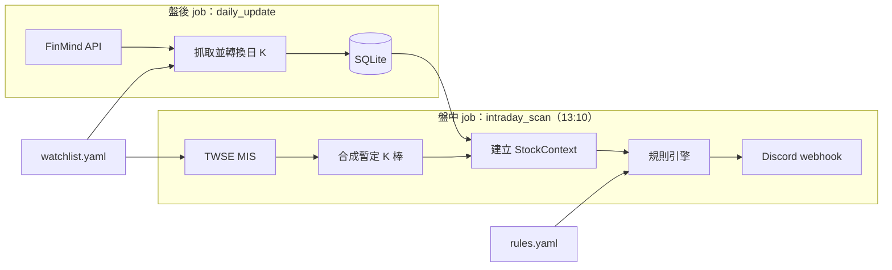

# stock-screener：台股技術面盤中選股系統

在收盤前（預設 13:10）依自訂的技術面規則掃描觀察清單，把符合型態的台股依族群分組推播到 Discord。

> 🚧 開發中：已完成 M0（專案骨架），下一步是 M1（盤後資料）。完整規劃見 [PROJECT_PLAN.md](PROJECT_PLAN.md)。

## 架構



盤後 job 把歷史日 K 寫進 SQLite；盤中 job 以 MIS 即時報價合成今日暫定 K 棒，接在歷史資料後面計算均線、轉折點與趨勢，再交給規則引擎篩選。

## 安裝

需要 Python 3.11 以上。

```bash
python -m venv .venv
```

啟用虛擬環境（Windows 用 `.venv\Scripts\activate`，macOS／Linux 用 `source .venv/bin/activate`）後安裝：

```bash
pip install -e ".[dev]"
```

## 設定

| 檔案 | 內容 |
|---|---|
| `config/watchlist.yaml` | 觀察清單、族群與題材（附範例，請換成自己的清單） |
| `config/rules.yaml` | 趨勢判斷與選股規則的參數 |
| `config/settings.yaml` | 資料庫與 log 路徑、回補天數、MIS 請求頻率 |
| `.env` | FinMind token、Discord webhook URL；從 `.env.example` 複製 |

設定檔載入時會完整驗證：缺少欄位、型別不符、未知欄位，或觀察清單引用了未定義的族群、子分類、題材，都會直接報錯並指出位置。

## 使用

請在專案根目錄執行：

```bash
python -m screener --help
```

| 指令 | 用途 |
|---|---|
| `python -m screener update` | 盤後更新資料庫 |
| `python -m screener scan` | 盤中掃描並推播 |
| `python -m screener scan --dry-run` | 只印在終端，不推播 |
| `python -m screener scan --replay 2026-10-29` | 以該日日 K 當作「今日」重跑，供非交易時段測試與展示 |

安裝後也可以用 `screener` 取代 `python -m screener`。log 寫入 `logs/screener-YYYY-MM-DD.log`。

## 測試

```bash
pytest
```

## 免責聲明

本專案僅供技術研究與作品展示，輸出結果不構成任何投資建議。使用者應自行判斷並承擔投資風險。
