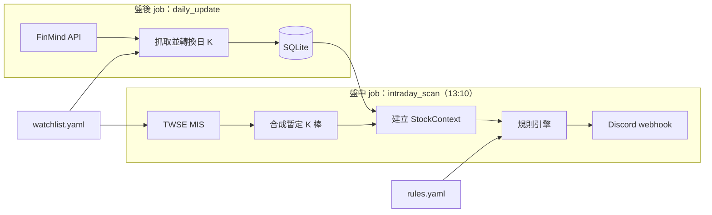

# stock-screener：台股技術面盤中選股系統

在收盤前（預設 13:10）依自訂的技術面規則掃描觀察清單，把符合型態的台股依族群分組推播到 Discord。

> 🚧 開發中：已完成 M5（Discord 推播、錯誤通知與排程），待交易日實測。完整規劃見 [PROJECT_PLAN.md](PROJECT_PLAN.md)。

## 架構



盤後 job 把歷史日 K 寫進 SQLite；盤中 job 以 MIS 即時報價合成今日暫定 K 棒，接在歷史資料後面計算均線、轉折點與趨勢，再交給規則引擎篩選。

## 安裝

需要 Python 3.11 以上。

```bash
python -m venv .venv
```

啟用虛擬環境（Windows 用 `.venv\Scripts\activate`，macOS／Linux 用 `source .venv/bin/activate`）後安裝：

```bash
pip install -e ".[dev]"
```

## 設定

| 檔案 | 內容 |
|---|---|
| `config/watchlist.yaml` | 觀察清單與族群（附範例，請換成自己的清單） |
| `config/rules.yaml` | 趨勢判斷與選股規則的參數 |
| `config/settings.yaml` | 資料庫與 log 路徑、回補天數、FinMind、MIS 與 Discord 的請求頻率、逾時與重試 |
| `.env` | FinMind token、Discord webhook URL；從 `.env.example` 複製。FinMind token 到 [FinMind](https://finmindtrade.com/) 免費註冊取得；webhook 在 Discord 頻道的「編輯頻道 → 整合 → Webhook」建立後複製網址 |

設定檔載入時會完整驗證：缺少欄位、型別不符、未知欄位，或觀察清單引用了未定義的族群、子分類，都會直接報錯並指出位置。

## 使用

請在專案根目錄執行：

```bash
python -m screener --help
```

| 指令 | 用途 |
|---|---|
| `python -m screener update` | 盤後更新資料庫 |
| `python -m screener scan` | 盤中掃描並推播 Discord |
| `python -m screener scan --dry-run` | 只印在終端，不推播 |
| `python -m screener scan --replay 2026-10-29` | 以該日日 K 當作「今日」重跑並推播（標題標示「回放」），供非交易時段測試與展示；加 `--dry-run` 只印在終端 |
| `python -m screener analyze 2330 2454` | 印出轉折點、基本趨勢與破位修正後的趨勢，供檢查分析結果；`--date` 指定「今日」 |

安裝後也可以用 `screener` 取代 `python -m screener`。log 寫入 `logs/screener-YYYY-MM-DD.log`，包含每條觸發規則的細節（例：「實體 10.7%，量比 5.41x，突破 40 日高 97.9」）。

### 盤中掃描（`scan`）

- 以 TWSE MIS 即時報價合成今日暫定 K 棒，接在資料庫的日 K 之後判斷，約 15～25 秒完成。
- 非交易日（MIS 回傳的資料日期不是今天）直接結束，不推播。
- 結果超過 Discord 單則 2000 字時依族群拆成多則；`--dry-run` 印出時以「──── 第 1/2 則 ────」分隔。
- 執行失敗（MIS 無法連線、資料庫不存在、`rules.yaml` 錯誤等）時推送「❌ 盤中選股執行失敗」與原因，避免誤以為只是沒有訊號。
- 未設定 `DISCORD_WEBHOOK_URL` 時無法推播，以結束碼 2 結束；只想看結果請加 `--dry-run`。

### 盤後更新（`update`）

- 第一次執行會為每檔股票回補 `backfill_days`（預設 365）天的日 K，之後只補抓資料庫最後一筆之後的資料，資料庫建在 `data/screener.db`。
- 每檔一次請求。FinMind 免費會員每小時上限 600 次，觀察清單 290 檔首次回補約需 5 分鐘。
- FinMind 每個交易日約 17:30 更新，請在此之後執行。
- 中途失敗（網路、超過請求上限等）時，已寫入的資料會保留，重新執行即可從中斷處繼續；設定了 webhook 時會推送「❌ 盤後更新執行失敗」。成功時不推播。

### 排程（Windows 工作排程器）

```bash
powershell -ExecutionPolicy Bypass -File scripts\register_tasks.ps1
```

註冊兩個週一至週五的工作：`stock-screener-scan`（13:10）與 `stock-screener-update`（21:00）。時間可用 `-ScanTime 13:05 -UpdateTime 19:00` 調整，`-Unregister` 移除。

- 以目前使用者身分執行，電腦須開機且已登入；執行時會出現命令列視窗。
- 錯過的 update（例：當時關機）會在開機後補跑；錯過的 scan 不補跑。
- 國定假日照常觸發，scan 會判定為非交易日後結束。

## 選股規則

規則定義在 [PROJECT_PLAN.md](PROJECT_PLAN.md) 第 3–5 節，參數在 `config/rules.yaml`：

每條規則屬於多方或空方，前置條件只管同方向的規則。推播訊息先列多方、再列空方。

| 方向 | 規則 | 條件 |
|---|---|---|
| 多方 | 前置條件：站上月線 | 現價 > MA20，未通過者不評估任何多方規則 |
| 多方 | E1 多頭突破五日線紅K | 多頭；昨收 ≤ 昨日 MA5、現價 > 今日 MA5；紅 K |
| 多方 | E2 盤整長紅爆量過前高 | 盤整；實體 ≥ 昨收 3%；量 ≥ 昨日 1.3 倍；現價 > 40 日高 |
| 多方 | E3 三線多排 | 不限趨勢；MA5 > MA10 > MA20，只在形成當天觸發 |
| 空方 | 前置條件：跌破月線 | 現價 < MA20，未通過者不評估任何空方規則 |
| 空方 | E4 空頭跌破五日線黑K | 空頭；昨收 ≥ 昨日 MA5、現價 < 今日 MA5；黑 K |
| 空方 | E6 盤整長黑破前低 | 盤整；實體 ≥ 昨收 3%；現價 < 40 日低；不看成交量 |
| 空方 | E5 三線空排 | 不限趨勢；MA5 < MA10 < MA20，只在形成當天觸發 |

### 新增規則

1. 在 `src/screener/rules/entry/` 新增模組（前置條件放 `rules/filters/`）。模組會被自動匯入，不需要修改引擎：

   ```python
   from screener.models import Side, Signal, StockContext
   from screener.rules.base import EntryRule, register_rule
   from screener.rules.conditions import is_red, is_volume_spike


   @register_rule("red_volume_spike")
   class RedVolumeSpike(EntryRule):
       name = "紅K爆量"
       side = Side.LONG                                                      # 多方或空方
       params_schema = {**EntryRule.params_schema, "volume_ratio": float}   # 參數全部必填，載入時檢查型別

       def evaluate(self, ctx: StockContext) -> Signal | None:
           if is_red(ctx) and is_volume_spike(ctx, self.params["volume_ratio"]):
               return self.signal("紅 K 且爆量")
           return None
   ```

2. 在 `config/rules.yaml` 的 `entry_rules` 加入設定，`trends` 為適用的趨勢（空陣列 = 不限）：

   ```yaml
     - id: red_volume_spike
       enabled: true
       params: { trends: [range], volume_ratio: 2.0 }
   ```

3. 在 `tests/rules/` 加上測試。`tests/conftest.py` 的 `make_bars`、`set_bar`、`make_context` 可以快速建立手工 K 棒。

## 測試

```bash
pytest
```

## 免責聲明

本專案僅供技術研究與作品展示，輸出結果不構成任何投資建議。使用者應自行判斷並承擔投資風險。
