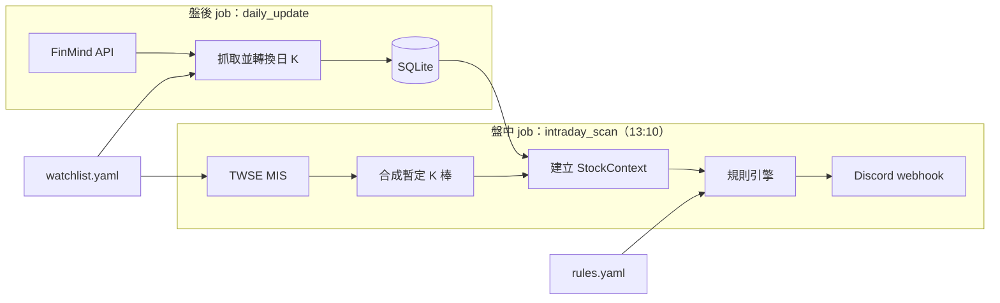

# stock-screener：台股技術面盤中選股系統

在收盤前（預設 13:10）依自訂的技術面規則掃描觀察清單，把符合型態的台股依族群分組推播到 Discord。

> 🚧 開發中：已完成 M0–M9（盤中選股、推播與排程、訊號回測、訊號紀錄與每週成績單、交易回測、全市場資料、單因子研究）。完整規劃見 [PROJECT_PLAN.md](PROJECT_PLAN.md)；M7 起的量化研究規劃見 [RESEARCH_PLAN.md](RESEARCH_PLAN.md)。

## 架構



盤後 job 把歷史日 K 寫進 SQLite；盤中 job 以 MIS 即時報價合成今日暫定 K 棒，接在歷史資料後面計算均線、轉折點與趨勢，再交給規則引擎篩選。

## 安裝

需要 Python 3.11 以上。

```bash
python -m venv .venv
```

啟用虛擬環境（Windows 用 `.venv\Scripts\activate`，macOS／Linux 用 `source .venv/bin/activate`）後安裝：

```bash
pip install -e ".[dev,research]"
```

`research` 是研究功能（`backtest` 的圖表報表）需要的套件；只跑每日的 `update`、`scan` 時可以只裝 `pip install -e .`。

## 設定

| 檔案 | 內容 |
|---|---|
| `config/watchlist.yaml` | 觀察清單與族群（附範例，請換成自己的清單） |
| `config/rules.yaml` | 趨勢判斷與選股規則的參數 |
| `config/settings.yaml` | 資料庫、log 與 MIS 原始快照的路徑、回補天數；FinMind、MIS、Discord 的請求頻率、逾時與重試 |
| `config/backtest.yaml` | 訊號回測的期間、持有天數、交易成本等；只有 `backtest` 會讀取 |
| `config/research.yaml` | 研究指令的設定：`events` 的重查天數與交叉驗證門檻、證交所 ISIN 清單的請求設定、訊號成績單的持有天數與輸出位置、全市場資料（`market`：期間、股票池、請求間隔、`market.db` 的位置）、單因子研究（`factors`：持有天數、分組數、因子清單）；只有研究指令會讀取，寫錯不影響每日的 `update`、`scan` |
| `.env` | FinMind token、Discord webhook URL（`DISCORD_WEBHOOK_URL` 每日選股、`DISCORD_RESEARCH_WEBHOOK_URL` 研究的定期報告，建議另開一個頻道）；從 `.env.example` 複製。FinMind token 到 [FinMind](https://finmindtrade.com/) 免費註冊取得；webhook 在 Discord 頻道的「編輯頻道 → 整合 → Webhook」建立後複製網址 |

設定檔載入時會完整驗證：缺少欄位、型別不符、未知欄位，或觀察清單引用了未定義的族群、子分類，都會直接報錯並指出位置。

## 使用

請在專案根目錄執行：

```bash
python -m screener --help
```

| 指令 | 用途 |
|---|---|
| `python -m screener update` | 盤後更新資料庫 |
| `python -m screener scan` | 盤中掃描並推播 Discord |
| `python -m screener scan --dry-run` | 只印在終端，不推播 |
| `python -m screener scan --replay 2026-10-29` | 以該日日 K 當作「今日」重跑並推播（標題標示「回放」），供非交易時段測試與展示；加 `--dry-run` 只印在終端 |
| `python -m screener analyze 2330 2454` | 印出轉折點、基本趨勢與破位修正後的趨勢，供檢查分析結果；`--date` 指定「今日」 |
| `python -m screener backtest` | 訊號回測：統計每條規則觸發後的報酬，輸出摘要、CSV 與圖表報表 |
| `python -m screener trade-backtest` | 交易回測：照進場與出場規則模擬 30 萬元的帳戶，比較檔數上限與挑選方式；`--validate` 只檢查選定的一組在驗證段的結果 |
| `python -m screener signal-report` | 訊號成績單：上一週推播的訊號，收盤是否仍成立與之後的表現，推播到研究頻道；`--end` 指定期間的最後一天，`--dry-run` 只印在終端 |
| `python -m screener market-update` | 全市場資料：補抓證交所、櫃買中心的每日行情與事件到 `data/market.db`（研究使用）；`--start`、`--end` 只抓指定期間 |
| `python -m screener market-check` | 全市場資料的品質報告：與 `screener.db` 重疊的價格、除權息與減資、報酬指數、異常值、下市與轉上市、基本面資料的涵蓋範圍 |
| `python -m screener factor-report` | 單因子研究：Rank IC、分位數報酬、換手率、衰減、產業中性前後，觀察段與驗證段分列；`--factors` 只跑指定的因子 |

安裝後也可以用 `screener` 取代 `python -m screener`。log 寫入 `logs/screener-YYYY-MM-DD.log`，包含每條觸發規則的細節（例：「實體 10.7%，量比 5.41x，突破 40 日高 97.9」）。

### 盤中掃描（`scan`）

- 以 TWSE MIS 即時報價合成今日暫定 K 棒，接在資料庫的日 K 之後判斷，約 15～25 秒完成。
- 非交易日（MIS 回傳的資料日期不是今天）直接結束，不推播。
- 符合進場規則的股票在訊息中標示「✅ 符合進場」：當天觸發 E1、現價 > 昨日最高價、今日 MA5 > 昨日 MA5，且現價還沒到漲停價。只是標示，不影響觸發結果；不構成投資建議。
- 結果超過 Discord 單則 2000 字時依族群拆成多則；`--dry-run` 印出時以「──── 第 1/2 則 ────」分隔。
- 執行失敗（MIS 無法連線、資料庫不存在、`rules.yaml` 錯誤等）時推送「❌ 盤中選股執行失敗」與原因，避免誤以為只是沒有訊號。
- 未設定 `DISCORD_WEBHOOK_URL` 時無法推播，以結束碼 2 結束；只想看結果請加 `--dry-run`。
- 推播成功後把這次掃描記錄到資料庫：執行紀錄、推播的每個訊號、約 290 檔的報價快照；MIS 原始資料另存 `data/snapshots/`（每次一個壓縮檔，約 45 KB）。`--dry-run` 與 `--replay` 不記錄。紀錄供每週的訊號成績單使用。

### 盤後更新（`update`）

- 第一次執行會為每檔股票回補 `backfill_days`（預設 365）天的日 K，之後只補抓資料庫最後一筆之後的資料，資料庫建在 `data/screener.db`。
- 每檔一次請求。FinMind 免費會員每小時上限 600 次，觀察清單 290 檔首次回補約需 5 分鐘。
- FinMind 每個交易日約 17:30 更新，請在此之後執行。
- 中途失敗（網路、超過請求上限等）時，已寫入的資料會保留，重新執行即可從中斷處繼續；設定了 webhook 時會推送「❌ 盤後更新執行失敗」。成功時不推播。

### 排程（Windows 工作排程器）

```bash
powershell -ExecutionPolicy Bypass -File scripts\register_tasks.ps1
```

註冊兩個週一至週五的工作：`stock-screener-scan`（13:10）與 `stock-screener-update`（21:00），以及兩個每週六的研究工作：`stock-screener-market`（09:00，`market-update`）與 `stock-screener-weekly`（10:00，`signal-report`）。時間可用 `-ScanTime 13:05 -UpdateTime 19:00 -WeeklyTime 09:00 -MarketTime 08:00` 調整，`-Unregister` 移除。

- 以目前使用者身分執行，電腦須開機且已登入；執行時會出現命令列視窗。
- 錯過的 update、weekly、market（例：當時關機）會在開機後補跑；錯過的 scan 不補跑。
- weekly 推播到研究頻道；weekly、market 失敗時錯誤通知也推到研究頻道，不影響每日的 scan、update。
- 國定假日照常觸發，scan 會判定為非交易日後結束。

### 訊號回測（`backtest`）

以歷史日 K 逐日回放規則（收盤 K 棒），統計每條規則觸發後持有 1、3、5、10、20 日的報酬，並與同一天整個觀察清單的平均比較（超額報酬）。只看觸發訊號、不模擬交易。定義見 [PROJECT_PLAN.md](PROJECT_PLAN.md) 14.1。

第一次使用前先準備資料；之後每天的 `update` 會自動補上新的日 K，但除權息與公司行動不會，每次回測前先執行 `events`：

```bash
python -m screener update --since 2020-06-01
```

```bash
python -m screener events
```

`update --since` 把日 K 往前回補（每檔一次請求，約 5 分鐘）。`events` 抓取除權息、減資與面額變更（每檔三次請求，免費方案每小時約可查 200 檔，超過上限時中止，一小時後重新執行會從中斷處繼續，當天已查過的股票不會重複查詢），以及證交所 ISIN 清單的上市日／上櫃日，完成後以官方的除權息參考價交叉驗證。

```bash
python -m screener backtest
```

- 290 檔、約 6 年的資料以多個行程平行計算，約 5 分鐘。每次都算到資料庫的最後一天，並覆寫 `data/backtest/` 的輸出。
- 除權息資料只查到上次執行 `events` 的那天；有股票的日 K 比它新時，摘要開頭與 log 會提醒先執行 `events`（之後的除權息沒有還原，報酬可能有誤），但照常回測。
- 最近的訊號要等持有天數走完才會列入該天數的統計（例：持有 20 日要等 20 個交易日後重跑）。
- 報酬以還原權息後的價格計算（有官方除權息結果時以官方前後價格為準）；判斷訊號仍用未還原價格，與每日推播一致，另以還原價重算一次作為對照。
- 掛牌（上市日／上櫃日）前的興櫃交易與掛牌後前五個交易日沒有漲跌幅限制，不產生訊號、也不列入基準。不在證交所清單中的股票（例：已下市）無法排除，照常回測並在 log 警告。
- 2025 年以前為觀察段、之後為驗證段；同時列出去重（同檔同規則 5 個交易日內只算第一次）、排除收盤漲跌停鎖死、排除計算區間內有跳空事件的結果。
- 輸出到 `data/backtest/`：`signals.csv`（每個訊號一列）、`summary.csv`（所有分組的統計）、`report.html`（總覽熱圖、觀察段 vs 驗證段、累積超額報酬、最大有利／不利幅度，用瀏覽器開啟）。
- `--rules-file` 用另一份規則檔回測，不影響每日推播；`--rules` 只回測指定的規則；`--horizon` 改變摘要使用的持有天數。

### 交易回測（`trade-backtest`）

照進場規則（當天 E1、現價 > 昨日最高價、MA5 上揚，收盤買進）與出場規則（收盤跌破 MA5 或第 5 個交易日賣出）模擬一個帳戶。設定在 `config/backtest.yaml` 的 `trade`，規則在 `config/rules.yaml` 的 `entry_rules`、`exit_rules`；定義見 [RESEARCH_PLAN.md](RESEARCH_PLAN.md) 4.2。需要的資料與訊號回測相同，先執行 `events`。

```bash
python -m screener trade-backtest
```

- 預設只跑觀察段（2021～2024），比較同時最多 3、5、10 檔與挑選方式（距 MA5 最近、量比最大、隨機 100 次）。約 2～3 分鐘。
- 初始資金 30 萬元，單筆金額 = 當天權益 ÷ 檔數上限，買零股；手續費 2.8 折、每筆最低 20 元，賣出證交稅 0.3%，不計滑價。
- 輸出到 `data/backtest/trade/observe/`：`summary.csv`（每種組合的報酬、回撤、勝率、資金使用率等）、`trades.csv`（每筆交易的股數、金額、手續費、損益與賣出原因）、`equity.csv`（每天的現金、持股市值、權益）、`report.html`（權益曲線含隨機挑選的範圍與基準、回撤）。
- 確認結果的方法：在 `trades.csv` 挑幾筆對照線圖與手算損益；`equity.csv` 每天的權益 = 現金 + 持股市值，期末權益 − 30 萬 = 所有損益的合計；固定的挑選方式落在隨機的 5%～95% 範圍內時，代表看不出挑選能力。
- 在觀察段選定一組後，才看那一組的驗證段（[PROJECT_PLAN.md](PROJECT_PLAN.md) D32），輸出到 `data/backtest/trade/validate/`：

```bash
python -m screener trade-backtest --validate --max-positions 5 --pick nearest_ma
```

#### 定期更新（建議每月一次）

日 K 每天由排程的 `update` 自動補上，除權息與回測統計要手動更新。回測涵蓋 2021 年至今，一個月只讓驗證段多約 20 個交易日（約 4%），數字變動很小，每月更新一次就夠；訊號成績單的「M6 驗證段」也是讀這裡的 `summary.csv`。

建議在每月第一個週六下午執行：週報（10:00）已經跑完，也避開 13:10 的盤中掃描與 21:00 `update` 使用的 FinMind 額度。依序執行：

```bash
python -m screener events
```

`events` 約需 870 次請求，超過免費方案每小時 600 次的上限，第一次會中途停下。一小時後再執行一次同一個指令，會從中斷處繼續；log 出現「事件更新結果」且沒有「抓取失敗」才算完成。接著：

```bash
python -m screener backtest
```

- 先 `events` 再 `backtest`：回測只會還原到 `events` 最後一次執行的那天，順序相反時，近期的除權息會被當成下跌（摘要開頭會提醒）。
- `backtest` 會覆寫 `data/backtest/`；想保留上一次的結果對照，先把整個資料夾複製一份。
- 驗證段只用來檢查，不要依更新後的驗證段結果調整參數（[PROJECT_PLAN.md](PROJECT_PLAN.md) D32）。

不等到月初、要立即重跑的情況：

- 修改 `rules.yaml` 或想試新規則、新參數：先用 `--rules-file` 另一份規則檔回測，確認後再改 `rules.yaml`，改完再跑一次正式的 `backtest`，讓成績單對照的是新規則的結果。
- 觀察清單新增股票：新股票只有 `update` 回補的一年日 K，先往前回補，再依序執行 `events`、`backtest`：

  ```bash
  python -m screener update --since 2020-06-01
  ```

- 除權息旺季（每年 6～9 月）結束後：事件多，9 月底更新一次，讓近期訊號的報酬正確還原。

### 單因子研究（`factor-report`）

檢驗「哪些可以算成分數的特徵，能預測之後的報酬」：以全市場的動態股票池計算每個因子，並把現有的技術規則改寫成連續分數。定義見 [RESEARCH_PLAN.md](RESEARCH_PLAN.md) 4.4、4.5。

```bash
python -m screener factor-report
python -m screener factor-report --factors ep,mom_12_1   # 只跑指定的因子
```

- 因子清單在 `config/research.yaml` 的 `factors.definitions`：動能、短期反轉、波動、流動性、現有規則的分數（站上均線的程度、量比、長紅長黑、距前高前低、均線排列、趨勢標籤）、月營收、本益比與淨值比、規模、週轉率。新增因子只要寫一個函式並以 `@register_factor` 註冊。
- 指標：Rank IC、ICIR、t 值（每 h 天取一次）、5 組的分位數報酬（另列排除當天收漲跌停）、換手率與扣成本後的超額、1～20 日的 IC 衰減、產業中性前後的比較。觀察段與驗證段分列；只用當時可得的資料（月營收在次月 10 日之後才能用，產業別用當時的分類）。
- 輸出：終端摘要，以及 `data/research/factors/` 的 `summary.csv`、`ic.csv`、`decay.csv`、`groups.csv` 與 `report.html`。

### 全市場資料（`market-update`、`market-check`、`--universe market`）

觀察清單是依目前的熱門族群挑的，回測結果有選擇偏差。全市場資料以證交所、櫃買中心的每日收盤行情建立 2015 年起所有上市、上櫃普通股的日 K（含之後才下市的股票），每月依成交金額取前 500 檔當作股票池，用相同的規則重跑回測並和觀察清單並列。定義見 [RESEARCH_PLAN.md](RESEARCH_PLAN.md) 4.3。

```bash
python -m screener market-update
```

- 第一次從 2015-01-01 開始回補：每個交易日上市、上櫃各一次請求，兩邊各自每 5 秒一次，共約 6,600 次、約 4.5 小時（2026-11 實測約 4 小時，沒有被限制連線）；中斷或電腦睡眠後重新執行會從中斷處繼續。建議在週末執行，避開 13:10 的盤中掃描（同一個 IP 也會連證交所的 MIS）。
- 之後由排程每週六 09:00 補抓上一週（`stock-screener-market`）。只抓到昨天：當天的行情可能還沒公布。
- 資料存在 `data/market.db`（研究專用，每日的 `scan`、`update` 不讀取），原始回應另存 `data/research/market_raw/`（壓縮檔，約 200 MB）。
- 交易日以交易所的回應判斷，並與 FinMind 的交易日曆互相檢查（2016～2018 年有週六的補班交易日）。
- 月營收與當時的產業別（公開資訊觀測站）、本益比、淨值比、殖利率與發行股數（每月第一個交易日取樣）併入同一個指令，供單因子研究使用，第一次約 1,000 次請求、約 50 分鐘；之後每週補上。
- 除權息、減資以證交所、櫃買中心的官方前後價格還原，面額變更用 FinMind；除權息日的行情不提供漲跌，推不出參考價，只在沒有官方資料時以行情推出的參考價補上。

```bash
python -m screener market-check
```

- 終端印出摘要，明細寫到 `data/research/market_check/*.csv`：與 `screener.db` 重疊的開高低收與成交量（上櫃成交量照櫃買中心的口徑，與 FinMind 不同）、官方事件與行情標示的對應、報酬指數與月表、異常值與中斷、下市日、轉上市與新掛牌、證券分類。

```bash
python -m screener backtest --universe market
```

```bash
python -m screener trade-backtest --universe market
```

- 股票池：每月第一個交易日，依之前 60 個交易日的平均成交金額（沒有成交的日子算 0）取前 500 檔；只有當月股票池內的股票產生訊號、進場與列入基準，已經發出的訊號照常算到期滿。
- 訊號從 2015-07 起算（轉折點要 120 根計算區間）；觀察段 2015-07～2024，驗證段 2025 起。
- 另以相同規則重跑觀察清單，在 2021-01 起的期間並列：基準（每天等權）的年化報酬、各規則的平均與超額報酬、交易回測各組合的帳戶結果。
- 輸出到 `data/backtest/market/`（交易回測在 `trade/observe/`、`trade/validate/`），另有並列的 `comparison.csv`。訊號回測約 23 分鐘、交易回測約 10 分鐘（含並列的觀察清單）。

### 訊號成績單（`signal-report`）

每週整理 `scan` 實際推播的訊號（每天只用第一次推播），回答兩個問題：13:10 推播的訊號到收盤還成立嗎？推播後的表現如何？定義見 [RESEARCH_PLAN.md](RESEARCH_PLAN.md) 4.1。

```bash
python -m screener signal-report --dry-run
```

- 期間為上一週的週一到週五（`--end` 指定期間的最後一天）；需要 `update` 已寫入期間內的日 K。
- 盤中 vs 收盤：以收盤 K 棒與目前的 `rules.yaml` 重算訊號，同一天、同一檔、同一規則比對；推播時的規則檔不同時會標註。
- 報酬以 13:10 的現價進場，持有到該週最後一個交易日收盤（本週），以及持有 1、5 日（累積，天數在 `research.yaml`）；空方取負號。基準為同一天所有有快照的股票以 13:10 現價進場的平均。
- 除權息：持有期間內某天的 MIS 參考價與前一日收盤不同時，以兩者的比例調整；沒有快照的日子改用 `events` 抓取的事件資料。
- 有 M6 回測結果（`data/backtest/summary.csv`）時，累積的每條規則附上 M6 驗證段的平均超額報酬作為參考。
- 輸出：推播到研究頻道（`DISCORD_RESEARCH_WEBHOOK_URL`，未設定時以結束碼 2 結束；`--dry-run` 除外），以及每個訊號一列的明細 `data/research/signal_report/<期間最後一天>.csv`。

## 選股規則

規則定義在 [PROJECT_PLAN.md](PROJECT_PLAN.md) 第 3–5 節，參數在 `config/rules.yaml`：

每條規則屬於多方或空方，前置條件只管同方向的規則。推播訊息先列多方、再列空方。

| 方向 | 規則 | 條件 |
|---|---|---|
| 多方 | 前置條件：站上月線 | 現價 > MA20，未通過者不評估任何多方規則 |
| 多方 | E1 多頭突破五日線紅K | 多頭；昨收 ≤ 昨日 MA5、現價 > 今日 MA5；紅 K |
| 多方 | E2 盤整長紅爆量過前高 | 盤整；實體 ≥ 昨收 3%；量 ≥ 昨日 1.3 倍；現價 > 40 日高 |
| 多方 | E3 三線多排 | 不限趨勢；MA5 > MA10 > MA20，只在形成當天觸發 |
| 空方 | 前置條件：跌破月線 | 現價 < MA20，未通過者不評估任何空方規則 |
| 空方 | E4 空頭跌破五日線黑K | 空頭；昨收 ≥ 昨日 MA5、現價 < 今日 MA5；黑 K |
| 空方 | E6 盤整長黑破前低 | 盤整；實體 ≥ 昨收 3%；現價 < 40 日低；不看成交量 |
| 空方 | E5 三線空排 | 不限趨勢；MA5 < MA10 < MA20，只在形成當天觸發 |

### 新增規則

1. 在 `src/screener/rules/trigger/` 新增模組（前置條件放 `rules/filters/`）。模組會被自動匯入，不需要修改引擎：

   ```python
   from screener.models import Side, Signal, StockContext
   from screener.rules.base import TriggerRule, register_rule
   from screener.rules.conditions import is_red, is_volume_spike


   @register_rule("red_volume_spike")
   class RedVolumeSpike(TriggerRule):
       name = "紅K爆量"
       side = Side.LONG                                                        # 多方或空方
       params_schema = {**TriggerRule.params_schema, "volume_ratio": float}    # 參數全部必填，載入時檢查型別

       def evaluate(self, ctx: StockContext) -> Signal | None:
           if is_red(ctx) and is_volume_spike(ctx, self.params["volume_ratio"]):
               return self.signal("紅 K 且爆量")
           return None
   ```

2. 在 `config/rules.yaml` 的 `trigger_rules` 加入設定，`trends` 為適用的趨勢（空陣列 = 不限）：

   ```yaml
     - id: red_volume_spike
       enabled: true
       params: { trends: [range], volume_ratio: 2.0 }
   ```

3. 在 `tests/rules/` 加上測試。`tests/conftest.py` 的 `make_bars`、`set_bar`、`make_context` 可以快速建立手工 K 棒。

## 測試

```bash
pytest
```

## 免責聲明

本專案僅供技術研究與作品展示，輸出結果不構成任何投資建議。使用者應自行判斷並承擔投資風險。
