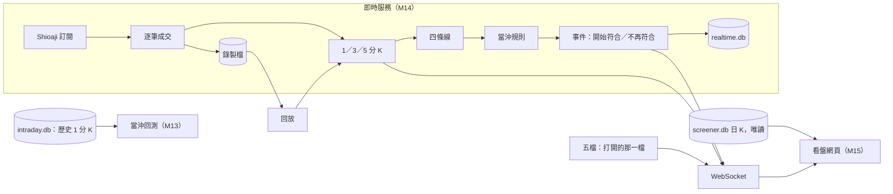

# 台股盤中即時系統：規劃書

> 版本：v0.6（2026-11-20）｜狀態：M12 完成（2026-11-19，7.1 實測結果）；M13 實作中：回補（`rt-backfill`）與品質檢查（`rt-check`）完成，試補 3 檔（7.2 的結果），全面回補待第一次合併後的排程；M14–M16 未開始
>
> 本文件規劃 M12 起的盤中即時系統：以永豐金證券的 Shioaji API 接收即時報價，依使用者的當沖規則，在本機的看盤網頁列出符合條件的股票；自動下單（M16）待使用者決定。每日選股系統與共用部分以 `PROJECT_PLAN.md` 為準，研究功能以 `RESEARCH_PLAN.md` 為準；三者的邊界見 PROJECT_PLAN.md 10.4 與本文件 4.2，必須遵守。標記「⚠️ 待確認」的項目是使用者尚未拍板的決定：請採用文中預設值，並保持可在設定檔調整。

---

## 0. 給 Claude 的閱讀指引

- 先讀 `PROJECT_PLAN.md`（尤其 10.4 邊界、第 13 節開發準則、15.1 決策），再讀本文件。
- K 棒與四條線的定義（第 2 節）以本文件為準，已和使用者看盤用的「台股大學堂」對照驗證（2.3）。定義不清時先詢問，不要自行詮釋。
- 每個里程碑開始前，先在本文件寫好該里程碑的規格給使用者確認，確認後才開分支實作（同 `RESEARCH_PLAN.md` 第 0 節）。
- **下單**：使用者明確決定前，不實作任何下單功能（`CLAUDE.md`、PROJECT_PLAN.md 第 0 節）。決定之後，Claude 也只撰寫程式、以假的下單介面測試；模擬環境的 API 測試、憑證的啟用與密碼、正式環境的下單都由使用者操作（第 6 節）。
- 不使用付費 API。Shioaji 對永豐金證券的客戶免費，但有流量與次數限制（第 3 節）。
- 研究與回測結果只描述統計，不構成投資建議。

---

## 1. 目標與範圍

### 1.1 目標

盤中以 Shioaji 接收逐筆成交與五檔報價，依使用者的當沖規則即時判斷，在看盤網頁的側邊欄列出符合條件的股票；點選後顯示必要的即時資訊。之後視使用者的決定加入下單（M16）。

使用情境：

- 交易日開盤前，排程啟動即時服務，盤中持續執行，收盤後結束（時間可調）。
- 在本機的瀏覽器開啟看盤網頁；外出時透過私人網路連回（第 5 節）。
- 13:10 的每日選股（PROJECT_PLAN.md）照常執行、不受影響，也是即時系統故障時的備援（L8）。

作品集展示重點：

- 事件驅動的即時資料管線：逐筆成交 → K 棒 → 指標 → 規則 → 網頁。
- 錄製與回放：盤後可以完全重現當天的結果，收盤後也能開發與測試。
- 和看盤軟體逐根對照的驗證（2.3）；回測沒有前視偏差（2.4）。

### 1.2 範圍與非目標

| 範圍內 | 非目標（目前不做） |
|---|---|
| 上市、上櫃普通股的現股當沖；候選股從觀察清單挑選（L11），篩選到訂閱上限以內的方法 ⚠️ 待確認（Q1） | 期貨、選擇權、ETF、權證、興櫃、零股 |
| 看盤網頁：側邊欄、1 分 K 與四條線、五檔、成交明細（第 5 節） | 複製市面看盤軟體的完整功能（技術指標庫、新聞、籌碼等）；手機 APP（手機用瀏覽器） |
| 盤中資料研究與當沖回測（M13） | 秒以下的高頻策略 |
| 錄製與回放：盤後重現當天的逐筆成交與結果 | 付費資料；對外公開的網站；下單（使用者決定前不做，⚠️ 待確認 Q5，第 6 節） |

### 1.3 以台股大學堂為準

使用者以「台股大學堂」看盤，當沖規則是在它的圖上練出來的。系統的 K 棒與指標必須和台股大學堂一致，否則同一條規則在兩邊會得到不同的結果（L3）。M12 逐根對照，之後發現不一致時，以台股大學堂為準修正，並記錄在本文件。

---

## 2. K 棒與指標的定義

### 2.1 K 棒

| 項目 | 定義 |
|---|---|
| 1 分 K | 涵蓋該分鐘的 00～59 秒：09:00:00～09:00:59 為第一根，09:01:00 的成交算下一根 |
| 時間標示 | 以開始時間標示（「09:00」那根 = 09:00:00～09:00:59），程式內部一律存開始時間。台股大學堂「技術分析」畫面的 1 分 K 以結束時間標示（同一根顯示為 09:01），對照時要換算 |
| 開盤 | 09:00:00 的開盤成交算在 09:00 那根 |
| 試撮 | 開盤前、緩漲、緩跌、收盤前的試撮都不畫 K 棒，也不計入成交量與均價線 |
| 沒有成交 | 該分鐘不畫 K 棒，不補量為 0 的 K 棒。均線取的是最近 N 根「有成交」的 K 棒 |
| 收盤 | 13:25～13:29 只有試撮，不畫 K 棒；13:30:00 的收盤成交自成一根「13:30」 |
| 3 分、5 分 K | 從 09:00 對齊（3 分 K：09:00:00～09:02:59、09:03:00～09:05:59……；5 分 K：09:00:00～09:04:59……），切法同 1 分 K。13:30 的收盤成交在 3 分、5 分 K 也各自成一根 |
| 成交的範圍 | 只計一般的整股交易，零股、盤後定價不計入。Shioaji 的歷史逐筆成交含 14:30 的盤後定價一筆，以「13:30 那一分鐘之後的成交不計入」排除；歷史分 K 不含（T5、T6）。即時成交的零股、試撮以 `intraday_odd`、`simtrade` 標示；`simtrade` 涵蓋開盤前、收盤前、緩漲緩跌與處置股分盤交易的全部試撮（2026-11-19 錄製日，T8） |

### 2.2 四條線

四條線都畫在同一張 1 分 K 圖上。週期與顏色放在設定檔。

| 線 | 顏色 | 定義 | 還沒走完的 K 棒 | 畫法 |
|---|---|---|---|---|
| 3MA | 藍 | 3 分 K 最近 3 根收盤價的簡單平均，延續前一交易日的 K 棒（L5） | 跟著現價移動：前 2 根已走完的 3 分 K 收盤與現價的平均（即時值）；走完時固定為該根的值（L5）。規則用哪一個值 ⚠️ 待確認（Q12） | 階梯線：每根 3 分 K 一個值，畫在它涵蓋的 1 分 K 上。形成中的那根只畫開頭的垂直線，終點跟著即時值上下移動；走完後才往右畫水平線 |
| 5MA | 金 | 5 分 K 最近 5 根收盤價的簡單平均，其餘同 3MA | 同 3MA：前 4 根已走完的 5 分 K 收盤與現價的平均 | 同 3MA |
| 均價線 | 銀 | 當天 09:00 起累積成交金額 ÷ 累積成交量（L6） | 每筆成交都更新 | 連續線 |
| VP | 粉 | 當天成交量最大的那根 1 分 K 的收盤價；開盤那根也算；量相同時維持原本那根，超過就換（L7） | 正在形成的 K 棒量超過目前最大量時立刻換成它，VP 跟著現價移動，這根走完才固定 | 整張圖一條水平線，換 K 棒時整條跳到新的價位 |

- VP 在 09:00 那根走完（09:01）時第一次出現。量只會增加，一根 K 棒成為最大量後不會被自己比下去，不會來回切換。
- 13:30 的收盤成交量是全天最大時，VP 在收盤時跳到收盤價。
- 延續前一交易日：09:00 那根 3 分 K 的 3MA = 前一交易日最後兩根 3 分 K（其中最後一根是 13:30 那根，收盤價即昨收）與今天第一根的平均。中間遇到假日時接前一個交易日。即時服務開盤前要先準備好前一交易日的分 K（M14）。
- 均線不足 N 根時（延續前一交易日後，只有新掛牌第一天等少數情況）：不畫，用到的規則視為不成立，同 PROJECT_PLAN.md D23（L13）。
- 價格不還原：除權息日開盤後的頭幾根 3MA、5MA 會混到除權息前的價格，同 PROJECT_PLAN.md D8 的限制。台股大學堂應該也是如此，遇到除權息的股票時對照確認。

### 2.3 和台股大學堂的對照（2026-11-18）

使用者提供台股大學堂歷史畫面的數值（同一檔股票；前一交易日 13:24 收 56.3、收盤 56.5；當天 1 分 K 收盤：09:02 57.0、09:04 56.9、09:05 57.4、09:08 57.8、09:09 56.9、09:14 58.4、09:19 57.9、09:24 56.5）：

| 項目 | 依 2.2 計算 | 台股大學堂 |
|---|---|---|
| 3MA 09:00～09:02 | (56.3 ＋ 56.5 ＋ 57.0) ÷ 3 = 56.60 | 56.6 |
| 3MA 09:03～09:05 | (56.5 ＋ 57.0 ＋ 57.4) ÷ 3 = 56.97 | 57.0 |
| 3MA 09:06～09:08 | (57.0 ＋ 57.4 ＋ 57.8) ÷ 3 = 57.40 | 57.4 |
| 5MA 09:20～09:24 | (56.9 ＋ 56.9 ＋ 58.4 ＋ 57.9 ＋ 56.5) ÷ 5 = 57.32 | 57.3 |

- 均線是一般的簡單平均，包含該根自己的收盤，並延續前一交易日。前一交易日 13:24 之後的下一根就是 13:30：收盤成交自成一根，試撮不畫 K 棒。
- 「只平均之前已走完的 K 棒」不符：那樣 09:09～09:11 那一階約 57.4，圖上約 57.7。
- 5MA 在 09:15～09:24 是平的：09:20 那一階加進來的 09:24 收盤 56.5，剛好等於被擠出去的前一交易日 13:30 那根。
- 均價線的數字符合「累積成交金額 ÷ 累積成交量」（例：09:00 均價 58.2、量 1,617 張，09:01 均價 57.9、量 939 張，推得 09:01 那根的均價約 57.4，與那根 K 棒相符）。
- 歷史畫面看不出盤中的行為，由使用者在台股大學堂盤中確認：3MA、5MA 形成中跟著現價移動（垂直線上下移動），走完才往右畫（L5，2026-11-19 更正 2026-11-18 的「走完才畫」）；VP 跟著現價移動（L7）。走完後的值不變，所以本節的對照與 7.1 的 A 對 C 都不受影響。
- 盤中即時值的對照（2026-11-19，4951，使用者的兩張截圖與當天的錄製檔）：09:24:05 藍 72.1、金 72.8、均價線 72.8、VP 71.9、總量 29 張；09:26:49 藍 71.8、金 72.3、均價線 72.8、VP 71.9、總量 30 張，和依 2.2 算出的即時值全部相同。09:26:49 時 09:24 那根 3 分 K 形成中、現價 71.7：(71.9 ＋ 71.8 ＋ 71.7) ÷ 3 = 71.8，走完的值是 72.1；09:25 那根 5 分 K 形成中：(73.0 ＋ 73.3 ＋ 71.9 ＋ 71.8 ＋ 71.7) ÷ 5 = 72.34，走完的值是 72.78。畫面上的是即時值。
- 使用者原本設定均線不延續前一交易日、且跟著現價即時變動，看到對照結果後改為現在的定義（L5）。

### 2.4 前視偏差

歷史圖上 09:06～09:08 畫著 57.4，但這個值要等 09:08 那根走完（09:09）才知道。時間 t 的 3MA、5MA 有兩種不會用到 t 以後資料的值，規則用哪一個 ⚠️ 待確認（Q12）；VP 與均價線用 t 當下的值。

| 值 | 時間 t 的值 | 當天第一根 3 分、5 分 K 走完之前（例：09:00～09:02） | `rt-bars` 的欄位 |
|---|---|---|---|
| 即時值 | 最近 N − 1 根已走完的收盤與現價的平均：台股大學堂畫面上當下的線（L5） | 前一交易日最後 N − 1 根的收盤與現價的平均 | `*_live` |
| 走完的值 | 最後一根已走完的 N 分 K 的值 | 前一交易日最後一根的值（L17） | `*_known` |

- 兩種值在 N 分 K 走完的那一刻相同，都等於歷史圖上那一階的值（`*_drawn`）。
- 即時服務記錄每分鐘當下的四條線，兩種值都記錄（M14），回放與回測用同樣的方式計算。
- 回測從歷史 1 分 K 重算時，不能用畫在 t 上方的那一階（M13）：走完的值照「走完的時間」取值；即時值以 1 分 K 的收盤代入，只算得到每分鐘結束時的值，分鐘之內的值要用逐筆成交。

---

## 3. 資料來源：永豐金證券 Shioaji

Python 套件 `shioaji`，以 API Key 與 Secret Key 登入（放在 `.env`，4.2）。下表的「官方文件」是 2026-11-17 閱讀官方文件（sinotrade.github.io）的內容；「M12 實測」是 2026-11-18 盤後（`rt-probe`）與 2026-11-19 錄製日（`rt-record`）以 Shioaji 1.7.11 實測的結果（7.1）：

| 項目 | 官方文件 | M12 實測 |
|---|---|---|
| 即時訂閱 | `subscribe` 上限 200 個；只在開盤時段推送；不佔流量 | 盤後逐一訂閱 201 檔的成交，再訂 1 檔的五檔，202 個都回應「Subscribe or Unsubscribe ok」，沒有錯誤：盤後不會擋超過的訂閱。錄製日（2026-11-19）：2 個連線共 293 個訂閱（第 1 個連線 197 檔成交＋3 檔五檔＝200 個、第 2 個連線 93 檔成交）都成功，兩個連線整天都收到推送，290 檔都有成交：**上限不是每個帳戶合計 200 個**，2 個連線就能訂閱整份觀察清單。單一連線盤中超過 200 個、成交與五檔是否各算 1 個、超過時的回應未測（T7）。訂閱的推送不算流量：整天 70.5 萬筆成交，`usage()` 只有約 406 KB |
| 查詢（snapshots、ticks、kbars 等） | 合計每 10 秒 50 次；盤中查 ticks 最多 10 次、kbars 最多 270 次；文件說明這些是盤後分析用，盤中請用訂閱 | 一次 snapshots 290 檔可以（50、100、200、290 都回傳全部，T4）。實測沒有遇到次數限制（查詢間隔 0.3 秒） |
| 流量 | 依近 30 日以 API 成交的金額：0 → 每天 500MB；1 元～1 億 → 2GB；1 億以上 → 10GB；開盤日 08:00 重置；超過時查詢回傳空值，其他功能不受影響 | 上限 500 MB（T1）。錄製檔每天約 43.5 MB（290 檔的成交＋3 檔的五檔，gzip）。分 K 每檔每天約 13.5 KB（30 天一次查）～19 KB（1 天）；逐筆成交約 40 bytes／筆（1303 南亞 35,733 筆 1.4 MB、2330 台積電約 590 KB、4951 精拓科 113 筆 9 KB）；快照 290 檔約 40～85 KB。登入時下載合約不算流量；重複的查詢由本機的快取（使用者目錄的 `.shioaji`）回應，不算流量。`usage()` 約每 5 秒才更新一次，每次呼叫本身約 0.7 KB（T2）。M13 試補 3 檔（2020-06 起 234 次查詢）：每個股日約 8.7 KB（平均 161 根，約 54 bytes／根）。全面回補 430,037 個股日（2020-06-01 或上市櫃日起，L25）× 約 10.5 KB ≈ 4.2 GB，每天用到 450 MB 停止，約 10 個交易日（7.2 的結果） |
| 連線與登入 | 同一身分證最多 5 個連線；每天登入 1,000 次 | 登入時自動下載合約（股票 3,185 檔，含興櫃；0.3 秒內可用），不能再呼叫 `fetch_contracts`（兩者同時進行時失敗：exclusive access lost）。預設的事件處理會把連線資訊印到終端，內容含身分證字號與對外 IP：程式在登入前換掉，log 與錄製檔中遮蔽。Shioaji 自己的 log 以環境變數 `SJ_LOG_PATH` 指定（檔案路徑），沒有設定時寫在目前的目錄。錄製日（T9、T10）：宿舍網路 08:03 登入 2 個連線，到 13:35 沒有斷線（`session_down` 0 次，除了訂閱的回應沒有其他連線事件），盤中收到成交的最大空檔 0.9 秒，不需要重新認證網路。斷線後的自動恢復沒有遇到，手動斷網未測 |
| 超過次數 | 查詢次數超過時暫停一分鐘；一天內多次超過，可能暫停 IP 與帳號 | 沒有遇到 |
| 歷史資料 | 股票從 2020-03-02 起；kbars 每次查詢不超過 30 天；ticks 每次一個交易日 | **kbars**（T5）：以**結束時間**標示（09:01 = 09:00:00～09:00:59），最後一根 13:30 是收盤成交；欄位 ts、Open、High、Low、Close、Volume（張）、Amount（元）。**當天**查詢的分 K 每分鐘都有一根：沒有成交的分鐘與 13:26～13:29 補上量為 0 的 K 棒（開高低收等於前一根收盤），共 270 根；**之前的日子**沒有量為 0 的 K 棒（4977 近 19 個交易日 219～266 根）。合起來的開高低收和 `screener.db` 的日 K 相同，量是日 K 的 97～99%（日 K 含零股、盤後定價、鉅額交易，D21）。轉換成第 2 節的定義：標示減 1 分鐘（13:30 維持）、刪除量為 0 的 K 棒，和逐筆成交組的 1 分 K 完全相同（3 檔 × 2026-11-18，`rt-bars --source ticks`）。ts 是把台灣時間當成 UTC 編碼的奈秒 |
| 逐筆成交 | `simtrade` 欄位標示試撮 | **歷史 ticks**（T6）：欄位 ts、close、volume（張）、bid／ask 的價與量、tick_type（1 外盤、2 內盤）；沒有試撮的標示，也沒有試撮（開盤前與 13:25～13:29 都沒有資料）；時間到微秒；開盤第一筆不一定在 09:00:00（4977 為 09:00:07.6）；收盤一筆在 13:30:00；另有 14:30:00 的盤後定價一筆。**即時成交**（`TickSTKv1`，錄製日 T8）：有 simtrade、intraday_odd、suspend、avg_price、total_volume、chg_type 等欄位。`simtrade` 標示全部的試撮：開盤前 08:30～08:59（284 檔）、收盤前 13:25～13:29（287 檔）、盤中 37 檔（33 檔是 2～9 分鐘的緩漲、緩跌，4 檔處置股 6108、6140、7717、3441 整天分盤交易）；排除後組的 1 分 K 和當天的歷史分 K **290 檔全部相同**。成交量單位張、成交金額元，時間到微秒；tick_type 1 外盤、2 內盤、0 開盤的集合競價；開盤第一筆在 09:00:00～09:00:30 之間陸續出現（12 檔超過 1 分鐘才有第一筆）；收盤一筆標示 13:30:00，但最晚 13:30:40 才收到；13:30 之後到 13:35 沒有其他成交。只訂整股，沒有零股。chg_type 1 漲停、5 跌停。**即時五檔**：試撮時也有，以 `simtrade` 標示；跌停時買一是跌停價，買二到買五為 0 |
| API key | 可分別勾選權限：行情／資料、帳務、交易、正式環境；建議設 IP 限制；Secret Key 只在建立時顯示一次 | — |
| 正式下單的前提 | 簽署相關文件；在模擬環境完成 API 測試報告（登入與下單）；啟用憑證（`activate_ca`） | 帳戶 `signed=False` 時，正式環境仍可登入並取得快照、歷史分 K、逐筆成交與訂閱（T1）：**只看行情不需要簽署與 API 測試**。下單時才需要（M16） |
| 合約 | — | 觀察清單 290 檔全部查得到，市場別與 `watchlist.yaml` 相同；名稱有 * 的 4 檔是做過面額變更的（6531、2327、6415、5536）。有參考價、漲跌停價（`reference`、`limit_up`、`limit_down`）與可否現股當沖（`day_trade`）：2026-11-18 為 Yes 280 檔、No 7 檔（含處置股 6108、7717、3441、6140）、OnlyBuy 3 檔（只能先買後賣）；另有處置、注意股的欄位（`disposition_level`、`attention_flag`）（T3） |
| 模擬環境 | 可訂閱行情、查詢與下單；不支援興櫃與零股 | 未測：行情用正式環境即可 |

- M12 到 M15 只需要一把只有「行情／資料」權限的 API key，建議設 IP 限制。有「交易」權限的 key 等 M16 決定後另外建立。
- 13:10 的每日選股繼續用 MIS，不改用 Shioaji（L8）。

---

## 4. 系統架構與邊界

### 4.1 架構



### 4.2 與每日系統、研究功能的邊界

即時系統是 PROJECT_PLAN.md 10.4 之外的第三個部分，原則相同：每日的 `scan`、`update` 必須保持穩定，即時系統會經常修改。

| 項目 | 即時系統 |
|---|---|
| 指令 | 實測、回補歷史分 K、當沖回測、即時服務、網頁（指令名稱在各里程碑確定） |
| 程式 | `src/screener/realtime/`，與 `jobs/` 中即時系統指令的程式 |
| 資料 | `data/realtime.db`（事件、每分鐘的四條線）、`data/intraday.db`（歷史 1 分 K）、`data/ticks/`（錄製檔）；唯讀 `screener.db` 的日 K（顯示日 K 趨勢） |
| 設定 | `config/realtime.yaml`（即時服務、網頁、Shioaji 的請求）、`config/daytrade.yaml`（當沖規則、K 棒與四條線的參數） |
| 套件 | 選用依賴群組 `realtime`：shioaji，M15 起加上 fastapi 等 |
| 機密 | `.env` 新增 `SHIOAJI_API_KEY`、`SHIOAJI_SECRET_KEY`；M16 才需要憑證的路徑與密碼 |
| 排程 | 獨立的工作（M14），開盤前啟動、收盤後結束；和 13:10 的 `scan` 同時執行，但資料來源分開（MIS 與 Shioaji），不共用連線與額度 |

規則：

1. **依賴只能單向。** 即時系統可以匯入共用模組（PROJECT_PLAN.md 10.4 列出的 `models.py`、`config.py`、`analysis/`、`rules/` 等），不匯入研究程式（`screener.backtest`、`screener.research`；M13 的回測與研究用共用模組自己計算，7.2）；每日系統、共用模組與研究程式都不匯入即時系統的程式。以測試確認執行 `update`、`scan` 時不會載入 `shioaji` 與即時系統的程式。
2. **共用模組的修改，每日系統的測試必須全數通過。** 即時系統需要的新功能先放在 `realtime/`，確定兩邊都會用到才移到共用模組。
3. **資料分開。** 即時系統不寫入 `screener.db`、`market.db`；13:10 的訊號紀錄（PROJECT_PLAN.md 8.3）只記錄每日的 `scan`，研究的成績單不受影響。
4. **設定分開。** 即時系統的設定不放 `settings.yaml`：`settings.yaml` 每個指令都會載入並驗證，寫錯會讓 `scan` 失敗。
5. **套件分開。** 排程使用的環境不需要安裝 `realtime` 群組，也能執行 `update`、`scan`。
6. **推播與排程分開。** 當沖和 13:10 的推播完全分開：即時系統不影響、也不改變 13:10 的推播（L12）；即時服務的失敗不影響每日的推播與排程。即時系統自己的錯誤通知與推播 ⚠️ 待確認（Q7）。
7. **開發在分支或 worktree 進行。** 主資料夾的 `main` 供排程使用，不直接修改。

### 4.3 預計的配置

M12 已建立的標示「M12」，其餘是預計，各里程碑開始時確認：

```
config/realtime.yaml        # M12：對照股、Shioaji 的請求設定、實測與錄製與對照的輸出；M13：回補（backfill）與品質檢查（check）；之後加上即時服務、網頁
config/daytrade.yaml        # M12：交易時段、3MA／5MA 的分鐘數與根數；之後加上當沖規則與顏色
data/realtime/probe/        # M12：rt-probe 的報告
data/realtime/bars/         # M12：rt-bars 的每分鐘 CSV 與對照清單
data/ticks/                 # M12：錄下的逐筆成交與五檔，每天一個壓縮檔（M14 沿用）
data/realtime/check/        # M13：rt-check 的報告與不一致的明細 CSV
data/realtime/backtest/     # 當沖回測的輸出（M13，預計）
data/realtime/volume/       # D52 的研究：早盤量、量能曲線（M13，預計）
data/realtime.db            # 事件、每分鐘的四條線（M14）
data/intraday.db            # M13：歷史 1 分 K：bars_1m、days、fetch_log（7.2 第 3 點）
src/screener/realtime/
  config.py                 # M12：載入 realtime.yaml、daytrade.yaml 與 .env 的金鑰
  shioaji_source.py         # M12：登入、查詢（間隔與重試）、訂閱；唯一匯入 shioaji 的模組，連線時才匯入
  timestamps.py             # M12：Shioaji 的 ts
  history.py                # M12：歷史分 K 與逐筆成交的解析、摘要，轉成第 2 節的 K 棒
  ticks.py                  # M12：錄製的即時成交 → 成交（Trade）
  bars.py                   # M12：逐筆成交 → 1／3／5 分 K（純函式）
  indicators.py             # M12：3MA、5MA、均價線、VP（純函式）
  recorder.py               # M12：錄製檔的寫入與讀取
  intraday.py               # M13：intraday.db 的讀寫；每次查詢在同一個交易內寫入
  backfill.py               # M13：回補的規劃（純函式）：起點（L25）、要查的股日、區間與順序、流量的預估
  quality.py                # M13：品質檢查（純函式）：1 分 K 合起來和日 K 比對
  replay.py                 # 回放（M14）
  rules/                    # 當沖規則：註冊表與設定驅動，同 PROJECT_PLAN.md 10.2 的做法（M13 起）
  backtest.py               # 當沖回測（M13）
  volume.py                 # D52 的研究：早盤量、量能曲線（M13，預計）
  service.py                # 即時服務（M14）
  web/                      # FastAPI 與前端（M15）
  broker/                   # 下單（M16，待決定）
src/screener/jobs/
  rt_probe.py, rt_record.py, rt_bars.py   # M12 的指令
  rt_backfill.py, rt_check.py   # M13 的指令（L24）
  rt_backtest.py, rt_volume.py  # M13 的指令（L24，預計）
tests/realtime/             # M12：假的 Shioaji 連線、K 棒與四條線、錄製、三個指令；M13：回補、品質檢查
tests/fixtures/realtime/    # M12：手工構造的逐筆成交（含試撮、無成交的分鐘、13:30、台股大學堂的對照案例）
```

---

## 5. 看盤網頁（M15）

本機網站：後端 FastAPI，以 WebSocket 推送即時資料；K 線圖用 TradingView 開源的 Lightweight Charts。不做手機 APP：Shioaji 是 Python 套件，必須有一台電腦一直連線，APP 只是同一台電腦的另一個畫面；手機用瀏覽器看（L2）。

| 區塊 | 內容 |
|---|---|
| 側邊欄 | 目前符合當沖規則的股票（L10），依族群 › 子分類分組（候選股都在觀察清單內，沿用 `watchlist.yaml` 的分類，L11）；每檔顯示規則名稱與開始符合的時間；今天符合過、現在不符合的放在最下面並變淡 |
| 頂部 | 代號、名稱、現價、漲跌幅、成交量 |
| 主圖 | 1 分 K、成交量與四條線（2.2） |
| 五檔 | 只訂閱目前打開的那一檔，換股時切換：候選股只訂閱成交資料，節省 200 個訂閱額度 |
| 成交明細 | 用即時服務錄下的逐筆成交。不在候選股的股票只能從打開的那一刻開始顯示（盤中查 ticks 最多 10 次），K 線用 kbars 補 |
| 底部 | 昨收、昨高、昨低、漲跌停價、日 K 的趨勢（PROJECT_PLAN.md 4.2） |

- 不放技術指標庫、新聞、籌碼等；需要時切到券商的 APP（L2）。
- 顏色放在設定檔，預設深色背景（銀色的均價線在白底上不清楚）。
- 回放：盤後可以重播某一天的錄製檔，供檢查與展示。
- 安全：只在本機開放（127.0.0.1）；外出時透過私人網路（例：Tailscale）連回，不開到公開網路；加登入保護。有下單功能之後尤其不能公開。
- 前端技術 ⚠️ 待確認（Q4）。

---

## 6. 下單（M16，⚠️ 待確認）

目前不做（`CLAUDE.md`、PROJECT_PLAN.md 第 0 節）。本節只記錄使用者決定要做時的原則，決定前不實作（Q5）。

- **前提（都由使用者操作）**：簽署相關文件；在模擬環境完成 API 測試報告；啟用憑證；另建一把有「交易」權限並設 IP 限制的 API key，和行情用的 key 分開。
- **分三步，每一步由使用者決定才進行**：
  1. 模擬：程式內假的下單介面與 Shioaji 模擬環境。
  2. 半自動：系統準備好委託（代號、張數、價格），在網頁上由使用者按確認才送出。
  3. 全自動：加上下面的風險控管才開放。
- **風險控管**：單日金額上限、同時持有檔數上限、只能下候選股、價格合理性檢查、防止重複送單、一鍵全部停止、收盤前強制平倉（當沖）、斷線或程式異常時持有部位的處理、所有委託與成交寫入紀錄、每天對帳。
- **帳務同步**：持股、委託、成交回報。知道實際持股後，可以考慮讓每日系統推播出場提醒（PROJECT_PLAN.md 5.4 目前因為不知道持股而不推播），另行決定。
- **分工**：Claude 撰寫程式並以假的下單介面測試；模擬環境的 API 測試、憑證與正式環境的下單由使用者操作。

---

## 7. 里程碑

| 階段 | 內容 | 完成標準 | 狀態 |
|---|---|---|---|
| M12 | Shioaji 接入與實測；K 棒與四條線的計算 | 第 3 節的待實測項目都有結果；自己組的 K 棒與四條線和台股大學堂逐根一致 | 完成（2026-11-19，7.1 實測結果） |
| M13 | 盤中資料研究：歷史 1 分 K、當沖回測工具 | 歷史分 K 回補完成並通過品質檢查；回測工具可用；D52 的問題有數字（7.2；回測使用者的規則不在內，L23） | 實作中：回補與品質檢查完成、試補 3 檔（2026-11-20，7.2 的結果） |
| M14 | 即時服務 | 無人看管跑完一個交易日；用錄製檔回放，產生的事件和當天完全相同 | 未開始 |
| M15 | 看盤網頁 | 盤中側邊欄與圖表即時更新；畫面上的數值和台股大學堂一致 | 未開始 |
| M16 | 下單 ⚠️ 待確認 | 模擬 → 半自動 → 全自動，每一步由使用者決定 | 未決定 |

M12 先做，不受待確認事項影響；M13 與 M14 大部分可以同時進行；M15 要等 M14 的後端；M16 最後。

### 7.1 M12：Shioaji 接入與實測（規格已確認，2026-11-18）

**目標**：把資料的事實摸清楚，並寫好 K 棒與四條線的計算，確認和台股大學堂一致。

**範圍**：只讀取資料：登入、合約、快照、歷史分 K 與逐筆成交、即時訂閱（成交、五檔）、錄製；K 棒與四條線的純函式；對照用的輸出。不做：即時服務（M14）、當沖規則、網頁、下單；歷史分 K 的全面回補（M13）。

**前置（使用者）**：

- API key：只有「行情／資料」與「正式環境」權限，金鑰放在主資料夾的 `.env`（`SHIOAJI_API_KEY`、`SHIOAJI_SECRET_KEY`；2026-11-18 已設定）。
- 校正電腦時間：時間差太多時，登入會出現「Sign data is timeout」。
- 挑 2～3 檔對照用的股票，其中一檔成交冷門；確認台股大學堂的 1 分 K 能往回看幾天。
- 挑一個盤中電腦開著、連著宿舍網路的交易日做錄製。

**1. 環境**

| 項目 | 做法 |
|---|---|
| 虛擬環境 | 即時系統用另一個虛擬環境 `.venv-realtime`（L14）：以可編輯模式安裝本專案與 `realtime` 群組；排程用的 `.venv` 不安裝 Shioaji，`scan`、`update` 的環境完全不變。安裝前先以「只模擬、不安裝」（`pip install --dry-run`）列出 Shioaji 會帶進或改動的套件，記在實測結果。`.venv-realtime/` 加進 `.gitignore` |
| 套件 | `pyproject.toml` 新增選用依賴群組 `realtime`：`shioaji`，寫下實測時安裝的確切版本 |
| 金鑰 | worktree 的 `.env` 只放 `SHIOAJI_*` 兩行，以指令從主資料夾複製、不顯示內容；不放 Discord webhook，測試不會推播。`.env.example` 加上這兩個名稱 |
| 設定 | 新增 `config/realtime.yaml`：Shioaji 的逾時、查詢間隔（官方限制每 10 秒 50 次）與重試；錄製檔與實測報告的位置；錄製的結束時間。只有即時系統的指令讀取 |
| 邊界 | 即時系統的指令在執行時才匯入（同研究指令）。`tests/test_cli.py` 加上：執行 `update`、`scan --dry-run` 時不載入 `shioaji` 與 `screener.realtime`。K 棒與四條線的純函式不匯入 `shioaji`，在原本的 `.venv` 也能測試 |

**2. 指令**（L15）

| 指令 | 用途 | 時段 |
|---|---|---|
| `python -m screener rt-probe` | 實測：登入正式環境、帳戶的簽署狀態、流量（`usage`）、合約、快照、指定股票與日期的歷史分 K 與逐筆成交、訂閱上限；結果寫成一份報告 | 盤後即可；訂閱上限的推送部分要盤中 |
| `python -m screener rt-record` | 盤中錄製：訂閱指定股票的成交與五檔，原樣寫入錄製檔，到設定的結束時間（13:35）或手動停止；記錄斷線、重連與流量 | 盤中，開盤前啟動 |
| `python -m screener rt-bars` | 用錄製檔或歷史分 K 組 K 棒、算四條線，輸出對照用的 CSV 與差異摘要 | 隨時 |

M12 的錄製用手動執行（在終端機輸入一行指令）；M14 才排程。

**3. 實測項目**

| # | 項目 | 方法 | 時段 |
|---|---|---|---|
| T1 | 正式環境能否登入、拿到行情 | 以 `simulation=False` 登入，查帳戶的 `signed`、快照與歷史分 K。拿不到行情時停下來回報：是否簽署文件與做 API 測試由使用者決定並自行操作（第 3 節） | 盤後 |
| T2 | 流量 | 每次查詢前後讀 `usage`，算出每檔每天的分 K、逐筆成交各用多少流量；登入時下載合約是否也算流量 | 盤後 |
| T3 | 合約 | 觀察清單 290 檔是否都查得到；有沒有「可否現股當沖」與漲跌停價的欄位 | 盤後 |
| T4 | 快照 | 一次最多幾檔（試 50、100、200、290）與欄位 | 盤後 |
| T5 | 歷史分 K | 3 檔 × 1 天、1 檔 × 30 天：時間標示（開始或結束時間）、量為 0 的 K 棒、成交金額欄位、試撮與 13:30 | 盤後 |
| T6 | 歷史逐筆成交 | 3 檔 × 1 天：欄位、試撮的標示、單日流量 | 盤後 |
| T7 | 訂閱上限 | 逐步增加訂閱數到超過 200：上限算每個連線還是每個帳戶（開第 2 個連線試）；同一檔訂成交與五檔是否算 2 個；超過時的回應 | 盤中（盤後先試能否訂閱） |
| T8 | 即時成交與五檔 | 錄製一整天：`simtrade` 是否涵蓋全部試撮（當天有緩漲、緩跌的股票才看得到，沒有時之後補）；內外盤、成交量單位、零股、時間精度；09:00 與 13:30 的成交；漲跌停時的五檔 | 盤中 |
| T9 | 宿舍網路 | 登入與訂閱是否成功；盤中斷線的次數與時間；需不需要重新登入認證頁面 | 盤中，至少一個完整交易日 |
| T10 | 斷線與重連 | 記錄 Shioaji 的連線事件；選做：盤中手動斷網 30 秒，看能否自動恢復、恢復後是否漏掉成交 | 盤中 |
| T11 | 和 MIS 比對 | 用 13:10 `scan` 已保存的 MIS 快照（PROJECT_PLAN.md 8.3），比對錄製資料在同一時刻的最新成交價、開高低與累積成交量；不另外向 MIS 查詢 | 錄製當天盤後 |

**4. 錄製**

- 錄製日的訂閱：對照用的 2～3 檔訂成交與五檔；觀察清單其他股票只訂成交，訂到額度上限；上限若是每個連線，用 2 個連線錄全部 290 檔（L16）。錄下的資料之後也供 M13、M14 的測試使用。
- 格式：每天一個壓縮檔 `data/ticks/YYYY-MM-DD.jsonl.gz`，每行一筆：類型（成交、五檔、連線事件）、本機收到的時間、Shioaji 回傳的原始欄位。只存原樣，解析在讀取時做，之後改解析方式不必重錄。
- 每筆收到就寫入，程式中斷時已收到的資料不遺失；檔案大小在實測時記錄。

**5. K 棒與四條線（純函式）**

- 位置：`src/screener/realtime/bars.py`、`indicators.py`，不碰網路、不匯入 `shioaji`。
- 輸入：一檔股票當天依時間排序的逐筆成交（時間、價格、張數、是否試撮），以及前一交易日的 3 分、5 分 K（均線延續）。
- 輸出：1、3、5 分 K（以開始時間標示）；3MA、5MA 在每根 3 分、5 分 K 走完時的值與走完的時間；每筆成交後的均價線；每分鐘當下的 VP。完全照第 2 節。
- 測試（`tests/realtime/`）：手工構造的逐筆成交，檔案開頭以註解寫明預期結果的推導（同 PROJECT_PLAN.md 第 13 節）。涵蓋：試撮排除；沒有成交的分鐘；09:00 開盤、13:30 收盤；3 分、5 分 K 從 09:00 對齊；延續前一交易日（中間有假日）；均線不足 N 根（L13）；走完的值與即時值（2.4）；VP 的開盤那根、同量維持、形成中的 K 棒超過時跟著現價、走完固定；均價線。2.3 的台股大學堂數字也做成一個測試案例。
- 數值比較沿用 `analysis/numeric.py` 的處理（PROJECT_PLAN.md 10.3）。

**6. 三方對照**

錄製日、使用者挑的 2～3 檔：

| 代號 | 來源 |
|---|---|
| A | 自己用錄製的逐筆成交組的 K 棒與四條線（第 2 節的定義） |
| B | Shioaji 的歷史分 K |
| C | 台股大學堂（使用者提供游標停在 K 棒上的截圖） |

1. A 對 B：每一分鐘的開高低收與成交量。列出所有差異並說明原因（時間標示、量為 0 的 K 棒、13:30、試撮），定出 M13 使用歷史分 K 時的轉換方式。
2. A 對 C：先對 1 分 K（開盤 09:00～09:05、盤中幾個時點、13:24～13:30、冷門股有空分鐘的時段），再對四條線。`rt-bars` 輸出一份對照清單，列出要看的時間點與 A 的值，使用者照清單在台股大學堂讀數字；比較時依台股大學堂顯示的小數位數四捨五入。
3. 有不一致時，以台股大學堂為準修正定義或程式（1.3），記錄在本文件。

**7. 紀錄與文件**

- 實測結果寫回第 3 節的「待 M12 實測」欄；定義有修正時改第 2 節；本節最後加上「實測結果」。報告與 CSV 存 `data/realtime/probe/`（不進版控）。
- 同步更新 PROJECT_PLAN.md（9.4 `.env`、10.4 的測試、第 12 節專案結構）、`.env.example` 與 README 的安裝說明。

**需要使用者**：前置的四項；錄製日盤中電腦開著；提供台股大學堂的截圖；T1 若需要簽署與 API 測試，決定是否進行並自行操作；選做的手動斷網（T10）。

**完成標準**：

1. T1–T11 都有結果並寫回本文件；T8 的緩漲、緩跌試撮若當天沒有發生，註明待補。
2. 純函式的測試涵蓋第 5 點列出的情況，全部測試通過（含既有的測試）；`update`、`scan` 不載入 `shioaji` 的測試通過。
3. A 和 C 在對照清單的時間點全部一致；A 和 B 的差異都有原因與轉換方式。
4. 至少一整個交易日的錄製檔。

**實測結果（2026-11-18 盤後、2026-11-19 錄製日，Shioaji 1.7.11）**

環境：

- 排程用的 `.venv` 以 `pip install --dry-run shioaji` 模擬：只會安裝 shioaji 1.7.11 本身，沒有其他必要的依賴（選用的 uvloop 只用於 Windows 以外），不改動任何既有的套件。實際沒有安裝。
- `.venv-realtime` 建在主資料夾（Python 3.11.9），安裝 shioaji 1.7.11 與本專案的依賴（版本同 `.venv`）。開發時從 worktree 以 `PYTHONPATH=src` 執行；合併後改以可編輯模式安裝主資料夾的專案（README 的安裝說明）。
- Shioaji 1.7 是重寫的版本，介面和官方文件的舊範例不同：`login` 沒有 `fetch_contract` 參數，合約在登入時自動下載；查詢與訂閱的回傳型別見 `shioaji_source.py`。
- 全部測試 966 個通過（877 個既有的＋89 個新的），排程用的 `.venv`（沒有 shioaji）與 `.venv-realtime` 都通過；`update`、`scan --dry-run` 不載入 shioaji 與 `screener.realtime`。

實測項目（細節寫在第 3 節的「M12 實測」欄）：

| # | 結果 |
|---|---|
| T1 | ✅ 正式環境登入成功，帳戶 1 個（證券，`signed=False`）；快照、歷史分 K 都拿得到：只看行情不需要簽署文件與 API 測試 |
| T2 | 分 K 每檔每天約 13.5～19 KB、逐筆成交約 40 bytes／筆；合約不算流量、重複查詢由本機快取回應；M13 回補約 6.5 GB、每天 500 MB 約 13 天 |
| T3 | 290 檔全部查得到、市場別相同；有參考價、漲跌停價與可否現股當沖（11-18：No 7 檔、OnlyBuy 3 檔） |
| T4 | 一次 290 檔可以 |
| T5 | 以結束時間標示；當天的分 K 補上量為 0 的 K 棒，之前的日子沒有；有成交金額；和日 K 的開高低收相同 |
| T6 | 歷史逐筆成交沒有試撮（也沒有試撮的標示），含 14:30 的盤後定價一筆 |
| T7 | 盤後訂閱 202 個都成功。錄製日 2 個連線共 293 個訂閱（200＋93）都成功、整天都有推送：上限不是每個帳戶合計 200 個，2 個連線就能訂閱整份觀察清單。未測：單一連線盤中超過 200 個、成交與五檔是否各算 1 個、超過時的回應 |
| T8 | 錄製一整天（08:03～13:35，成交 70.5 萬筆、五檔 6.3 萬筆，43.5 MB）。`simtrade` 標示全部的試撮，含 33 檔盤中的緩漲、緩跌與 4 檔處置股的分盤交易；排除後組的 1 分 K 和當天的歷史分 K 290 檔全部相同。量的單位張、時間到微秒、tick_type 0 是開盤的集合競價；收盤一筆最晚 13:30:40 才收到；跌停時的五檔只有買一（細節在第 3 節） |
| T9 | 宿舍網路：2 個連線登入與訂閱都成功，整天沒有斷線，不需要重新認證 |
| T10 | 沒有連線事件（只有訂閱的回應），`session_down` 0 次；斷線後的自動恢復沒有遇到，手動斷網未測 |
| T11 | 2026-11-18（歷史逐筆成交試算）：4977、4951 的現價、開高低與累積量和 MIS 完全相同；1303 的開高低與累積量相同，現價不同：MIS 的資料時間為 13:10:00、`z` 為 `-`，`trade.z` 是 13:09:40 的 249.5，實際 13:10:00 的成交是 249.0。2026-11-19（錄製檔）：3 檔全部相同（1303 的 `trade.z` 同樣停在 13:09:40，但這段時間沒有新的成交）。MIS 的 `trade` 欄位有時比累積量晚約 20 秒更新，13:10 的 `scan` 現價（D47）可能差一檔；每日系統不改（L8） |

三方對照：

- A 對 B：以 2026-11-18 的歷史逐筆成交組的 1 分 K（A）和歷史分 K（B，轉換後）逐分鐘比對，4977、1303、4951 分別 264、266、67 根，開高低收與量全部相同（`rt-bars --source ticks`）。B 的轉換方式：標示減 1 分鐘（13:30 維持）、刪除量為 0 的 K 棒（`history.kbars_to_bars`），M13 回補時使用。錄製日（2026-11-19）以錄製的即時成交（排除 `simtrade`）組的 1 分 K 比對：3 檔分別 154、265、100 根全部相同（`rt-bars --source record`），觀察清單 290 檔也全部相同。
- A 對 C：使用者照 2026-11-18 的對照清單（`rt-bars --source ticks` 輸出的 `checklist_ticks.md`）在台股大學堂讀數字（當天晚上），3 檔清單上的時點（開盤的頭幾根、10:00～13:00 的整點、13:24、13:30 收盤，以及 4951 沒有成交的時段前後）的 1 分 K 開高低收量、3MA、5MA、均價線與 VP 全部一致。3MA、5MA 在 09:00 就延續前一交易日的 K 棒，3 檔都再次符合 2.2；第 2 節的定義不用修正。台股大學堂的 1 分 K 能往回看幾天尚未確認。
- A 對 C（盤中）：2026-11-19 以錄製檔算 4951 兩個時刻的即時值，和使用者的台股大學堂截圖相同（2.3）。

錄製檔和 B 一致，B 又和 C 一致（11-18），所以錄製檔不用再逐根對 C。

完成標準：1～4 都達到。沒測到的部分（T7 單一連線超過 200 個、T10 斷線後的恢復）不影響 M13；M14 無人看管執行前要處理斷線重連，屆時再測。

### 7.2 M13：盤中資料研究（規格已確認，2026-11-20）

**目標**：回補觀察清單的歷史 1 分 K，建立當沖回測工具，並用它回答 D52 留下的兩個問題（早盤量、量能曲線）。使用者的當沖規則（Q2）設計好後用同一個工具回測，不在 M13 的完成標準內（L23）。

**範圍**：歷史 1 分 K 的回補與品質檢查；從 1 分 K 算四條線的歷史值；當沖回測工具；D52 的兩個研究。不做：即時服務（M14）、網頁（M15）、下單；使用者的當沖規則（Q2）；修改 13:10 的 `scan`（預估全日量要不要加入，使用者看完數字另外決定）。

**前置（使用者）**：

- 回補期間（約 14 個交易日）盤後電腦開著、連著網路。
- 註冊回補的排程（L19）：`rt-backfill` 合併到 `main` 之後，Claude 提供註冊的指令；補完後刪除。
- 選做：確認台股大學堂的 1 分 K 能往回看幾天（M12 的前置留下的）。看得到 2021、2022 年時，挑一兩天抽查舊資料的 1 分 K。

**1. 環境與邊界**

| 項目 | 做法 |
|---|---|
| 虛擬環境 | 全部用 `.venv-realtime`：回補需要 shioaji，報表用 plotly（已安裝 `research` 群組）。排程用的 `.venv` 不變 |
| 程式 | `src/screener/realtime/` 與 `jobs/` 中即時系統指令的程式（L9）。只匯入共用模組（`analysis/`、`data/`、`models.py` 等）；不匯入研究程式（`screener.backtest`、`screener.research`）：還原因子、漲跌停價、升降單位用共用的 `analysis/adjustment.py`、`analysis/market.py` |
| 資料 | 寫入新的 `data/intraday.db` 與 `data/realtime/` 底下的報告；`screener.db` 以唯讀開啟（`?mode=ro`），日 K 與交易日都以它為準；不讀 `market.db` |
| 設定 | `realtime.yaml` 新增 `backfill`（資料庫位置、起始日、流量停止點、案例股）、`check`、`backtest`、`volume` 的輸出位置；`daytrade.yaml` 新增 `backtest`（成交、出場、成本、滑價、驗證段起點）、`rules`（啟用的規則，目前沒有）與 `studies`（D52 的參數）。`tests/conftest.py` 的 `config_dir` 把新的輸出位置都導到 `tmp_path` |
| 邊界測試 | `tests/test_cli.py` 的即時系統模組清單加上新的模組與 job：`update`、`scan --dry-run` 不載入它們 |

**2. 指令**（L24）

| 指令 | 用途 | 時段 |
|---|---|---|
| `python -m screener rt-backfill` | 回補歷史 1 分 K 到 `intraday.db`，接近流量上限時停止，下次從缺的地方繼續。`--codes`、`--start`、`--end` 限定範圍；`--case` 抓案例股（L20）；`--dry-run` 只列出要查的區間與預估流量，不登入 | 盤後（排程：平日 14:30，L19） |
| `python -m screener rt-check` | 品質檢查：1 分 K 合起來和 `screener.db` 的日 K 比對，輸出報告 | 隨時 |
| `python -m screener rt-backtest` | 當沖回測：`--rules` 指定規則，輸出每筆交易、統計與報表 | 隨時 |
| `python -m screener rt-volume` | D52 的兩個研究：早盤量、量能曲線 | 隨時 |

只有 `rt-backfill` 登入 Shioaji、需要 `.env` 的金鑰；其他三個只讀資料庫。

**3. 回補（`rt-backfill`）**

- 範圍（L18）：觀察清單 290 檔，每檔從 2020-06-01（`screener.db` 日 K 的第一天）或上市櫃日起（較晚者，L25），到 `screener.db` 的最後一天為止。要查的股日 = 該檔在 `screener.db` 有日 K 的日子，減去 `intraday.db` 已經查過的股日；觀察清單新增的股票、每天新增的交易日都會自動補上。2026-11-19 為止 `screener.db` 有 445,647 個股日，扣掉上市櫃日之前的 11,483 個，要回補 434,164 個。
- 上市櫃日（L25）：`screener.db` 的 `listings`（`events` 指令寫入，PROJECT_PLAN.md 14.2）。`screener.db` 的日 K 含上市櫃前的興櫃交易（D38）：Shioaji 也有這段的分 K，但交易到 15:00、量以股計（量的比例約 700 倍）、開盤價和日 K 不同（試補的 4951 精拓科 2022-11-03 上櫃，之前 597 個股日），不是當沖研究的對象，不回補。轉市場的股票（`backfill.market_transfers`：6438 迅得 2021-01-19、6125 廣運 2026-06-01 上櫃轉上市）的上市櫃日是轉到目前市場的日子，之前是正常的上櫃交易，照常從 2020-06-01 起；觀察清單新增轉過市場的股票時要加進清單。`listings` 沒有的股票從 2020-06-01 起，並在輸出中提醒先執行 `events`。
- 時段：平日 08:30～13:40（`backfill.blocked_hours`）不執行，`--dry-run` 除外：盤中查 kbars 最多 270 次，多次超過可能暫停帳號（第 3 節）。排程也不補跑錯過的執行：開機時間可能在盤中。
- 查詢：每次一檔、最多 30 個日曆天（kbars 的限制），由新到舊（L18）：先補近期與驗證段（2025 起）的資料，回補期間就能用來開發與研究。查詢間隔沿用 `shioaji.query_interval_sec`。
- 轉換：`history.kbars_to_bars`（M12 驗證過：標示減 1 分鐘、13:30 維持、刪除量為 0 的 K 棒）。查詢結果中不在要查的股日裡的資料不寫入。
- 流量：每次查詢前讀 `usage()`，已用量到 `traffic_stop_mb`（預設 450 MB，上限 500 MB）就停止，保留額度給 M14 與其他查詢。`usage()` 約每 5 秒才更新一次，一次查詢約 0.3 MB，停止點的餘裕足夠。超過上限時 Shioaji 回傳空值、不報錯，所以不能只憑空值判斷沒有資料：只有在用量低於停止點時拿到的空值，才記為「沒有資料」，並列入品質檢查的報告。
- 進度：每次查詢的代號、區間、要查的股日數、K 棒數、刪除的量為 0 的 K 棒數、查詢前的用量與結果寫入 `intraday.db` 的 `fetch_log`，每個查過的股日寫入 `days`（K 棒數 0 = 沒有資料）。每次查詢的結果在同一個交易（transaction）內寫入，中斷（關機、斷線、流量停止）時不會留下半個區間；重跑時從缺的地方繼續。查詢失敗（重試後仍失敗）只寫 `fetch_log`，股日留到下次再查；合約查不到的股票本次略過。
- 順序：每檔缺的股日由新到舊切成不超過 30 個日曆天的區間（區間只包含缺的股日，中間已查過的不會重查），全部區間依迄日由新到舊，同一個迄日依觀察清單的順序。
- 結束時印出並寫入 log：本次的查詢數、寫入的股日、用掉的流量、剩下的股日、預估還要幾個交易日。
- 預估：445,647 個股日 × 約 13.5 KB ≈ 6.0 GB。每天約 1,600 次查詢、8 分鐘，約 14 個交易日補完。流量只在交易日 08:00 重置；假日執行時用量已在停止點，會直接結束。
- 案例股（L20）：`backfill.cases` 列出 2486 一詮 2026-01-19～2026-01-28（含前一交易日，供均線延續與昨量）。不在觀察清單、沒有 `screener.db` 的日 K：交易日以 `screener.db` 的日期為準，不做品質檢查。
- 失敗：登入失敗或連續查詢失敗時停止、寫 log，結束碼 1；不推播（Q7 未定）。

`intraday.db` 的資料表（`realtime/intraday.py`）：

```sql
bars_1m   (code, date, minute, open, high, low, close, volume, amount)  -- minute 為開始時間 HH:MM；量為張、金額為元；主鍵 (code, date, minute)，WITHOUT ROWID
days      (code, date, bars, fetched_at)                                 -- 每個查過的股日；bars = 0 為沒有資料
fetch_log (id, code, start, end, fetched_at, days, bars, zero_bars, usage_bytes, status, note)
          -- 每次查詢；status：ok、empty、failed；usage_bytes 是查詢前 usage() 的已用量（約每 5 秒才更新，相鄰兩筆的差是大約的流量）；
          -- note：失敗的原因，或回傳了不在 screener.db 日 K 的日子（沒有寫入）
```

`bars_1m` 以 WITHOUT ROWID 存放（主鍵就是資料本身的排序，不另外建索引）。資料庫大小：試補 3 檔約 73 bytes／根（7.2 的結果）。

**4. 品質檢查（`rt-check`）**

每檔每天的 1 分 K 合起來（開 = 第一根的開盤、高低 = 最高與最低、收 = 最後一根的收盤、量 = 合計），和 `screener.db` 的日 K 比對：

- 開高低收：以 `normalize`（PROJECT_PLAN.md 10.3）比較，要完全相同。
- 量：1 分 K 只含一般交易，日 K 含零股、盤後定價、鉅額交易（D21），比例應該略低於 1（M12：97～99%）。列出比例的分布；低於 `check.volume_ratio_min`（預設 0.8）或高於 1 的股日列出明細。
- 缺漏：有日 K 沒有 1 分 K、有 1 分 K 沒有日 K、沒有 13:30 那根（收盤沒有成交）的股日，各自計數並列出。
- 舊資料的格式：不抽樣，全部的股日依年度列出平均 K 棒數、有 09:00 與 13:30 那根的比例、交易時段（09:00～13:24 與 13:30）以外的 K 棒數，以及查詢時刪除的量為 0 的 K 棒數（`fetch_log` 的 `zero_bars`），和 M12 驗證過的近期資料相同。舊資料若以開始時間標示，轉換後會出現 08:59 的 K 棒。
- 範圍同回補（2020-06-01 或上市櫃日起，L25）；回補還在進行時也可以執行，還沒回補的股日只計數。
- 輸出到 `data/realtime/check/`：`report.md` 與不一致的明細 CSV（`ohlc_mismatch.csv`、`volume_outliers.csv`、`missing.csv`）。不一致與缺漏的股日找出原因（例：資料源的錯誤、處置股的分盤交易），原因與處理方式寫在本節的結果；無法解釋的股日在研究與回測中排除，並在報告註明。

**5. 四條線的歷史值**

- 從 1 分 K 照 2.4 算出每分鐘結束時的值：3MA、5MA 的走完的值與即時值（即時值以該分鐘的收盤代入）、均價線、VP。用 M12 的 `indicators`（`moving_average`、`live_moving_average_by_bar`、`vwap_by_bar`、`volume_profile_by_bar`）。
- 均線延續前一交易日：取 `intraday.db` 中該檔前一個有 K 棒的交易日（同 `rt-bars`）。每檔的第一天沒有前一交易日：照 L13 不畫、規則不成立。
- 不另外存檔：回測時計算，定義改了重算即可。
- 分鐘之內的值要用逐筆成交，歷史 1 分 K 算不到（2.4）：回測只在每根 1 分 K 走完時判斷。

**6. 當沖回測（`rt-backtest`）**

規則：

- 註冊表與設定驅動，同 PROJECT_PLAN.md 10.2：規則以 id 註冊在 `realtime/rules/`，`daytrade.yaml` 的 `rules` 列出啟用的規則與參數。每條規則指定方向（先買後賣、先賣後買），以及 3MA、5MA 用即時值或走完的值（Q12，預設走完的值）。
- 規則在每根 1 分 K 走完時判斷，只看得到這一刻以前的資料：當天到這一根為止的 1、3、5 分 K 與四條線，以及前一交易日以前的日 K（`screener.db`：昨收、昨高等）。以測試確認沒有前視：改動之後的 K 棒，之前的訊號不變。
- 同一檔同一天最多進場 `max_entries_per_day` 次（預設 1）。
- M13 只有早盤量研究用的條件（第 7 點）與測試用的規則；使用者的當沖規則在 Q2 之後加入（L23）。

成交與出場（L21）：

- 訊號在 1 分 K 走完時成立，以下一根 1 分 K 的開盤價成交；下一分鐘沒有成交時，用之後第一根有成交的 K 棒。
- 進場最晚在 `last_entry`（預設 13:24 那根）：收盤集合競價期間沒有連續成交，之後的訊號不進場。
- 強制平倉：`exit_time` 那一根（或之後第一根有成交的）的開盤價。預設 13:30，即收盤價，時間可以設定（L21）。當天沒有 13:30 那根（收盤沒有成交）時，用最後一根的收盤價，另外標記。
- 停損、停利：只保留介面（規則可以回傳出場訊號），M13 不實作任何出場規則（`CLAUDE.md`）。
- 漲跌停：進場價等於漲停價（先買）或跌停價（先賣）時，保守地視為買不到或賣不到，不進場，另外計數（同 PROJECT_PLAN.md 5.5）。平倉價在不利方向的漲跌停（先買遇到跌停、先賣遇到漲停）時，視為無法平倉：照該價計算，另外標記與計數。漲跌停價以參考價計算：前一交易日收盤 × 當天的調整因子（除權息、減資），同 PROJECT_PLAN.md 14.1（`analysis/adjustment.py`、`analysis/market.py` 的 `limit_prices`）。

部位與成本（L22）：

- 每筆交易以相同金額計算（`trade_amount`，預設 100,000 元，只用來計算最低手續費，不取整張），只看每筆交易的統計，不模擬資金曲線。
- 成本：手續費 0.1425% × 0.28（D53）買賣各一次，每筆最低 20 元；現股當沖證交稅 0.15%，賣出時收。2017-04-28 起減半，已延長到 2027-12-31（2026-11-20 確認），回測期間都適用。合計約 0.23%。
- 滑價：進場、平倉各往不利的方向移 0、1、2 個升降單位（`analysis/market.py` 的 `tick_size`），三種都列出。

輸出到 `data/realtime/backtest/<規則>/`：

- `trades.csv`：每筆交易的代號、日期、方向、訊號時間、進出場的時間與價格、報酬、成本、標記（無法平倉、沒有 13:30 那根）。
- `summary.csv` 與 `report.html`：觀察段（2025-01-01 之前）與驗證段分開（D32）。列出筆數、每天平均筆數、勝率、平均與中位數報酬（扣成本前後、三種滑價），以及依年度、依進場時段的統計，和漲跌停買不到、無法平倉的筆數。
- 結果只描述統計，不構成投資建議。

已知的限制（寫在報告）：

- 只用目前的觀察清單，有存活者偏差（同 D32）。
- Shioaji 沒有歷史上的處置股與能否現股當沖的狀態，全部視為可以當沖。處置股的分盤交易在 1 分 K 上是零星的幾根，報告列出 K 棒特別少的股日。
- 以 1 分 K 的開盤價成交，沒有考慮委託量對價格的影響。

**7. D52 的兩個研究（`rt-volume`）**

早盤量：2486 一詮 2026-01-23 的案例。`RESEARCH_PLAN.md` 第 8 節 2026-11-07 的研究以全天量代替早盤量，有前視；這次改用盤中真正的累積量。

- 條件：跳空分兩組，開盤 > 昨高、開盤漲幅 ≥ 3%（同 2026-11-07）。趨勢分兩種：同 2026-11-07（盤整、站上月線，趨勢用開盤當下的暫定 K 棒），以及不限趨勢。
- 早盤量：到 09:05、09:10、09:15、09:30 的累積量（之前的 1 分 K 合計）÷ 昨天的全天量，分成 < 1、≥ 1、≥ 2、≥ 3 倍。昨天的全天量用前一交易日 1 分 K 的合計，和累積量同口徑（只含一般交易）；以 `screener.db` 日 K 的量計算的結果另列對照（D21）。
- 當天：在該時點的下一根 1 分 K 開盤價進場（例：到 09:10 的條件，在 09:10 那根的開盤進場），用第 6 點的回測工具算到 13:30 收盤（成交、出場、成本、滑價、漲跌停都照第 6 點）。
- 之後：當天收盤到之後第 1、5、20 個交易日收盤的超額報酬（還原權息，減去觀察清單同期間的等權平均，同 D32），和 2026-11-07 的「收盤後 20 日超額」並列。
- 2486 的案例：列出 2026-01-23 開盤後 30 分鐘的 1 分 K、各時點的早盤量倍數與進場價，對照當時的描述（以 100 元買進、早盤就漲停）。
- 觀察段、驗證段分開；每組列出每天平均檔數、勝率、平均與中位數報酬。

量能曲線（PROJECT_PLAN.md 第 6 節「預估全日量」）：

- 每檔每天在每一分鐘結束時的累積量 ÷ 當天的全天量（1 分 K 的合計，含 13:30）。依前 20 個交易日的平均成交值分成 3 組，列出每分鐘的中位數與 25%～75%。
- 重點時點的比例表：09:05、09:30、10:00、11:00、12:00、13:00、13:10、13:25。
- 13:10 的預估全日量 = 13:10 的累積量 ÷ 13:10 比例的中位數（依組別，以觀察段算出，在驗證段檢驗）。列出預估的誤差（中位數與絕對誤差的分布），以及「爆量」判斷的一致程度：口徑同 13:10 的 `scan`（`volume_ratio` 1.3，D29；昨量用 `screener.db` 的日 K，D21），比較「直接用 13:10 的累積量」與「用預估全日量」判斷的結果，各有多少比例和收盤後的判斷相同。
- 結果寫入 `RESEARCH_PLAN.md` 第 8 節。13:10 的 `scan` 要不要加入預估全日量，由使用者看完數字另外決定（每日系統的修改記在 PROJECT_PLAN.md 15.1）。

輸出到 `data/realtime/volume/`：`report.html` 與各表的 CSV。

**8. 測試**（`tests/realtime/`；同 PROJECT_PLAN.md 第 13 節，手工構造的資料，檔案開頭以註解寫明預期結果的推導）

- 回補（M12 的 `fake_shioaji.py`）：由新到舊、每次不超過 30 天、只查缺的股日、到流量停止點就停止、停止點以下的空值記為沒有資料、中斷後繼續、案例股、`--dry-run` 不登入也不查詢。
- 品質檢查：完全相同、價格不同、量的比例、缺漏、沒有 13:30 那根。
- 回測：下一根開盤成交（含中間沒有成交的分鐘）、`last_entry`、13:30 平倉與沒有 13:30 那根、漲跌停買不到與無法平倉、除權息日的漲跌停價、成本與最低手續費、三種滑價、觀察段與驗證段、即時值與走完的值、沒有前視、均線延續前一交易日與 L13。
- 早盤量與量能曲線：手算的小例子。
- 全部測試通過（含既有的測試，兩個虛擬環境）；邊界測試通過。

**9. 實作順序與合併**（L19）

1. 先做回補與品質檢查。測試通過、以幾檔實際回補確認後，經使用者同意先合併到 `main`（M13 的第一次合併），使用者註冊排程，開始每天回補。
2. 回補期間在分支上做四條線的歷史值、回測工具與 D52 的研究，先用已補完的近期資料開發。
3. 補完後跑完整的品質檢查與 D52 的研究，寫入紀錄，再合併一次。使用者刪除回補的排程。

**10. 紀錄與文件**

- 回補與品質檢查的結果（實際的流量與天數、資料庫大小、不一致的原因與處理方式）寫在本節最後的「結果」；第 3 節的流量欄更新為實際的數字。
- D52 的兩個研究與回測的結果寫入 `RESEARCH_PLAN.md` 第 8 節。
- 同步更新 4.3 的配置、PROJECT_PLAN.md（第 12 節專案結構、第 14 節、10.4 的測試）與 README（指令與排程）。

**需要使用者**：前置的項目；同意第一次合併的時機；註冊與刪除回補的排程；選做的台股大學堂抽查；看完 D52 的數字，決定要不要修改 13:10 的 `scan`。

**完成標準**：

1. 觀察清單 290 檔從 2020-06-01 起的 1 分 K 回補完成（到完成當時 `screener.db` 的最後一天）：每個股日都有 K 棒或「沒有資料」的紀錄。
2. 品質檢查跑完：開高低收不一致與缺漏的股日都有原因與處理方式。
3. 回測工具可用：第 8 點的測試通過，並以早盤量的條件實際跑過全部資料。
4. D52 的兩個問題有數字，記錄在 `RESEARCH_PLAN.md` 第 8 節。
5. 全部測試通過（含既有的測試，兩個虛擬環境）；`update`、`scan` 不載入新的模組。

回測使用者的當沖規則不在完成標準內（L23）。

**結果（進行中）**

試補 3 檔（2026-11-20 20:40，對照股 4977、1303、4951，2020-06-01～2026-11-19，worktree 的 `intraday.db`）：

| 項目 | 數字 |
|---|---|
| 查詢 | 234 次，2 分 35 秒（每次約 0.66 秒：`usage()` 與 kbars 各一次，間隔 0.3 秒），沒有失敗 |
| 寫入 | 4,724 個股日（含 4951 上市櫃前的 597 個，L25 之前補的；其中 2 個沒有資料）、760,269 根 1 分 K，平均每天 161 根 |
| 流量 | 約 39.0 MB：每個股日 8.7 KB、每根約 54 bytes（M12 估計的 13.5 KB 偏高） |
| 資料庫 | 55.5 MB：每根約 73 bytes、每個股日約 11.7 KB |
| 案例股 | 2486 一詮 2026-01-19～01-28（8 個股日、1,971 根）：01-23 開盤 99.4，09:00 那根收 100.5、量 2,142 張；全天 35,407 張（前一天 11,969 張） |

品質檢查（`rt-check`，上市櫃日起的 4,127 個股日）：

- 開高低收：4,123 個股日完全相同。4 個只有開盤價不同（4977 2024-07-03、2026-06-30；1303 2021-08-03、2024-07-03）：`market.db` 的證交所日 K 和 `screener.db` 相同；Shioaji 的歷史逐筆成交第一筆在 09:00:44（1303，48.35）、09:00:54（4977，81.5），沒有開盤的那筆成交（證交所的開盤價 48.25、81.2）：**Shioaji 少了開盤的成交**，分 K 與逐筆成交一致。處理方式等全面回補後看有多少股日再決定（例：用到開盤價的研究排除這些股日）。
- 量的比例：中位數 0.993，5%～95% 為 0.970～1.000，最大 1.000。低於 0.8 的 17 個股日，開高低收都相同，應該是日 K 含鉅額交易（D21；例：1303 2021-10-26 1 分 K 5,728 張、日 K 13,741 張；4977 2021-10-13 99 張、2,545 張）。沒有高於 1 的股日。
- 缺漏：有日 K 沒有 1 分 K、有 1 分 K 沒有日 K 都是 0。沒有 13:30 那根 43 個股日（4951 38、4977 5）：冷門股收盤沒有成交，開高低收和日 K 相同，屬正常。
- 格式：2020～2026 年每年交易時段以外的 K 棒都是 0，有 13:30 那根 97.7%～100%；之前的日子沒有量為 0 的 K 棒（刪除的 9 根在 4951 上市櫃前的興櫃期間）。1303 有 09:00 那根的股日 99.8%：舊資料同樣以結束時間標示，M12 的轉換適用 2020 年以後的全部資料。
- 興櫃（L25 的由來）：第一次試補從 2020-06-01 起，4951 上市櫃前有 1 分 K 的 595 個股日中，開盤價不同 593 個、量的比例約 700 倍（量以股計）、15:00 收盤（交易時段以外的 K 棒 5,894 根）。觀察清單 36 檔的上市櫃日在 2020-06-01 之後，上市櫃前的日 K 共 13,101 個股日；其中 6438、6125 是上櫃轉上市（`market.db` 的證交所與櫃買中心日 K 從 2017、2015 年起），之前是正常的上櫃交易，共 1,618 個股日照常回補。

全面回補的預估（`rt-backfill --dry-run`，2026-11-20）：430,037 個股日、21,313 次查詢；每天約 2,200 次（約 25 分鐘）、約 10 個交易日。近期每檔每天約 204 根（2026-11-19 錄製檔，290 檔平均；中位數 221），2020～2022 年較少；全部約 8,000 萬根，資料庫約 6 GB（C 槽剩約 379 GB）。

### 7.3 M14：即時服務

**目標**：盤中持續執行的程式，接收即時報價、計算四條線、執行當沖規則，記錄「開始符合／不再符合」並推給網頁。

**工作項目**：

1. 開盤前（排程啟動）：從觀察清單篩選候選股（L11，方法 ⚠️ Q1）；排除不能現股當沖的股票；準備前一交易日的分 K（均線延續）；在 200 檔額度內訂閱成交資料。
2. 盤中：每筆成交依序組 K 棒、更新四條線、執行當沖規則（`config/daytrade.yaml`，註冊表的做法同 PROJECT_PLAN.md 10.2）。只執行當沖規則，每日系統的觸發規則不在盤中判斷（L10）。
3. 事件：「開始符合／不再符合」與每分鐘的四條線寫入 `data/realtime.db`，透過 WebSocket 推給網頁。不影響 13:10 的推播（L12）；即時系統自己的錯誤通知與推播 ⚠️ 待確認（Q7）。
4. 錄製：全部逐筆成交與五檔存成每天一個壓縮檔（同 PROJECT_PLAN.md D46 的做法）。
5. 回放：依時間重播錄製檔，收盤後也能開發與測試，結果完全可重現。
6. 穩定性：斷線自動重連；程式重開後以錄製檔與 kbars 補回當天的狀態；監控流量（`api.usage()`）；錯誤寫入 log 並通知。

**完成標準**：無人看管跑完一個交易日；用當天的錄製檔回放，產生的事件與四條線和當天完全相同；手動抽查數筆事件，和台股大學堂的圖一致。

### 7.4 M15：看盤網頁

**目標**：照第 5 節的版面，只顯示必要的資訊。

**工作項目**：

1. 後端 API（FastAPI）：開啟時提供目前的狀態（候選股、K 棒、四條線），之後以 WebSocket 推送更新。
2. 側邊欄、頂部、主圖、五檔、成交明細、底部（第 5 節）。
3. 顏色與深色背景的設定；回放某一天。
4. 安全：只在本機開放、登入保護；外出時的連線方式。

**完成標準**：盤中側邊欄與圖表即時更新；畫面上的 K 棒與四條線和台股大學堂一致；回放某一天時畫面和當天相同。

### 7.5 M16：下單（⚠️ 待確認）

見第 6 節。使用者決定要做之後，先在本文件寫好規格（風險控管的數字、半自動的操作流程、異常處理）給使用者確認，並修改 `CLAUDE.md` 與 PROJECT_PLAN.md 第 0、2 節的「不做自動下單」。

---

## 8. 待確認

| # | 項目 | 選項／預設 | 影響 |
|---|---|---|---|
| Q1 | 候選股的篩選方法 | 候選股從觀察清單挑選（L11）。原本以為 290 檔超過 200 個的訂閱上限要先篩選；M12 錄製日以 2 個連線訂閱 290 檔的成交與 3 檔的五檔（293 個）都成功（T7），訂閱上限不再需要篩選。剩下：要不要依條件篩選（前一天收盤後依條件、成交量或族群）；五檔只訂打開的那一檔或少數幾檔；排除不能現股當沖的股票。預設：未定，使用者之後決定 | M14 |
| Q2 | 當沖規則 | 使用者之後設計，以四條線為主。設計好後用 M13 的 `rt-backtest` 回測（不在 M13 的完成標準內，L23） | M14；回測 |
| Q4 | 前端技術 | React＋TypeScript，或以 Python 為主的做法；取決於使用者的前端經驗 | M15 |
| Q5 | 自動下單 | 做或不做；做的話照第 6 節分三步。預設：不做 | M16；`CLAUDE.md`、PROJECT_PLAN.md 第 0、2 節 |
| Q7 | 即時系統自己的推播 | 和 13:10 的推播分開已確認（L12）。剩下：新符合的股票要不要推播到 Discord；錯誤通知推到哪裡。預設：新符合的股票只在網頁顯示、不推播；錯誤通知推到另一個頻道（`.env` 新增 `DISCORD_REALTIME_WEBHOOK_URL`） | M14 |
| Q12 | 規則用的 3MA、5MA | 即時值（台股大學堂畫面上當下的線：最近 N − 1 根已走完的收盤與現價的平均）或走完的值（最後一根已走完的 N 分 K，L17）（2.4）。兩種都計算、都記錄。使用者確認（2026-11-19）：設計當沖規則（Q2）時決定，可以每條規則各自選；在那之前用走完的值 | M13、M14 |

Q3、Q6、Q8 已確認（2026-11-18）：側邊欄只顯示符合當沖規則的股票（L10）；候選股從觀察清單挑選，都有族群分類，不需要處理清單外的股票（L11）；均線不足 N 根時不畫、規則不成立（L13）。M12 規格的 Q9–Q11 已確認，都採用預設（L14–L16）。Q1、Q7 已確認的部分記在 L11、L12，剩下的部分保留在表中。

---

## 9. 決策紀錄

即時系統內部的決定以 L 編號記錄在這裡；影響每日系統或共用部分的決定記錄在 PROJECT_PLAN.md 15.1（與即時系統相關的有 D52、D59）。

| # | 項目 | 決定 |
|---|---|---|
| L1 | 盤中即時系統另立文件 | M12 起的盤中即時系統規劃在本文件，邊界見 4.2 與 PROJECT_PLAN.md 10.4（PROJECT_PLAN.md D59，2026-11-18） |
| L2 | 呈現方式 | 本機網站（FastAPI、WebSocket、Lightweight Charts），不做手機 APP；只顯示必要的資訊：側邊欄、1 分 K 與四條線、五檔、成交明細，不複製市面看盤軟體的功能。五檔與成交明細是使用者要求加入的（2026-11-17～18）（第 5 節） |
| L3 | 以台股大學堂為準 | K 棒與四條線的算法和使用者看盤用的台股大學堂一致，M12 逐根對照（1.3、2.3） |
| L4 | K 棒的切法 | 1 分 K 涵蓋 00～59 秒，以開始時間標示；試撮（開盤前、緩漲、緩跌、收盤前）與沒有成交的分鐘不畫 K 棒；13:30 的收盤成交自成一根；3 分、5 分 K 從 09:00 對齊（2026-11-18）（2.1） |
| L5 | 3MA、5MA | 藍線為 3 分 K 的 3MA、金線為 5 分 K 的 5MA：簡單平均，包含該根自己的收盤，延續前一交易日的 K 棒；形成中的 K 棒以現價代入，跟著現價移動（畫成垂直線上下移動），走完才往右畫。規則用即時值或走完的值待確認（Q12）。使用者原本設定不延續、即時變動，以台股大學堂的歷史數值對照（2.3）後改為和台股大學堂相同（2026-11-18）；2026-11-18 記為「走完才算、才畫」，2026-11-19 使用者在台股大學堂盤中確認形成中會跟著現價移動，更正為現在的畫法（2.2、2.4） |
| L6 | 均價線 | 當天 09:00 起累積成交金額 ÷ 累積成交量，每筆成交都更新（2026-11-18）（2.2） |
| L7 | VP | 當天成交量最大的那根 1 分 K 的收盤價，開盤那根也算；量相同時維持，超過立刻換；正在形成的 K 棒成為最大量時跟著現價移動；整張圖一條水平線，換 K 棒時跳到新的價位。盤中的行為由使用者在台股大學堂確認（2026-11-18）（2.2） |
| L8 | 13:10 的每日選股維持用 MIS | 不改用 Shioaji：每日系統不依賴登入，也不和即時服務搶連線與額度；即時系統故障時，13:10 的推播仍是備援（第 3 節） |
| L9 | 盤中研究寫在本文件 | M13 的盤中資料研究與當沖回測寫在本文件，程式放在 `realtime/`：和 M14 共用 K 棒與四條線的計算。研究結果記錄在 `RESEARCH_PLAN.md` 第 8 節；`RESEARCH_PLAN.md` 的非目標「盤中或高頻策略研究」改為指向本文件（7.2） |
| L10 | 側邊欄只顯示當沖規則 | 側邊欄顯示符合當沖規則的股票；每日系統的觸發規則（E1–E6）不在盤中判斷，維持 13:10 推播（2026-11-18）（第 5 節、7.3） |
| L11 | 候選股從觀察清單挑選 | 當沖的候選股從 `watchlist.yaml` 的觀察清單挑選，側邊欄沿用它的族群分類；M13 回補觀察清單的歷史分 K。290 檔超過 200 檔的訂閱上限，篩選方法之後決定（Q1）（2026-11-18）（1.2、第 5 節、7.2、7.3） |
| L12 | 和 13:10 的推播分開 | 當沖和 13:10 的尾盤推播是兩件事：即時系統不影響、也不改變 13:10 的推播內容與時間（2026-11-18）（4.2、7.3） |
| L13 | 均線不足 N 根時 | 不畫，用到的規則視為不成立，同 PROJECT_PLAN.md D23。均線延續前一交易日，只有新掛牌第一天等沒有前一交易日 K 棒的股票會遇到（例：3MA 要到 09:09、5MA 要到 09:25 才有值）；另一種做法「有幾根先平均幾根」不採用（2026-11-18）（2.2） |
| L14 | 即時系統的虛擬環境 | 另一個虛擬環境 `.venv-realtime`：以可編輯模式安裝本專案與 `realtime` 群組；排程用的 `.venv` 不安裝 Shioaji 與之後的網頁套件，`scan`、`update` 的環境完全不變（2026-11-18）（7.1） |
| L15 | M12 的指令 | `rt-probe`（實測）、`rt-record`（盤中錄製）、`rt-bars`（組 K 棒與對照），rt = realtime（2026-11-18）（7.1） |
| L16 | 錄製日的訂閱 | 對照用的 2～3 檔訂成交與五檔；觀察清單其他股票只訂成交，訂到額度上限，上限若是每個連線就用 2 個連線錄全部 290 檔；錄下的資料也供 M13、M14 使用（2026-11-18）（7.1） |
| L17 | 當天第一根 3 分、5 分 K 走完之前的均線 | 規則用前一交易日最後一根已走完的 K 棒的 3MA、5MA（例：09:00～09:02 用前一交易日 13:30 那根的 3MA），由使用者確認（2026-11-18）。這是「走完的值」在這段時間的取法；規則若改用即時值（Q12），這段時間用前一交易日最後 N − 1 根的收盤與現價的平均（2.4） |
| L18 | 回補的範圍與順序 | 觀察清單 290 檔，從 2020-06-01 起：和 `screener.db` 日 K 的第一天相同，每一天都能做品質檢查，也不用讀 `market.db`（Shioaji 最早到 2020-03-02，但 2020-03-20 以前是每 5 秒一次的集合競價，K 棒的性質不同）。由新到舊回補，先補近期與驗證段的資料；每天用到 450 MB 就停止（2026-11-20）（7.2） |
| L19 | 回補的執行方式 | 排程：平日 14:30（盤後，避開盤中 kbars 的次數限制與 13:10、21:00），由使用者註冊，補完後刪除。排程使用主資料夾的 `main`，所以 `rt-backfill` 與品質檢查先完成、合併到 `main`，其餘功能在分支上繼續（2026-11-20）（7.2 第 9 點） |
| L20 | 2486 一詮的案例 | 研究範圍維持觀察清單（L11）；2486 不在觀察清單，只另外回補 2026-01-23 前後幾天，在早盤量的研究中當作案例說明（2026-11-20）（7.2） |
| L21 | 當沖回測的成交與出場 | 訊號在 1 分 K 走完時成立，以下一根 1 分 K 的開盤價成交；強制平倉在 13:30 的收盤價，時間可以設定；停損、停利只保留介面，等使用者定義（`CLAUDE.md`）（2026-11-20）（7.2 第 6 點） |
| L22 | 當沖回測的部位與成本 | 每筆交易以相同金額計算，只看每筆交易的統計，不模擬資金曲線。成本：手續費 0.1425% × 0.28 買賣各一次、每筆最低 20 元，現股當沖證交稅 0.15%（已延長到 2027-12-31）；滑價 0、1、2 個升降單位都列出（2026-11-20）（7.2 第 6 點） |
| L23 | M13 的完成標準 | 不含回測使用者的當沖規則：M13 完成時提供回測工具與 D52 的數字；規則設計好（Q2）以後再回測，不影響 M14 開始（2026-11-20）（7.2） |
| L24 | M13 的指令 | `rt-backfill`（回補）、`rt-check`（品質檢查）、`rt-backtest`（當沖回測）、`rt-volume`（D52 的早盤量與量能曲線）（2026-11-20）（7.2 第 2 點） |
| L25 | 回補與檢查的起點 | 每檔從 2020-06-01 或上市櫃日（`screener.db` 的 `listings`）起，取較晚者：上市櫃日之前的日 K 是興櫃交易（D38），Shioaji 的分 K 交易到 15:00、量以股計、開盤價不同，不回補也不檢查。轉市場的股票（`backfill.market_transfers`：6438、6125 上櫃轉上市）上市櫃日之前是正常的上櫃交易，照常從 2020-06-01 起；觀察清單新增轉過市場的股票時加進清單。試補 3 檔時發現，使用者選擇建議的做法（另兩個選項：一律從上市櫃日起，6438、6125 少 1,618 個股日；都從 2020-06-01 起、研究時再排除）（2026-11-20）（7.2 第 3 點） |

---

## 10. 變更紀錄

- v0.6（2026-11-20）：M13 的回補與品質檢查：`rt-backfill`、`rt-check` 兩個指令（`realtime/intraday.py`、`backfill.py`、`quality.py`），`realtime.yaml` 新增 `backfill`、`check`。試補對照股 3 檔、案例股 2486，結果寫在 7.2 的結果；第 3 節的流量欄改為實測的數字（每個股日約 8.7 KB，全面回補約 4.2 GB、10 個交易日）。試補發現 `screener.db` 含上市櫃前的興櫃交易，回補與檢查改從 2020-06-01 或上市櫃日起，轉市場的 6438、6125 例外（L25，7.2 第 3 點）；Shioaji 有 4 個股日少了開盤的成交（7.2 的結果）。7.2 第 3 點補上實作的細節：查詢的順序、失敗與合約查不到的處理、平日 08:30～13:40 不執行（盤中 kbars 有次數限制）、`fetch_log` 的欄位（`days`、`zero_bars`、`usage_bytes`、`note`）與 `bars_1m` 的 WITHOUT ROWID；7.2 第 4 點的格式檢查改為全部股日依年度列出（不抽樣）。4.3 的配置、第 7 節 M13 的狀態。
- v0.5（2026-11-20）：M13 的規格（7.2）：範圍、使用者的前置作業、環境與邊界、指令、回補（範圍、由新到舊、流量停止點、進度與續跑、`intraday.db` 的資料表）、品質檢查、四條線的歷史值、當沖回測（規則、成交與出場、部位與成本、輸出、已知的限制）、D52 的兩個研究（早盤量、量能曲線）、測試、實作順序與合併、完成標準。使用者確認採用建議的預設，記為 L18（回補從 2020-06-01 起、由新到舊）、L19（排程回補，`rt-backfill` 先合併到 `main`）、L20（2486 只當作案例）、L21（下一根開盤成交、13:30 強制平倉、停損停利只留介面）、L22（每筆相同金額、成本與滑價）、L23（回測使用者的規則不在 M13 的完成標準內）、L24（指令名稱）。現股當沖證交稅 0.15% 已延長到 2027-12-31（7.2 原本的「開始前確認期限」）。4.2 規則 1 明訂即時系統不匯入研究程式；4.3 加上 M13 預計的檔案；第 3 節的回補流量改以 2020-06-01 起計算；Q2 的影響改為 M14 與回測；第 7 節 M13 的狀態。程式沒有改變。
- v0.4（2026-11-19）：使用者在台股大學堂盤中確認 3MA、5MA 形成中會跟著現價移動（垂直線上下移動，走完才往右畫），更正 v0.3 以前的「走完才算、才畫」（L5、2.2、2.3）。2.4 改為兩種值：即時值與走完的值，規則用哪一個列為待確認 Q12（使用者確認設計當沖規則時再決定，在那之前用走完的值）；L17 註明是走完的值的取法。程式新增即時均線的計算（`indicators.live_moving_average_by_trade`、`live_moving_average_by_bar`），`rt-bars` 的每分鐘 CSV 新增 `*_live` 欄。走完後的值不變，2.3 與 A 對 C 的結果不受影響。2.3 補上盤中截圖的對照：4951 兩個時刻的即時值和台股大學堂相同。錄製日（2026-11-19）的 T7–T11 寫回第 3 節與 7.1：2 個連線共 293 個訂閱整天都有推送（上限不是每個帳戶合計）；`simtrade` 標示全部的試撮，錄製的即時成交組的 1 分 K 和歷史分 K 290 檔全部相同；宿舍網路整天沒有斷線；13:10 的 MIS 快照 3 檔全部相同。Q1 補上訂閱上限不再需要篩選。M12 的完成標準都達到，M12 完成。
- v0.3（2026-11-18）：M12 實作：`rt-probe`、`rt-record`、`rt-bars` 三個指令，K 棒與四條線的純函式與測試，`config/realtime.yaml`、`config/daytrade.yaml`，`.venv-realtime`（shioaji 1.7.11）。盤後實測 T1–T6、T7 的盤後部分與 T11 的方法完成，結果寫進第 3 節的「M12 實測」欄（原「待 M12 實測」）與 7.1 的實測結果；只看行情不需要簽署（T1）；歷史分 K 以結束時間標示，轉換後和逐筆成交組的 1 分 K 完全相同；2026-11-18 的對照清單和台股大學堂一致（A 對 C）。2.1 的「成交的範圍」補上盤後定價的排除方式；2.4 補上當天第一根走完之前用前一交易日最後一根的值（L17）；4.3 改為實際的配置；第 7 節 M12 的狀態。第 2 節的定義沒有改變。
- v0.2（2026-11-18）：M12 的規格（7.1）：範圍、使用者的前置作業、環境（獨立的虛擬環境、金鑰、設定、邊界測試）、指令、實測項目 T1–T11、錄製檔的格式、K 棒與四條線的純函式與測試、三方對照的方法、完成標準；規格的 Q9–Q11 使用者確認採用預設，記為 L14（獨立的虛擬環境）、L15（指令名稱）、L16（錄製日的訂閱）；第 7 節 M12 的狀態改為實作中。
- v0.1（2026-11-18）：初版。目標與範圍；K 棒與四條線的定義，以及和台股大學堂的對照（L3–L7）；Shioaji 官方文件的限制（待 M12 實測）；架構與邊界（4.2）；看盤網頁（L2）；下單的原則（待確認）；M12–M16 里程碑；待確認 Q1、Q2、Q4、Q5、Q7（Q3、Q6、Q8 已確認）；決策 L1–L13。
