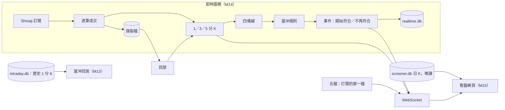

# 台股盤中即時系統：規劃書

> 版本：v0.1（2026-11-18）｜狀態：規劃中（M12–M16 未開始）
>
> 本文件規劃 M12 起的盤中即時系統：以永豐金證券的 Shioaji API 接收即時報價，依使用者的當沖規則，在本機的看盤網頁列出符合條件的股票；自動下單（M16）待使用者決定。每日選股系統與共用部分以 `PROJECT_PLAN.md` 為準，研究功能以 `RESEARCH_PLAN.md` 為準；三者的邊界見 PROJECT_PLAN.md 10.4 與本文件 4.2，必須遵守。標記「⚠️ 待確認」的項目是使用者尚未拍板的決定：請採用文中預設值，並保持可在設定檔調整。

---

## 0. 給 Claude 的閱讀指引

- 先讀 `PROJECT_PLAN.md`（尤其 10.4 邊界、第 13 節開發準則、15.1 決策），再讀本文件。
- K 棒與四條線的定義（第 2 節）以本文件為準，已和使用者看盤用的「台股大學堂」對照驗證（2.3）。定義不清時先詢問，不要自行詮釋。
- 每個里程碑開始前，先在本文件寫好該里程碑的規格給使用者確認，確認後才開分支實作（同 `RESEARCH_PLAN.md` 第 0 節）。
- **下單**：使用者明確決定前，不實作任何下單功能（`CLAUDE.md`、PROJECT_PLAN.md 第 0 節）。決定之後，Claude 也只撰寫程式、以假的下單介面測試；模擬環境的 API 測試、憑證的啟用與密碼、正式環境的下單都由使用者操作（第 6 節）。
- 不使用付費 API。Shioaji 對永豐金證券的客戶免費，但有流量與次數限制（第 3 節）。
- 研究與回測結果只描述統計，不構成投資建議。

---

## 1. 目標與範圍

### 1.1 目標

盤中以 Shioaji 接收逐筆成交與五檔報價，依使用者的當沖規則即時判斷，在看盤網頁的側邊欄列出符合條件的股票；點選後顯示必要的即時資訊。之後視使用者的決定加入下單（M16）。

使用情境：

- 交易日開盤前，排程啟動即時服務，盤中持續執行，收盤後結束（時間可調）。
- 在本機的瀏覽器開啟看盤網頁；外出時透過私人網路連回（第 5 節）。
- 13:10 的每日選股（PROJECT_PLAN.md）照常執行、不受影響，也是即時系統故障時的備援（L8）。

作品集展示重點：

- 事件驅動的即時資料管線：逐筆成交 → K 棒 → 指標 → 規則 → 網頁。
- 錄製與回放：盤後可以完全重現當天的結果，收盤後也能開發與測試。
- 和看盤軟體逐根對照的驗證（2.3）；回測沒有前視偏差（2.4）。

### 1.2 範圍與非目標

| 範圍內 | 非目標（目前不做） |
|---|---|
| 上市、上櫃普通股的現股當沖；候選股從觀察清單挑選（L11），篩選到訂閱上限以內的方法 ⚠️ 待確認（Q1） | 期貨、選擇權、ETF、權證、興櫃、零股 |
| 看盤網頁：側邊欄、1 分 K 與四條線、五檔、成交明細（第 5 節） | 複製市面看盤軟體的完整功能（技術指標庫、新聞、籌碼等）；手機 APP（手機用瀏覽器） |
| 盤中資料研究與當沖回測（M13） | 秒以下的高頻策略 |
| 錄製與回放：盤後重現當天的逐筆成交與結果 | 付費資料；對外公開的網站；下單（使用者決定前不做，⚠️ 待確認 Q5，第 6 節） |

### 1.3 以台股大學堂為準

使用者以「台股大學堂」看盤，當沖規則是在它的圖上練出來的。系統的 K 棒與指標必須和台股大學堂一致，否則同一條規則在兩邊會得到不同的結果（L3）。M12 逐根對照，之後發現不一致時，以台股大學堂為準修正，並記錄在本文件。

---

## 2. K 棒與指標的定義

### 2.1 K 棒

| 項目 | 定義 |
|---|---|
| 1 分 K | 涵蓋該分鐘的 00～59 秒：09:00:00～09:00:59 為第一根，09:01:00 的成交算下一根 |
| 時間標示 | 以開始時間標示（「09:00」那根 = 09:00:00～09:00:59），程式內部一律存開始時間。台股大學堂「技術分析」畫面的 1 分 K 以結束時間標示（同一根顯示為 09:01），對照時要換算 |
| 開盤 | 09:00:00 的開盤成交算在 09:00 那根 |
| 試撮 | 開盤前、緩漲、緩跌、收盤前的試撮都不畫 K 棒，也不計入成交量與均價線 |
| 沒有成交 | 該分鐘不畫 K 棒，不補量為 0 的 K 棒。均線取的是最近 N 根「有成交」的 K 棒 |
| 收盤 | 13:25～13:29 只有試撮，不畫 K 棒；13:30:00 的收盤成交自成一根「13:30」 |
| 3 分、5 分 K | 從 09:00 對齊（3 分 K：09:00:00～09:02:59、09:03:00～09:05:59……；5 分 K：09:00:00～09:04:59……），切法同 1 分 K。13:30 的收盤成交在 3 分、5 分 K 也各自成一根 |
| 成交的範圍 | 只計一般的整股交易，零股、盤後定價不計入（M12 確認 Shioaji 的欄位，並對照台股大學堂） |

### 2.2 四條線

四條線都畫在同一張 1 分 K 圖上。週期與顏色放在設定檔。

| 線 | 顏色 | 定義 | 還沒走完的 K 棒 | 畫法 |
|---|---|---|---|---|
| 3MA | 藍 | 3 分 K 最近 3 根收盤價的簡單平均，延續前一交易日的 K 棒（L5） | 不計算：3 分 K 走完才算出該根的值；規則用最後一根已走完的值（L5） | 階梯線：每根 3 分 K 一個值，畫在它涵蓋的 1 分 K 上；走完才畫 |
| 5MA | 金 | 5 分 K 最近 5 根收盤價的簡單平均，其餘同 3MA | 同 3MA | 同 3MA |
| 均價線 | 銀 | 當天 09:00 起累積成交金額 ÷ 累積成交量（L6） | 每筆成交都更新 | 連續線 |
| VP | 粉 | 當天成交量最大的那根 1 分 K 的收盤價；開盤那根也算；量相同時維持原本那根，超過就換（L7） | 正在形成的 K 棒量超過目前最大量時立刻換成它，VP 跟著現價移動，這根走完才固定 | 整張圖一條水平線，換 K 棒時整條跳到新的價位 |

- VP 在 09:00 那根走完（09:01）時第一次出現。量只會增加，一根 K 棒成為最大量後不會被自己比下去，不會來回切換。
- 13:30 的收盤成交量是全天最大時，VP 在收盤時跳到收盤價。
- 延續前一交易日：09:00 那根 3 分 K 的 3MA = 前一交易日最後兩根 3 分 K（其中最後一根是 13:30 那根，收盤價即昨收）與今天第一根的平均。中間遇到假日時接前一個交易日。即時服務開盤前要先準備好前一交易日的分 K（M14）。
- 均線不足 N 根時（延續前一交易日後，只有新掛牌第一天等少數情況）：不畫，用到的規則視為不成立，同 PROJECT_PLAN.md D23（L13）。
- 價格不還原：除權息日開盤後的頭幾根 3MA、5MA 會混到除權息前的價格，同 PROJECT_PLAN.md D8 的限制。台股大學堂應該也是如此，遇到除權息的股票時對照確認。

### 2.3 和台股大學堂的對照（2026-11-18）

使用者提供台股大學堂歷史畫面的數值（同一檔股票；前一交易日 13:24 收 56.3、收盤 56.5；當天 1 分 K 收盤：09:02 57.0、09:04 56.9、09:05 57.4、09:08 57.8、09:09 56.9、09:14 58.4、09:19 57.9、09:24 56.5）：

| 項目 | 依 2.2 計算 | 台股大學堂 |
|---|---|---|
| 3MA 09:00～09:02 | (56.3 ＋ 56.5 ＋ 57.0) ÷ 3 = 56.60 | 56.6 |
| 3MA 09:03～09:05 | (56.5 ＋ 57.0 ＋ 57.4) ÷ 3 = 56.97 | 57.0 |
| 3MA 09:06～09:08 | (57.0 ＋ 57.4 ＋ 57.8) ÷ 3 = 57.40 | 57.4 |
| 5MA 09:20～09:24 | (56.9 ＋ 56.9 ＋ 58.4 ＋ 57.9 ＋ 56.5) ÷ 5 = 57.32 | 57.3 |

- 均線是一般的簡單平均，包含該根自己的收盤，並延續前一交易日。前一交易日 13:24 之後的下一根就是 13:30：收盤成交自成一根，試撮不畫 K 棒。
- 「只平均之前已走完的 K 棒」不符：那樣 09:09～09:11 那一階約 57.4，圖上約 57.7。
- 5MA 在 09:15～09:24 是平的：09:20 那一階加進來的 09:24 收盤 56.5，剛好等於被擠出去的前一交易日 13:30 那根。
- 均價線的數字符合「累積成交金額 ÷ 累積成交量」（例：09:00 均價 58.2、量 1,617 張，09:01 均價 57.9、量 939 張，推得 09:01 那根的均價約 57.4，與那根 K 棒相符）。
- 歷史畫面看不出盤中的行為，由使用者在台股大學堂盤中確認：3MA、5MA 走完才畫（L5）；VP 跟著現價移動（L7）。
- 使用者原本設定均線不延續前一交易日、且跟著現價即時變動，看到對照結果後改為現在的定義（L5）。

### 2.4 前視偏差

歷史圖上 09:06～09:08 畫著 57.4，但這個值要等 09:08 那根走完（09:09）才知道。規則與回測在時間 t 只能用 t 以前已經走完的 3 分、5 分 K 算出的值；VP 與均價線用 t 當下的值。

- 即時服務記錄每分鐘當下的四條線（M14），回放與回測用同樣的方式計算。
- 回測從歷史 1 分 K 重算時，3MA、5MA 照「走完的時間」取值，不能用畫在 t 上方的那一階（M13）。

---

## 3. 資料來源：永豐金證券 Shioaji

Python 套件 `shioaji`，以 API Key 與 Secret Key 登入（放在 `.env`，4.2）。下表是 2026-11-17 閱讀官方文件（sinotrade.github.io）的內容，M12 實測後更新：

| 項目 | 官方文件 | 待 M12 實測 |
|---|---|---|
| 即時訂閱 | `subscribe` 上限 200 個；只在開盤時段推送；不佔流量 | 上限是每個連線還是每個帳戶；同一檔同時訂成交與五檔是否算 2 個；超過上限時的行為 |
| 查詢（snapshots、ticks、kbars 等） | 合計每 10 秒 50 次；盤中查 ticks 最多 10 次、kbars 最多 270 次；文件說明這些是盤後分析用，盤中請用訂閱 | 一次 snapshots 最多幾檔 |
| 流量 | 依近 30 日以 API 成交的金額：0 → 每天 500MB；1 元～1 億 → 2GB；1 億以上 → 10GB；開盤日 08:00 重置；超過時查詢回傳空值，其他功能不受影響 | 每檔每天的分 K、逐筆成交各用多少流量（估算 M13 回補要幾天） |
| 連線與登入 | 同一身分證最多 5 個連線；每天登入 1,000 次 | — |
| 超過次數 | 查詢次數超過時暫停一分鐘；一天內多次超過，可能暫停 IP 與帳號 | — |
| 歷史資料 | 股票從 2020-03-02 起；kbars 每次查詢不超過 30 天；ticks 每次一個交易日 | kbars 的時間標示（開始或結束時間）、有沒有量為 0 的 K 棒、有沒有成交金額欄位、試撮與 13:30 的處理 |
| 逐筆成交 | `simtrade` 欄位標示試撮 | 緩漲、緩跌的試撮是否也有標示；內外盤、成交量單位、零股、均價欄位 |
| API key | 可分別勾選權限：行情／資料、帳務、交易、正式環境；建議設 IP 限制；Secret Key 只在建立時顯示一次 | — |
| 正式下單的前提 | 簽署相關文件；在模擬環境完成 API 測試報告（登入與下單）；啟用憑證（`activate_ca`） | M16 才需要 |
| 模擬環境 | 可訂閱行情、查詢與下單；不支援興櫃與零股 | 模擬環境的行情是否為真實資料 |

- M12 到 M15 只需要一把只有「行情／資料」權限的 API key，建議設 IP 限制。有「交易」權限的 key 等 M16 決定後另外建立。
- 13:10 的每日選股繼續用 MIS，不改用 Shioaji（L8）。

---

## 4. 系統架構與邊界

### 4.1 架構



### 4.2 與每日系統、研究功能的邊界

即時系統是 PROJECT_PLAN.md 10.4 之外的第三個部分，原則相同：每日的 `scan`、`update` 必須保持穩定，即時系統會經常修改。

| 項目 | 即時系統 |
|---|---|
| 指令 | 實測、回補歷史分 K、當沖回測、即時服務、網頁（指令名稱在各里程碑確定） |
| 程式 | `src/screener/realtime/`，與 `jobs/` 中即時系統指令的程式 |
| 資料 | `data/realtime.db`（事件、每分鐘的四條線）、`data/intraday.db`（歷史 1 分 K）、`data/ticks/`（錄製檔）；唯讀 `screener.db` 的日 K（顯示日 K 趨勢） |
| 設定 | `config/realtime.yaml`（即時服務、網頁、Shioaji 的請求）、`config/daytrade.yaml`（當沖規則、K 棒與四條線的參數） |
| 套件 | 選用依賴群組 `realtime`：shioaji，M15 起加上 fastapi 等 |
| 機密 | `.env` 新增 `SHIOAJI_API_KEY`、`SHIOAJI_SECRET_KEY`；M16 才需要憑證的路徑與密碼 |
| 排程 | 獨立的工作（M14），開盤前啟動、收盤後結束；和 13:10 的 `scan` 同時執行，但資料來源分開（MIS 與 Shioaji），不共用連線與額度 |

規則：

1. **依賴只能單向。** 即時系統可以匯入共用模組（PROJECT_PLAN.md 10.4 列出的 `models.py`、`config.py`、`analysis/`、`rules/` 等）；每日系統、共用模組與研究程式都不匯入即時系統的程式。以測試確認執行 `update`、`scan` 時不會載入 `shioaji` 與即時系統的程式。
2. **共用模組的修改，每日系統的測試必須全數通過。** 即時系統需要的新功能先放在 `realtime/`，確定兩邊都會用到才移到共用模組。
3. **資料分開。** 即時系統不寫入 `screener.db`、`market.db`；13:10 的訊號紀錄（PROJECT_PLAN.md 8.3）只記錄每日的 `scan`，研究的成績單不受影響。
4. **設定分開。** 即時系統的設定不放 `settings.yaml`：`settings.yaml` 每個指令都會載入並驗證，寫錯會讓 `scan` 失敗。
5. **套件分開。** 排程使用的環境不需要安裝 `realtime` 群組，也能執行 `update`、`scan`。
6. **推播與排程分開。** 當沖和 13:10 的推播完全分開：即時系統不影響、也不改變 13:10 的推播（L12）；即時服務的失敗不影響每日的推播與排程。即時系統自己的錯誤通知與推播 ⚠️ 待確認（Q7）。
7. **開發在分支或 worktree 進行。** 主資料夾的 `main` 供排程使用，不直接修改。

### 4.3 預計的配置

各里程碑開始時確認：

```
config/realtime.yaml        # 即時服務、網頁、Shioaji 的請求設定；只有即時系統讀取
config/daytrade.yaml        # 當沖規則，K 棒分鐘數、均線根數與顏色
data/realtime.db            # 事件、每分鐘的四條線（M14）
data/intraday.db            # 歷史 1 分 K（M13）
data/ticks/                 # 錄下的逐筆成交與五檔，每天一個壓縮檔（M12、M14）
src/screener/realtime/
  shioaji_source.py         # 登入、訂閱、查詢；放在資料來源的介面後面
  bars.py                   # 逐筆成交 → 1／3／5 分 K（純函式）
  indicators.py             # 3MA、5MA、均價線、VP（純函式）
  recorder.py, replay.py    # 錄製與回放
  rules/                    # 當沖規則：註冊表與設定驅動，同 PROJECT_PLAN.md 10.2 的做法
  backtest.py               # 當沖回測（M13）
  service.py                # 即時服務（M14）
  web/                      # FastAPI 與前端（M15）
  broker/                   # 下單（M16，待決定）
tests/realtime/             # 手工構造的逐筆成交（含試撮、無成交的分鐘、13:30）與錄製檔
```

---

## 5. 看盤網頁（M15）

本機網站：後端 FastAPI，以 WebSocket 推送即時資料；K 線圖用 TradingView 開源的 Lightweight Charts。不做手機 APP：Shioaji 是 Python 套件，必須有一台電腦一直連線，APP 只是同一台電腦的另一個畫面；手機用瀏覽器看（L2）。

| 區塊 | 內容 |
|---|---|
| 側邊欄 | 目前符合當沖規則的股票（L10），依族群 › 子分類分組（候選股都在觀察清單內，沿用 `watchlist.yaml` 的分類，L11）；每檔顯示規則名稱與開始符合的時間；今天符合過、現在不符合的放在最下面並變淡 |
| 頂部 | 代號、名稱、現價、漲跌幅、成交量 |
| 主圖 | 1 分 K、成交量與四條線（2.2） |
| 五檔 | 只訂閱目前打開的那一檔，換股時切換：候選股只訂閱成交資料，節省 200 個訂閱額度 |
| 成交明細 | 用即時服務錄下的逐筆成交。不在候選股的股票只能從打開的那一刻開始顯示（盤中查 ticks 最多 10 次），K 線用 kbars 補 |
| 底部 | 昨收、昨高、昨低、漲跌停價、日 K 的趨勢（PROJECT_PLAN.md 4.2） |

- 不放技術指標庫、新聞、籌碼等；需要時切到券商的 APP（L2）。
- 顏色放在設定檔，預設深色背景（銀色的均價線在白底上不清楚）。
- 回放：盤後可以重播某一天的錄製檔，供檢查與展示。
- 安全：只在本機開放（127.0.0.1）；外出時透過私人網路（例：Tailscale）連回，不開到公開網路；加登入保護。有下單功能之後尤其不能公開。
- 前端技術 ⚠️ 待確認（Q4）。

---

## 6. 下單（M16，⚠️ 待確認）

目前不做（`CLAUDE.md`、PROJECT_PLAN.md 第 0 節）。本節只記錄使用者決定要做時的原則，決定前不實作（Q5）。

- **前提（都由使用者操作）**：簽署相關文件；在模擬環境完成 API 測試報告；啟用憑證；另建一把有「交易」權限並設 IP 限制的 API key，和行情用的 key 分開。
- **分三步，每一步由使用者決定才進行**：
  1. 模擬：程式內假的下單介面與 Shioaji 模擬環境。
  2. 半自動：系統準備好委託（代號、張數、價格），在網頁上由使用者按確認才送出。
  3. 全自動：加上下面的風險控管才開放。
- **風險控管**：單日金額上限、同時持有檔數上限、只能下候選股、價格合理性檢查、防止重複送單、一鍵全部停止、收盤前強制平倉（當沖）、斷線或程式異常時持有部位的處理、所有委託與成交寫入紀錄、每天對帳。
- **帳務同步**：持股、委託、成交回報。知道實際持股後，可以考慮讓每日系統推播出場提醒（PROJECT_PLAN.md 5.4 目前因為不知道持股而不推播），另行決定。
- **分工**：Claude 撰寫程式並以假的下單介面測試；模擬環境的 API 測試、憑證與正式環境的下單由使用者操作。

---

## 7. 里程碑

| 階段 | 內容 | 完成標準 | 狀態 |
|---|---|---|---|
| M12 | Shioaji 接入與實測；K 棒與四條線的計算 | 第 3 節的待實測項目都有結果；自己組的 K 棒與四條線和台股大學堂逐根一致 | 未開始 |
| M13 | 盤中資料研究：歷史 1 分 K、當沖回測工具 | 歷史分 K 回補完成並通過品質檢查；回測工具可用；D52 的問題有數字 | 未開始 |
| M14 | 即時服務 | 無人看管跑完一個交易日；用錄製檔回放，產生的事件和當天完全相同 | 未開始 |
| M15 | 看盤網頁 | 盤中側邊欄與圖表即時更新；畫面上的數值和台股大學堂一致 | 未開始 |
| M16 | 下單 ⚠️ 待確認 | 模擬 → 半自動 → 全自動，每一步由使用者決定 | 未決定 |

M12 先做，不受待確認事項影響；M13 與 M14 大部分可以同時進行；M15 要等 M14 的後端；M16 最後。

### 7.1 M12：Shioaji 接入與實測

**目標**：把資料的事實摸清楚，並寫好 K 棒與四條線的計算，確認和台股大學堂一致。

**需要使用者**：建立只有「行情／資料」權限的 API key（建議設 IP 限制），放進 `.env`。不需要憑證，也不需要簽署下單文件。

**工作項目**：

1. 環境：選用依賴群組 `realtime`；Shioaji 的存取放在資料來源的介面後面；測試確認 `scan`、`update` 不載入 `shioaji`。
2. 實測使用限制：訂閱上限的計算方式與超過時的行為；一次 snapshots 的檔數；每檔每天的分 K 與逐筆成交的流量。
3. 實測逐筆成交與五檔：`simtrade` 是否涵蓋全部試撮（含緩漲、緩跌）；內外盤、成交量單位、時間精度、零股；09:00 開盤與 13:30 收盤的成交；漲跌停時的五檔。
4. 實測歷史分 K：時間標示、量為 0 的 K 棒、成交金額欄位、試撮與 13:30 的處理。
5. K 棒與四條線的計算：寫成不碰網路的純函式，用手工構造的逐筆成交寫單元測試（試撮、沒有成交的分鐘、13:30、延續前一交易日、VP 換 K 棒與同量）。
6. 三方對照：同一天 2～3 檔股票，比對自己用逐筆成交組的 K 棒、Shioaji 歷史分 K、台股大學堂；重點是開盤、13:24～13:30，以及一檔冷門股。先對 1 分 K 的開高低收與成交量，再對四條線。台股大學堂的數值由使用者提供截圖。
7. 13:10 時和 MIS 的報價互相比對（同 PROJECT_PLAN.md M4 的做法）。
8. 錄下一整天的逐筆成交與五檔，當作之後回放與測試的資料。
9. 斷線與重連的行為。

**完成標準**：第 3 節「待 M12 實測」欄都有結果並寫回本文件；自己組的 K 棒與四條線和台股大學堂逐根一致；Shioaji 歷史分 K 和這套切法不同時，記錄差異與轉換方式。

### 7.2 M13：盤中資料研究

**目標**：建立歷史 1 分 K 與當沖回測的工具，回答 D52 留下的問題；使用者設計好當沖規則後拿來回測。規格在開始前另外確認。

**工作項目**：

1. 回補歷史 1 分 K：觀察清單 290 檔（候選股從觀察清單挑選，L11），2020-03 起；存 `data/intraday.db`；流量每天上限 500MB，可以分多天、從中斷處繼續。
2. 品質檢查：每天的 1 分 K 合起來要和 `screener.db` 日 K 的開高低收、成交量對得上（成交量口徑不同，見 PROJECT_PLAN.md D21）；不一致的列成報告。
3. 四條線的歷史值：照 2.4 算出每分鐘當下的值。
4. 當沖回測工具：訊號在 K 棒走完時成立；歷史只有分 K，以下一根 1 分 K 的開盤價成交，另列滑價；成本 = 手續費 0.1425% × 0.28 × 2 ＋ 現股當沖證交稅 0.15%（目前的減半優惠，開始前確認期限），約 0.23%；漲跌停時無法成交；收盤前強制平倉；觀察段、驗證段沿用 2025-01-01 切分（PROJECT_PLAN.md D32）。
5. D52 的問題：早盤量（2486 一詮 2026-01-23 的案例）、各時段的量能曲線（預估全日量，PROJECT_PLAN.md 第 6 節）。
6. 回測使用者的當沖規則（Q2）。

**完成標準**：歷史分 K 回補完成並通過品質檢查；回測工具可用；D52 的問題有數字，記錄在 `RESEARCH_PLAN.md` 第 8 節的研究紀錄。

### 7.3 M14：即時服務

**目標**：盤中持續執行的程式，接收即時報價、計算四條線、執行當沖規則，記錄「開始符合／不再符合」並推給網頁。

**工作項目**：

1. 開盤前（排程啟動）：從觀察清單篩選候選股（L11，方法 ⚠️ Q1）；排除不能現股當沖的股票；準備前一交易日的分 K（均線延續）；在 200 檔額度內訂閱成交資料。
2. 盤中：每筆成交依序組 K 棒、更新四條線、執行當沖規則（`config/daytrade.yaml`，註冊表的做法同 PROJECT_PLAN.md 10.2）。只執行當沖規則，每日系統的觸發規則不在盤中判斷（L10）。
3. 事件：「開始符合／不再符合」與每分鐘的四條線寫入 `data/realtime.db`，透過 WebSocket 推給網頁。不影響 13:10 的推播（L12）；即時系統自己的錯誤通知與推播 ⚠️ 待確認（Q7）。
4. 錄製：全部逐筆成交與五檔存成每天一個壓縮檔（同 PROJECT_PLAN.md D46 的做法）。
5. 回放：依時間重播錄製檔，收盤後也能開發與測試，結果完全可重現。
6. 穩定性：斷線自動重連；程式重開後以錄製檔與 kbars 補回當天的狀態；監控流量（`api.usage()`）；錯誤寫入 log 並通知。

**完成標準**：無人看管跑完一個交易日；用當天的錄製檔回放，產生的事件與四條線和當天完全相同；手動抽查數筆事件，和台股大學堂的圖一致。

### 7.4 M15：看盤網頁

**目標**：照第 5 節的版面，只顯示必要的資訊。

**工作項目**：

1. 後端 API（FastAPI）：開啟時提供目前的狀態（候選股、K 棒、四條線），之後以 WebSocket 推送更新。
2. 側邊欄、頂部、主圖、五檔、成交明細、底部（第 5 節）。
3. 顏色與深色背景的設定；回放某一天。
4. 安全：只在本機開放、登入保護；外出時的連線方式。

**完成標準**：盤中側邊欄與圖表即時更新；畫面上的 K 棒與四條線和台股大學堂一致；回放某一天時畫面和當天相同。

### 7.5 M16：下單（⚠️ 待確認）

見第 6 節。使用者決定要做之後，先在本文件寫好規格（風險控管的數字、半自動的操作流程、異常處理）給使用者確認，並修改 `CLAUDE.md` 與 PROJECT_PLAN.md 第 0、2 節的「不做自動下單」。

---

## 8. 待確認

| # | 項目 | 選項／預設 | 影響 |
|---|---|---|---|
| Q1 | 候選股的篩選方法 | 候選股從觀察清單挑選（L11），但 290 檔超過 200 檔的訂閱上限，要篩選到上限以內（五檔還要留額度，M12 實測計算方式）。可能的做法：前一天收盤後依條件篩選、依成交量或族群挑選。也要排除不能現股當沖的股票。預設：未定，使用者之後決定 | M14 |
| Q2 | 當沖規則 | 使用者之後設計，以四條線為主 | M13、M14 |
| Q4 | 前端技術 | React＋TypeScript，或以 Python 為主的做法；取決於使用者的前端經驗 | M15 |
| Q5 | 自動下單 | 做或不做；做的話照第 6 節分三步。預設：不做 | M16；`CLAUDE.md`、PROJECT_PLAN.md 第 0、2 節 |
| Q7 | 即時系統自己的推播 | 和 13:10 的推播分開已確認（L12）。剩下：新符合的股票要不要推播到 Discord；錯誤通知推到哪裡。預設：新符合的股票只在網頁顯示、不推播；錯誤通知推到另一個頻道（`.env` 新增 `DISCORD_REALTIME_WEBHOOK_URL`） | M14 |

Q3、Q6、Q8 已確認（2026-11-18）：側邊欄只顯示符合當沖規則的股票（L10）；候選股從觀察清單挑選，都有族群分類，不需要處理清單外的股票（L11）；均線不足 N 根時不畫、規則不成立（L13）。Q1、Q7 已確認的部分記在 L11、L12，剩下的部分保留在表中。

---

## 9. 決策紀錄

即時系統內部的決定以 L 編號記錄在這裡；影響每日系統或共用部分的決定記錄在 PROJECT_PLAN.md 15.1（與即時系統相關的有 D52、D59）。

| # | 項目 | 決定 |
|---|---|---|
| L1 | 盤中即時系統另立文件 | M12 起的盤中即時系統規劃在本文件，邊界見 4.2 與 PROJECT_PLAN.md 10.4（PROJECT_PLAN.md D59，2026-11-18） |
| L2 | 呈現方式 | 本機網站（FastAPI、WebSocket、Lightweight Charts），不做手機 APP；只顯示必要的資訊：側邊欄、1 分 K 與四條線、五檔、成交明細，不複製市面看盤軟體的功能。五檔與成交明細是使用者要求加入的（2026-11-17～18）（第 5 節） |
| L3 | 以台股大學堂為準 | K 棒與四條線的算法和使用者看盤用的台股大學堂一致，M12 逐根對照（1.3、2.3） |
| L4 | K 棒的切法 | 1 分 K 涵蓋 00～59 秒，以開始時間標示；試撮（開盤前、緩漲、緩跌、收盤前）與沒有成交的分鐘不畫 K 棒；13:30 的收盤成交自成一根；3 分、5 分 K 從 09:00 對齊（2026-11-18）（2.1） |
| L5 | 3MA、5MA | 藍線為 3 分 K 的 3MA、金線為 5 分 K 的 5MA：簡單平均，包含該根自己的收盤，延續前一交易日的 K 棒；K 棒走完才算、才畫，規則用最後一根已走完的值。使用者原本設定不延續、即時變動，以台股大學堂的歷史數值對照（2.3），並確認台股大學堂盤中是走完才畫後，改為和台股大學堂相同（2026-11-18）（2.2） |
| L6 | 均價線 | 當天 09:00 起累積成交金額 ÷ 累積成交量，每筆成交都更新（2026-11-18）（2.2） |
| L7 | VP | 當天成交量最大的那根 1 分 K 的收盤價，開盤那根也算；量相同時維持，超過立刻換；正在形成的 K 棒成為最大量時跟著現價移動；整張圖一條水平線，換 K 棒時跳到新的價位。盤中的行為由使用者在台股大學堂確認（2026-11-18）（2.2） |
| L8 | 13:10 的每日選股維持用 MIS | 不改用 Shioaji：每日系統不依賴登入，也不和即時服務搶連線與額度；即時系統故障時，13:10 的推播仍是備援（第 3 節） |
| L9 | 盤中研究寫在本文件 | M13 的盤中資料研究與當沖回測寫在本文件，程式放在 `realtime/`：和 M14 共用 K 棒與四條線的計算。研究結果記錄在 `RESEARCH_PLAN.md` 第 8 節；`RESEARCH_PLAN.md` 的非目標「盤中或高頻策略研究」改為指向本文件（7.2） |
| L10 | 側邊欄只顯示當沖規則 | 側邊欄顯示符合當沖規則的股票；每日系統的觸發規則（E1–E6）不在盤中判斷，維持 13:10 推播（2026-11-18）（第 5 節、7.3） |
| L11 | 候選股從觀察清單挑選 | 當沖的候選股從 `watchlist.yaml` 的觀察清單挑選，側邊欄沿用它的族群分類；M13 回補觀察清單的歷史分 K。290 檔超過 200 檔的訂閱上限，篩選方法之後決定（Q1）（2026-11-18）（1.2、第 5 節、7.2、7.3） |
| L12 | 和 13:10 的推播分開 | 當沖和 13:10 的尾盤推播是兩件事：即時系統不影響、也不改變 13:10 的推播內容與時間（2026-11-18）（4.2、7.3） |
| L13 | 均線不足 N 根時 | 不畫，用到的規則視為不成立，同 PROJECT_PLAN.md D23。均線延續前一交易日，只有新掛牌第一天等沒有前一交易日 K 棒的股票會遇到（例：3MA 要到 09:09、5MA 要到 09:25 才有值）；另一種做法「有幾根先平均幾根」不採用（2026-11-18）（2.2） |

---

## 10. 變更紀錄

- v0.1（2026-11-18）：初版。目標與範圍；K 棒與四條線的定義，以及和台股大學堂的對照（L3–L7）；Shioaji 官方文件的限制（待 M12 實測）；架構與邊界（4.2）；看盤網頁（L2）；下單的原則（待確認）；M12–M16 里程碑；待確認 Q1、Q2、Q4、Q5、Q7（Q3、Q6、Q8 已確認）；決策 L1–L13。
